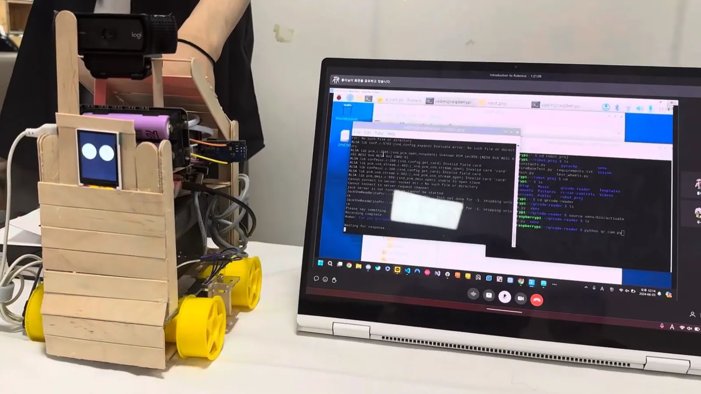
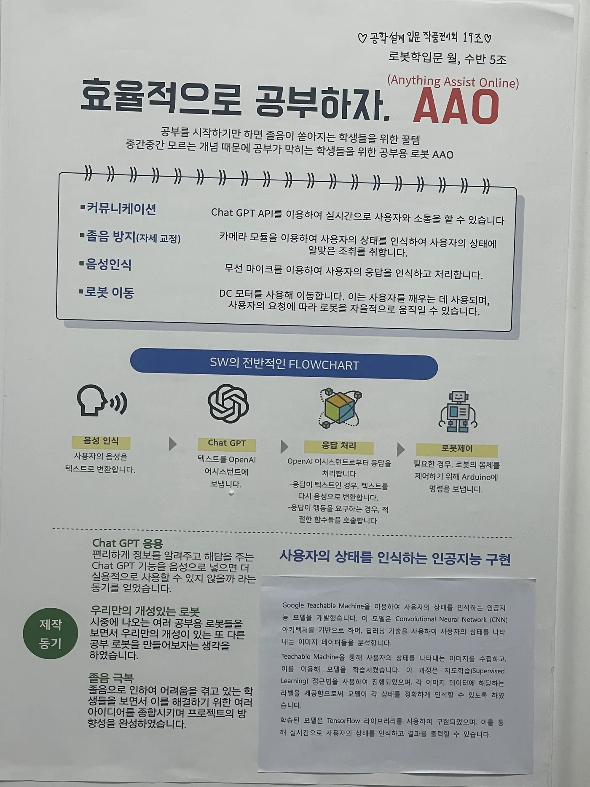
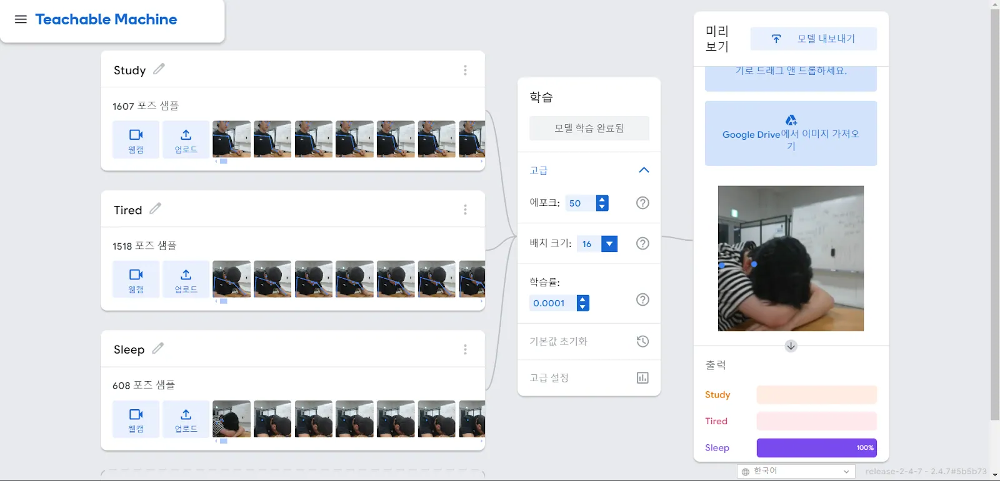
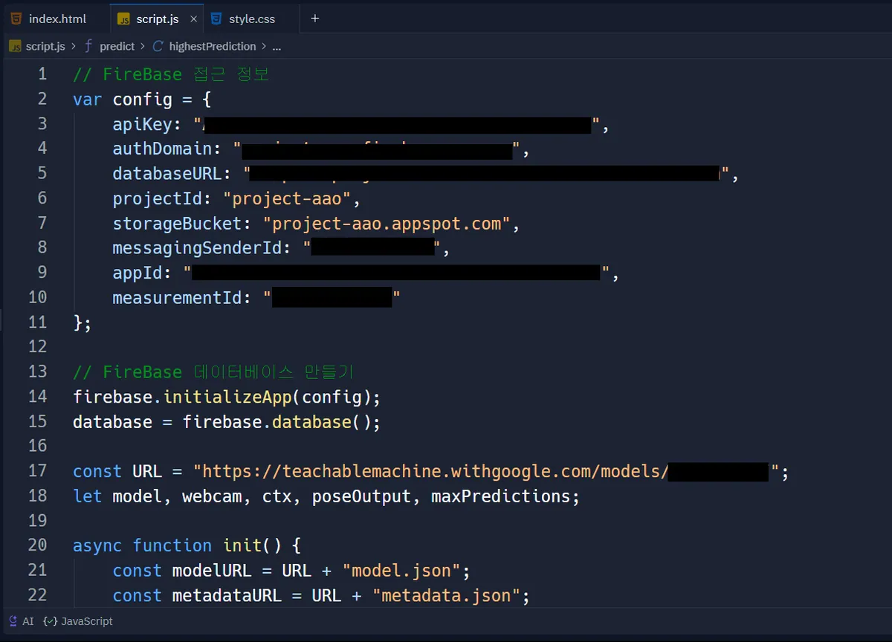

## 1. Overview
**AAO (Anything Assist Online)** is a study-assistant robot built as a team project for the "Introduction to Robotics" course and shown at the engineering design exhibition.
It is made for students who get sleepy as soon as they start studying, or get stuck on concepts they do not understand: it helps them study efficiently with AI, wakes them if they doze off, and gives instant answers.

- **Course:** Introduction to Robotics (2024)
- **Period:** 2024.04.07 – 2024.06.03
- **Final presentation:** 2024.06.12
- **Team:** Team of 5, with roles split into hardware making and display control / hardware design and database / QR code detection and wheel control / object detection and image classification / assistant system and UART connection
- **My role:** Hardware design (Inventor), database system (Firebase)

## 2. Objectives
- **Optimize study efficiency:** use AI to guide students in studying more effectively
- **Time management support:** wake the student with a timer if they fall asleep while studying
- **Access to information:** provide instant, relevant information on a wide range of topics

## 3. Key Features
- **Communication:** talk with the user in real time through the ChatGPT API
- **Drowsiness prevention (posture correction):** recognize the user's state with a camera module and respond appropriately
- **Voice recognition:** recognize and process the user's replies through a wireless microphone
- **Movement:** move with DC motors, used to wake the user and to move on request

## 4. System Overview
### Hardware
One Raspberry Pi, two Arduino Nanos, one LCD display, one Bluetooth speaker, four DC motors, one Arduino battery, one webcam and 50 ice-cream sticks.

- The Raspberry Pi runs from a power bank (USB-C), and the Bluetooth speaker connects to the 3.5mm jack.
- The LCD display and the DC motors are each driven by an Arduino Nano connected to the Raspberry Pi's USB-A ports. The Bluetooth microphone and the webcam are also on USB-A ports.
- An Arduino Nano and a DC motor driver on a breadboard control the motors.

### Software flow
`Speech recognition → ChatGPT → Response handling → Robot control`

1. **Speech recognition:** convert the user's voice to text
2. **ChatGPT:** send the text to an OpenAI assistant
3. **Response handling:** if the response is text, convert it back to speech; if it asks for an action, call the appropriate functions
4. **Robot control:** when needed, send commands to the Arduino to control the body

*The explanation poster displayed at the engineering design exhibition (in Korean)*

QR code detection results were converted in the order `detected NumPy arrays → Python list → coordinates of the four corners of the QR code` and used for robot control.

## 5. AI That Recognizes the User's State
I built a model that recognizes the user's state with Google **Teachable Machine** using a pose model. After training the classes, I exported the model to JavaScript. A web page (HTML5, CSS3, JavaScript) recognizes the person's pose (T-pose) through the laptop camera and decides whether they are dozing off or studying. It is based on a CNN (Convolutional Neural Network), trained by **supervised learning** with labeled images for each state, and implemented with TensorFlow.

- **3 classes:** `Study` (1,607 samples), `Tired` (1,518 samples), `Sleep` (608 samples)
- **Training settings:** 50 epochs, batch size 16, learning rate 0.0001

## 6. Database System
A web page (HTML5, CSS3, JavaScript) loads the trained Teachable Machine model (`model.json`, `metadata.json`) and decides the user's state (studying, tired, sleeping) from the laptop camera feed, and it writes that state to a **Firebase Realtime Database**.

**Firebase is the channel between the web page and the Raspberry Pi.** A Python script on the Raspberry Pi reads the value through the Firebase database API and branches on it with a `switch ~ case` style to take the matching action. For example, if the user is dozing off, the robot moves toward them and bumps into them to wake them up.

## 7. Hardware Design and Lessons
I **designed the robot's hardware in Inventor.** Even finding somewhere to print it was hard. I contacted several 3D printing facilities, and they fell through one after another because of failed talks, an ended program and print errors. The last one I contacted worked with me from May 9 and we could finally print the model.

But the printed model was **far too heavy.** I had designed it thick for durability, and did not account for the weight once the parts were mounted. So we switched to a new material and **rebuilt the structure with wood (ice-cream sticks).**

## 8. Analysis (SWOT)
- **Strengths:** efficient study with GPT, deep learning algorithms, appropriate feedback on the user's status
- **Weaknesses:** high cost, sensitivity to ambient noise, heavy weight
- **Opportunities:** study robots are not yet popularized, usable for other purposes as additional parts, growing demand for e-learning
- **Threats:** market competition, rapid pace of technological change, competitors developing similar technology

## 9. Future Applications
Beyond studying, we laid out possible uses in **housekeeping, medical care and rescue**.

## 10. Reflection
I was proud to build something by applying the concepts I learned in Introduction to Robotics together with my earlier experience. Design and development were difficult and full of errors, and they stressed me a lot, but what I think I will remember longest is working with my teammates and challenging ourselves again and again to reach a shared goal.

---

## 11. Demo Video
<!-- TODO: Send me the YouTube link and I will add it in this form.

  <iframe class="w-full h-full rounded-xl" src="https://www.youtube.com/embed/VIDEO_ID" title="AAO Demo" frameborder="0" allowfullscreen></iframe>

-->
