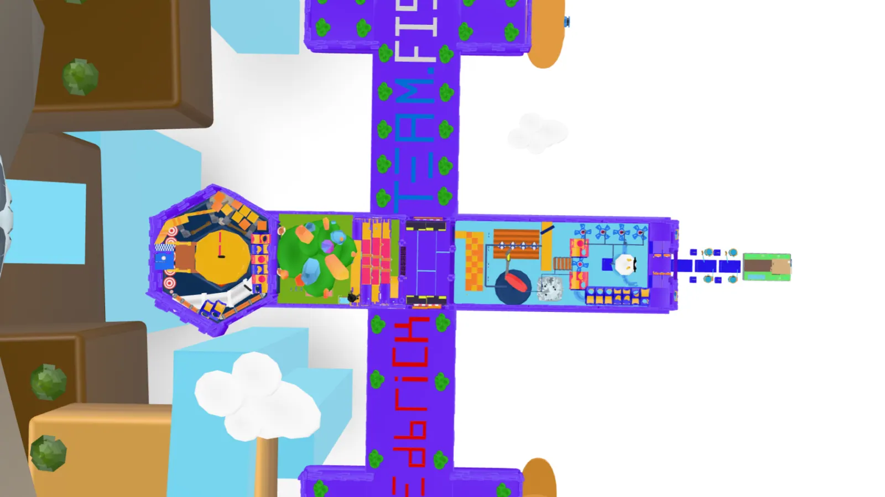
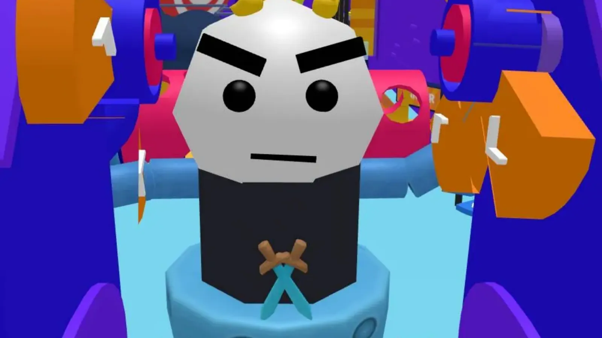

## 1. Overview
This is my entry for the "2022 RedBrick World Challenge: Time Attack" contest.
Inspired by the Korean variety show "Departure Dream Team", I built a **time-attack racing world** where players dodge fairy-tale obstacles and race to the destination (a school) as fast as they can.

- **Period:** 2022.04.18 ~ 2022.05.29
- **Role:** World Director (lead) - planning, map design and all stages of development
- **Result:** **Award winner**, 2022 RedBrick World Challenge: Time Attack

## 2. Key Features
- **Time-attack system:** racing logic that measures the time it takes to pass the obstacles and reach the finish line
- **Varied themes:** obstacle courses themed on well-known fairy tales from around the world
- **Spawn system:** logic that moves the player to designated 3D coordinates at game start and on respawn

## 3. Engineering & Collaboration
The core of this project was **all-rounder collaboration**.

### Running a cross-functional team
All four members took part in planning, design and development without hard boundaries between roles.
- **Challenge:** each member wanted to build a different fairy-tale world, so agreeing on an initial concept was hard.
- **Solution:** through continuous brainstorming on Discord, we arrived at **an airship** as the main concept that could tie the different fairy-tale themes together.

### Spatial coordinates and logic design
- **Coordinate system:** I calculated the exact (x, y, z) coordinates of the start point, checkpoints and finish line to build the spawn system.
- **Route design:** I placed obstacles with the player's "optimal route" in mind so difficulty stayed balanced for the fastest run.

## 4. Retrospective
Because every member thought about both technology and design, I built the communication skills to **turn ideas into something technically feasible**.

---

## 5. World Pitch Video
The planning pitch video of Team.FIS.

  <iframe 
    class="w-full h-full rounded-xl border border-neutral-800"
    src="https://www.youtube.com/embed/bU4PyNK7MZo" 
    title="Strange World Airship Project" 
    frameborder="0" 
    allow="accelerometer; autoplay; clipboard-write; encrypted-media; gyroscope; picture-in-picture" 
    allowfullscreen>
  </iframe>

## 6. Screenshots

*The whole map, shaped like an airship with the Team.FIS logo*

*The robot character (Snow) that guards the map*
