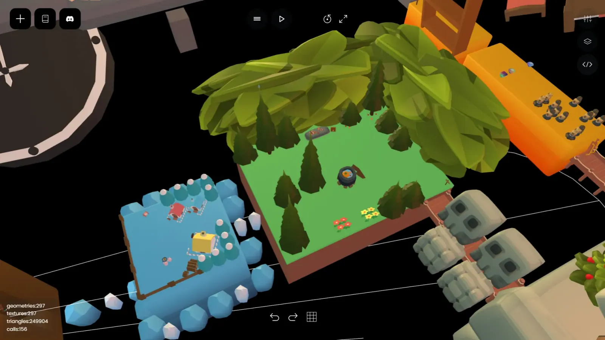

## 1. Overview
This is my entry for the "2022 RedBrick World Challenge: Spin-off" contest.
Based on the fairy tale "Alice in Wonderland", I built a dreamlike, layered 3D virtual space. I designed the levels so players feel like Alice falling down the rabbit hole.

- **Period:** 2022.01.28 ~ 2022.02.24
- **Role:** Solo development (World Director) - planning, map design, scripting
- **Result:** **Encouragement Award**, 2022 RedBrick World Challenge: Spin-off

## 2. Level Design
To capture the original's "chaotic yet seamless" feeling, I split the world into themed zones and connected them organically.

- **Falling Zone:** to recreate Alice's tumble in the opening, I scattered clocks, furniture and books irregularly through a tall vertical space.
- **Themed zones:** I placed zones with different concepts, such as an ice zone, a witch's forest and a toy factory, and guided the player's path through them.
- **Spawn system:** I wrote a script so that the player starts exactly at the planned coordinates when the game begins.

## 3. Technical Challenge (Spatial Design)
This project built my **3D spatial design skills**.

### Making up for design sense with engineering
Since I couldn't create professional art assets, I solved the problem with an **engineering approach**.
- **Reference analysis:** I studied YouTube and 3D references to get a feel for space.
- **Asset use:** I combined and arranged the provided assets creatively, building an original world without modeling new objects.

## 4. What I Gained
- **Better 3D tool skills:** working with object coordinates (X, Y, Z), rotation and scale sharpened my spatial awareness. That later became the groundwork for building robot simulation environments (Gazebo, Unity).
- **Visualizing a plan:** I went through the whole process of sketching an idea in my head and building it as a real 3D world.

---

## 5. World Screenshot

*The world with its different themes (ice zone, forest, factory)*

## 6. Demo Video

  <iframe 
    class="w-full h-full rounded-xl"
    src="https://www.youtube.com/embed/YPRg0TyHKo0?si=mvM7UjSXUEU1gfrF"
    title="Minecraft RPG Project" 
    frameborder="0" 
    allow="accelerometer; autoplay; clipboard-write; encrypted-media; gyroscope; picture-in-picture" 
    allowfullscreen>
  </iframe>

