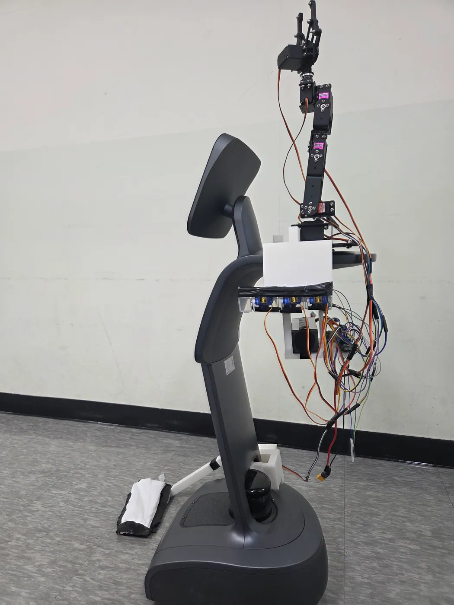
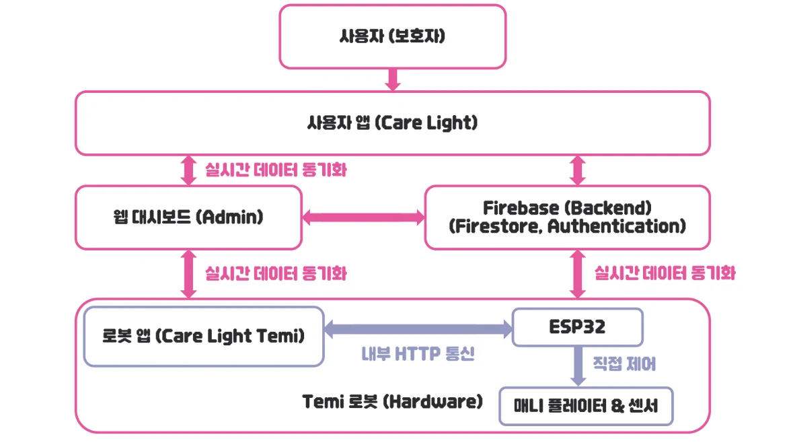
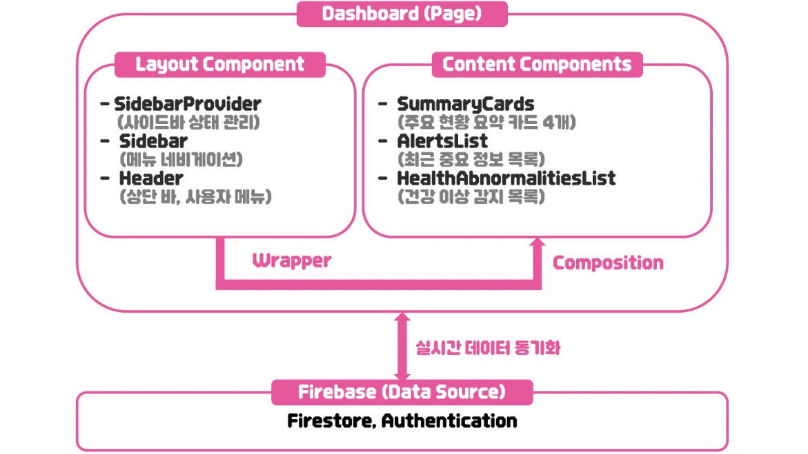
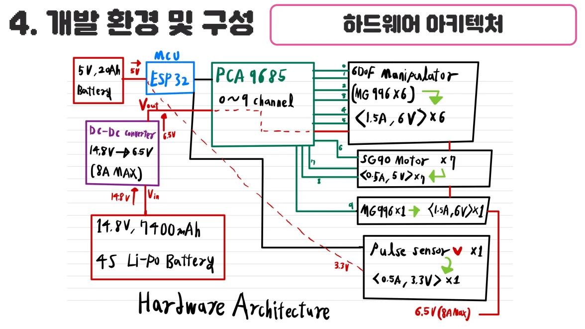

## 1. Overview
**Care Light** is an elder-care robot service built as a team project (team name: "Bichi-doegil-baera") for the "Understanding Mobile Robots" course.
We focused on the growing care gap in a super-aged society. Existing approaches, such as human caregivers, IoT (emergency call devices, sensors) and video (CCTV), fall short on **mobility, two-way communication and emotional connection**, and the goal was to fill that gap with a robot.

- **Course:** Understanding Mobile Robots (2025)
- **Development period:** May – June 2025 (8 weeks)
- **Final presentation:** 2025.06.20
- **Team:** Team of 3, with roles split into app, web and database / hardware design, circuits and low-level control / 3D hardware design and actuation
- **My role:** the two Android apps (user app and robot app), the web dashboard, the Firebase database design, and the ESP32 server firmware
- **Budget:** about 300,000 KRW, for a flat indoor environment where an elderly person lives alone

## 2. Core Goals
- **SMART SAFETY:** secure 24-hour safety through voice-based emergency calls and remote monitoring
- **WARM CONNECT:** reduce emotional isolation with personalized content
- **EASY CONTROL:** ease the caregiver's burden with an intuitive app

## 3. Key Features
- **Health manager:** repeated voice and on-screen reminders for medication times
- **Companion:** conversation by text or voice (a chatbot based on Perplexity's Sonar model)
- **Cleaning:** with one button, the robot moves to the user and cleans the table with its manipulator
- **Robot call:** call the robot to the user's location or to a registered place
- **Heart rate measurement:** measured by a sensor on the robot, shown on screen and saved to the database
- **Admin web dashboard:** register, edit and delete users, check robot status, and monitor health such as medication status

## 4. System Architecture
I designed the system as a **hub-and-spoke architecture with Firebase as the central hub.** The user app (caregiver), the robot app (Temi), the web dashboard (admin) and the custom hardware share state and exchange commands through Firebase. Each component focuses on its own role, and new features or devices are easy to add.

| Component | Technology |
|---|---|
| User app (Care Light) | Android (Java) |
| Robot app (Care Light Temi) | Android (Java), Temi SDK |
| Web dashboard (Admin) | Next.js, TypeScript, shadcn/ui |
| Backend | Firebase (Firestore, Authentication) |
| Robot platform | Temi (3D LiDAR autonomous driving, 4 digital microphones) |
| Custom hardware | ESP32-S3-WROOM-1, PCA9685 servo driver, 6-axis manipulator (pill box SG90, cleaning and manipulator MG996R) |
| Communication | Wi-Fi (HTTP), okhttp |
| Tools | SolidWorks, Arduino IDE, Android Studio, Git/GitHub |

The user app, robot app and web dashboard **synchronize data with Firestore real-time listeners**, and the robot app controls the manipulator and pill box through internal HTTP communication with the ESP32.

## 5. What I Did
- **User app (Care Light) and robot app (Care Light Temi):** login and sign-up, home screen, robot call, chatbot, heart rate measurement request, and a developer-only manual control screen
- **Admin web dashboard:** summary cards, recent alerts, a health anomaly list, and user CRUD. I drafted the UI with an AI tool (v0.dev) and wrote the Firebase integration logic and event handlers myself.
- **Database design:** I kept caregiver, elder and robot information in a Firestore `users` collection and deliberately duplicated some data to fit the app's read patterns.
- **ESP32 server firmware:** I built the server that receives the apps' HTTP requests; the hardware teammate implemented the low-level servo control and sensor reading on top of that base.

## 6. Implementation Highlights
### Real-time two-way synchronization
Every client attaches an `addSnapshotListener` to its Firestore document and receives changes immediately. When the user app writes a command to the `temiCommand` field (for example `{"command": "goToLocation", "parameters": {"location": "living room"}}`), the robot app's listener parses it and runs it through the Temi SDK (`goTo`, TTS) or an HTTP request to the ESP32, then reports battery, position and activity back to `robotState`. The user app and dashboard show those values without refreshing.

### Joystick-style manual control
Before building complex autonomous features, I made a developer-only `DebugActivity` to verify communication and actuation. An `OnTouchListener` sends a move command every 150 ms while a button is held and sends a stop command the moment it is released. It became the base for the later "go to location" and "call user" features.

### Heart rate data flow
The data flows `app → ESP32 → app → Firestore → every client`. When the app asks the ESP32 for a BPM value over HTTP and receives it, it does not update the screen directly; it updates the `heartRate` field in Firestore, and the listeners spread that change to the app and the dashboard. It is a design that keeps the data in a single source of truth.

### AI chatbot and voice loop
The chatbot uses Perplexity's `sonar-pro` model. Input comes by text or voice, the reply is shown in the chat and at the same time sent to Firestore as a `speak` command so the robot reads it aloud with Temi's TTS. The persona is managed by a `PromptFormatter` class (see Problem Solving).

### Dashboard
It uses `getCountFromServer` to get only document counts without downloading the documents, reducing cost and network use, and an `onSnapshot` listener detects users whose `status` changes to `Caution` or `Danger` and lists them under "users with abnormal heart rate" in real time. The screens follow a component-based structure that composes layout and content components.

<!-- TODO(author): Send me screenshots of the user app (home, robot call, chatbot) and the dashboard (main, user management) and I will add them to this section. -->

## 7. Hardware
- **Design and fabrication:** I designed it in SolidWorks and printed it in ABS on printers including an Ultimaker S5 Pro, then smoothed the surfaces with a soldering iron and removed supports. The manipulator is fixed to the upper left of the Temi, with 3D-printed parts on both sides so it does not tilt when moving.
- **Circuit:** the ESP32 drives a PCA9685 servo driver (10 servos: 7 MG996R, 3 SG90) over I2C and reads the heart rate sensor. The servos run from a 7400mAh lithium battery (14.8V) stepped down by a DC-DC converter (6.5V, up to 8A), and the ESP32 runs from a separate 5V power bank.

- **Manipulator control:** we first tried inverse kinematics (IK), but analysis and learning took too long, so we **entered joint angles directly and debugged them**, taking the desk height and the manipulator's position into account.

## 8. Problem Solving
### Hardware
- **3D print tolerances and machining:** we had no experience with SolidWorks or 3D printing and could not get the exact dimensions in one go. From the second week of May to the first week of June we repeated design and printing about nine times to complete the motor and manipulator mounts and the battery and circuit space. Even so, tolerance errors and unpierced screw holes showed up during assembly, so we drilled the holes ourselves and melted or sawed the parts to fit.
- **Powering the robot:** we thought two power banks (20000mAh, 5V) could run all the motors and sensors, but they could not. Combining searches, an AI chatbot, and advice from a professor and seniors, we settled on a 7400mAh 14.8V battery and an 8A DC-DC converter, tuned the converter's variable resistor, and supplied a steady 6V to the MG996R and about 5.5V to the SG90. I also learned how to store, charge and use lithium batteries along the way.

### Software
- **Race condition on the splash screen:** a 2-second timer and the Firebase login check finished asynchronously at the same time, so the screen transition was duplicated or off. I used two flag variables (`isSplashTimeOver`, `isNavigated`) and `synchronized` so the transition runs exactly once, only when the timer is over and no transition has started.
- **Chatbot leaving its persona:** even "hello" got a dictionary-style explanation. I put a `system` prompt at the front of the request that defines a warm conversation-friend robot for the elderly, polite speech and an empathetic tone, and added few-shot examples of ideal questions and answers, which stabilized the tone.
- **Unstable Wi-Fi between the ESP32 and the robot app:** HTTP requests often timed out. By narrowing it down step by step, I found that the ESP32 **supports only 2.4GHz**, and that a phone hotspot's power saving and client isolation interfere with communication. Without extra hardware, I turned off the hotspot's power saving, checked the ESP32's IP on the serial monitor and stored it in the app's `SharedPreferences`, and increased the `okhttp` timeouts, which stabilized it.

## 9. Demo Scenarios
1. **Calling the robot:** the user taps "Call" and Care Light moves to the user's location
2. **Calling it to a specific place:** choose one of the places registered in the app to send the robot there
3. **Medication check:** after a medication reminder, tapping "Bring medicine" sends the robot over, and it opens the pill box when it detects the user's hand
4. **Cleaning the surroundings:** the robot moves to the place the user designates and cleans the table with its manipulator
5. **Heart rate:** place a finger on the sensor to show the heart rate on screen and save it to the database, where the admin can check it on the dashboard
6. **Conversation:** speak or type and the robot answers using the Sonar model
7. **Admin dashboard:** log in, review user information, add and delete users

## 10. Results and Limits
We implemented most of the features planned in the proposal and built several clients that talk to each other. Medication reminders and checks, robot calls, cleaning, heart rate monitoring and the admin dashboard are what set this project apart.

- **An integrated ecosystem:** not just an app or a robot, but a [user app] - [robot app] - [web dashboard] - [custom hardware] system that works together.
- **Active care:** instead of waiting like a fixed sensor or CCTV, the robot goes to the user, talks to them, and performs physical tasks such as cleaning and delivering medicine.
- **Limits:** it depends heavily on the Temi's built-in features, the manipulator lacks precision and stability, and it copes poorly with complex obstacles and dynamic environments. Heart rate and medication patterns alone are also not enough to judge a person's health accurately.
- **Future directions:** intelligent fall and emergency detection, AI-based life pattern analysis, emotional conversation AI, family albums and news sharing, a more precise manipulator, more IoT healthcare devices, and B2B expansion to hospitals and care facilities.

## 11. Reflection
I felt how hard it is for three people to build everything, and being able to trust my teammates with the low-level control let us finish the manipulator and sensor control on time. This time I was not afraid of failing and freely tried what I wanted to try. I was also reminded that the best team is the one that steps back from disagreements and moves toward a shared goal.
I also found that drafting a UI quickly with AI, while understanding the generated code and rewriting the core logic myself, speeds up development.

---

## 12. Demo Video
<!-- TODO: Send me the YouTube link and I will add it in this form.

  <iframe class="w-full h-full rounded-xl" src="https://www.youtube.com/embed/VIDEO_ID" title="Care Light Demo" frameborder="0" allowfullscreen></iframe>

-->
