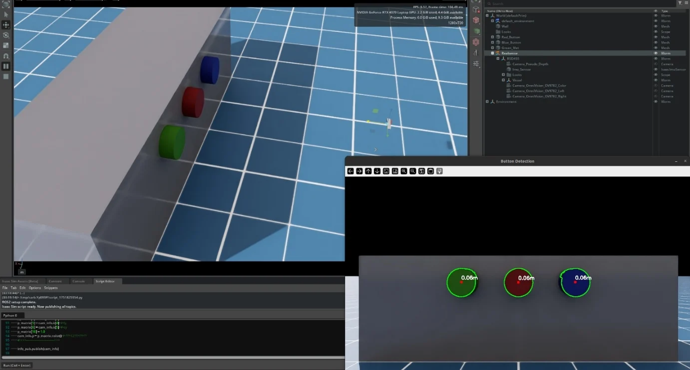
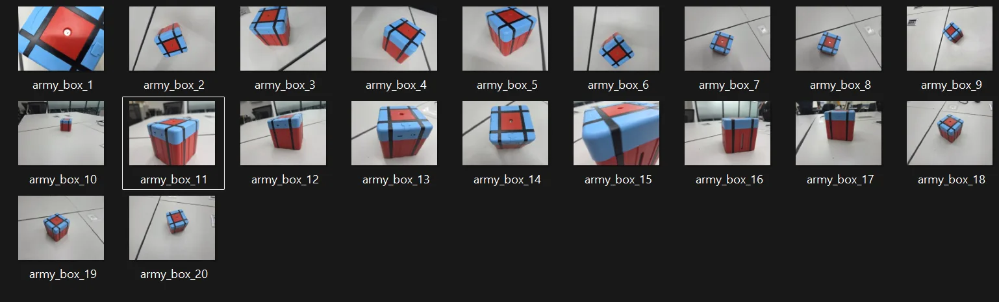

<!-- TODO(author to confirm): (1) Please confirm that the box labeling and YOLO training were for Extreme mission 4 (relief supplies) and how the work was split with teammates. (2) Please tell me whether to also include `isaacsim-realsense-detection.mp4` from the same folder. The RViz title bar in the video shows a small local path (username, repository name). (3) Please confirm that the mission numbers (3, 4) and the mission environment description are at a level that can be public. (4) Please tell me how far you went after the simulation stage (coordinate display, etc.). -->
## 1. Overview
On the ROBIT Intelligence Team, a student self-governing organization, I took on the **Isaac Sim simulation** and **vision** while we prepared for the **Extreme Robot Competition** (September 30 – October 2, 2025, COEX). Wiring and embedded work were not my responsibility that year.

- **Period:** July 2025
- **My role:** Setting up the mission environment and a RealSense camera in Isaac Sim, testing color-button detection and distance measurement, and taking part (with teammates) in YOLO training for recognizing relief supplies
- **Team result:** The ROBIT team won the **grand prize (Seoul Mayor's Award)** in the Extreme Robot category of this competition. It also won the grand prize at the Defense Robot Competition the same year (September 13–14, 2025) and again in 2026, for **two years in a row**. This is a result of the whole team.

## 2. Simulation: Building the Mission Environment in Isaac Sim
I recreated the competition mission's environment in Isaac Sim so the camera recognition algorithm could be tested in simulation first.

- **Environment:** I placed a panel with differently colored buttons and a RealSense D455 camera model in the scene.
- **Sending camera data to ROS 2:** For ordinary cameras I built nodes with an Action Graph to send the data. But for the RealSense model there was little material on that approach, so I **put code directly into the Script Editor** to receive the image data.
- **Checking the vision while the arm moves by motion planning:** I added the manipulator from the Isaac Sim ROS 2 motion planning (MoveIt 2) package I had built earlier to the same environment. When the arm moves as planned in RViz, the camera viewpoint changes too, and I checked in simulation that **the button detection and distance display keep working** in that situation. → [Isaac Sim ROS 2 Manipulator Control](/en/projects/isaac-ros2-control-manipulator/)

<video controls muted playsinline preload="metadata" src="/videos/isaacsim-motion-planning-vision.mp4"></video>

The Isaac Sim view (top), motion planning in RViz (bottom left), and the button detection view (bottom right). The displayed distance shrinks as the arm gets closer to the buttons.

## 3. Vision
### Button detection and distance measurement
- At the real competition the goal was to carry out the mission with a RealSense D435; in simulation I used the RGB and depth cameras built into the D455 model.
- I completed **distinguishing the buttons by color and displaying the distance to each button from the depth values**.
- I set up the development environment (RealSense SDK, Qt), and implemented the mission algorithm on top of a RealSense package a teammate had already set up.

### Recognizing relief supplies (YOLO)
- With teammates, I photographed and labeled boxes, and trained YOLOv4-tiny and YOLOv7-tiny models with Darknet.
- I implemented computing the **center coordinates** of the detected bounding boxes.
- It is easy to confuse `.conv` (pretrained starting weights) with `.weights` (finished weights) during training, so I wrote down which file to use when starting a new training run and which when resuming.

## 4. Limits and What I Learned
- The distance measurement in simulation was not yet precise enough, so **splitting the area more finely to collect data** and **displaying coordinates** were left as next steps.
- How to send sensor data from Isaac Sim to ROS 2 differed from sensor to sensor, and for sensors with little material I had to **implement it myself with a script**.
- By recreating the mission environment, I could verify the flow of the recognition algorithm (color separation → distance calculation → display) first, without real equipment.
- Even with little data, running the whole pipeline once (capture → label → train → extract coordinates) helped later improvements.
