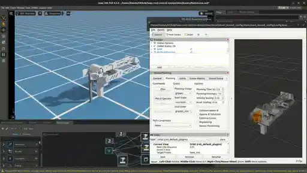
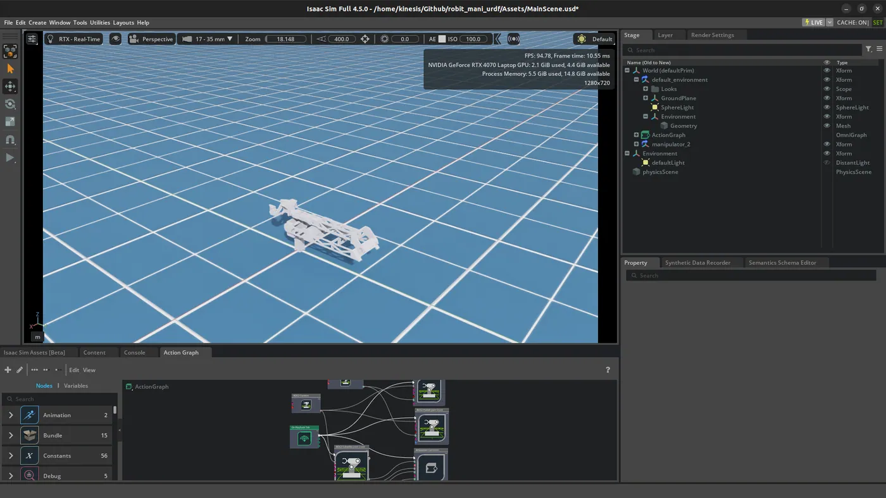
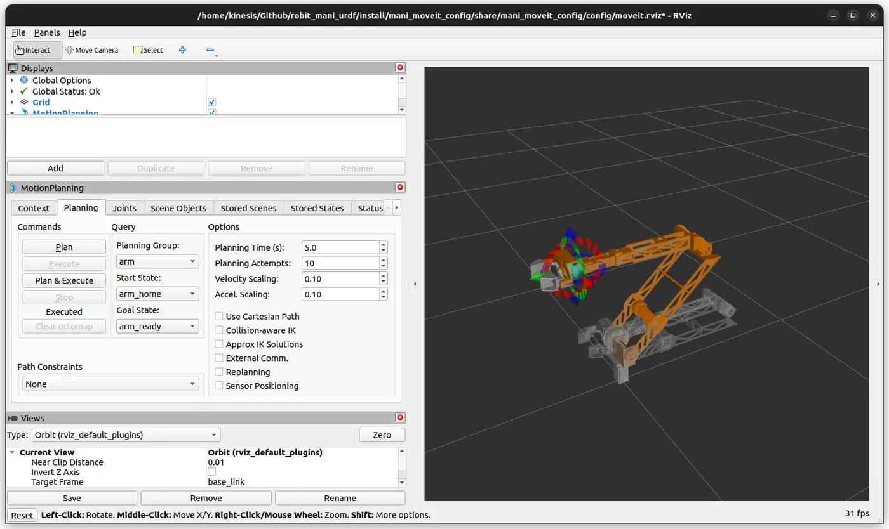

<!-- TODO(author): Tell me the background (course, club, lab, personal) and purpose of this project and I will add a line to the overview. The date is based on the repository's commit period (2025-02-20 to 02-24). -->
## 1. Overview
This package **imports a manipulator into Isaac Sim** and **synchronizes the motion planning set in RViz with Isaac Sim**, so the manipulator can be controlled in a simulated environment.
When you set a target pose in RViz and execute it, the URDF model loaded in Isaac Sim performs the same motion.


*Isaac Sim is on the left and RViz (MoveIt 2) is on the right.*

- **My role:** package development; the manipulator design and the gripper design were handled by other teammates
- **License:** MIT
- **Repository:** [kinesis19/isaac-ros2-control-manipulator](https://github.com/kinesis19/isaac-ros2-control-manipulator)

## 2. Built With
- **Manipulator model:** a 6-axis manipulator and gripper (5 gripper joints) converted into URDF so it can be controlled in simulation
- **Simulation:** Isaac Sim 4.5.0
- **Framework:** ROS 2 Humble. MoveIt 2 and ros2_control synchronize the manipulator in RViz with the manipulator in Isaac Sim
- **Environment:** Ubuntu 22.04

## 3. Structure and How It Works
### Structure
- **Motion planning (`mani_moveit_config`):** a configuration package generated with the MoveIt Setup Assistant. Planning groups are `arm` (Joint_1–6) and `gripper`, inverse kinematics uses the KDL solver, and named poses such as `arm_home` and `arm_ready` are defined.
- **Controllers (ros2_control):** `arm_controller` and `gripper_controller` are `JointTrajectoryController`s (100 Hz), and MoveIt sends trajectories through `FollowJointTrajectory`. A `joint_state_broadcaster` publishes the joint states.
- **Isaac Sim scene (`MainScene.usd`):** the Action Graph connects the ROS 2 context, joint state subscribe and publish, and an Articulation Controller so that joint values from the ROS 2 side move the manipulator in the simulation.



### Run order
1. **Set the ROS domain ID:** use the same `ROS_DOMAIN_ID` in the Isaac Sim Action Graph and the ROS 2 environment
2. **Launch Isaac Sim:** load the `MainScene.usd` file
3. **Start ROS 2:** source the workspace and run the motion planning node
   ```bash
   ros2 launch mani_moveit_config demo.launch.py
   ```
4. **Set the pose in RViz:** choose the desired motion planning pose and run Plan & Execute, and the manipulators in RViz and Isaac Sim move together



## 4. Team
- Package development: me
- Manipulator design: one teammate
- Gripper design: one teammate

This is currently at the simulation stage; the real hardware (digital twin) is not connected yet.
