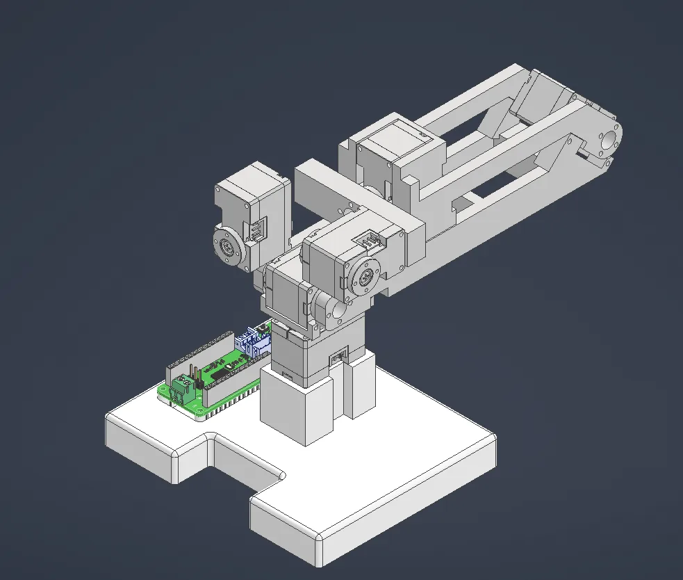
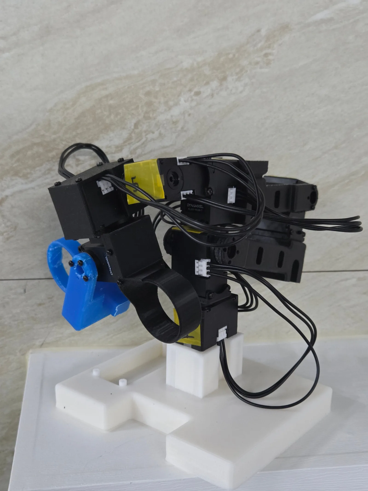
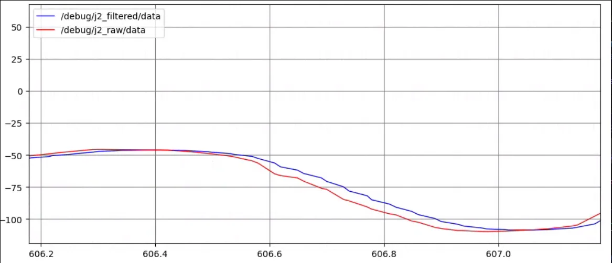
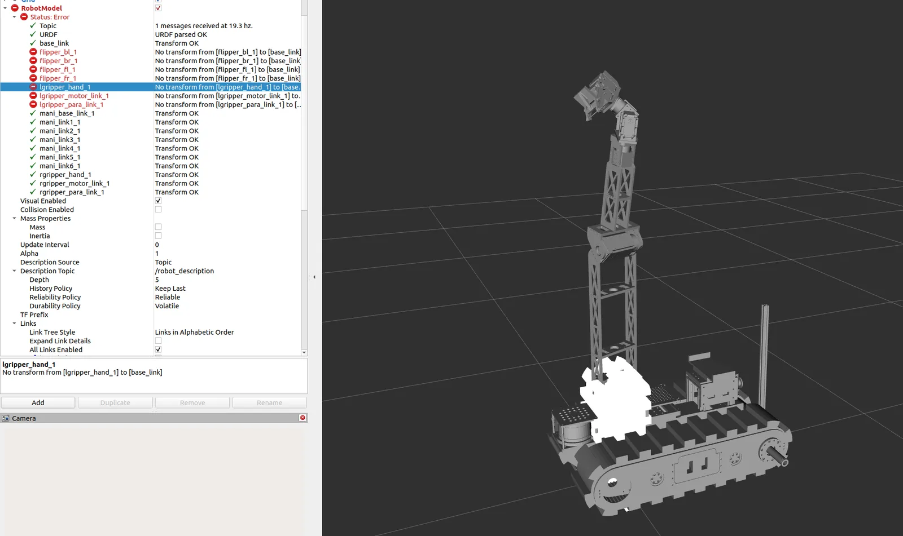

## 1. Overview
Controlling a manipulator with a joystick or keyboard did not feel intuitive, so I built a **teleoperation leader arm** that the manipulator follows as a person moves their arm. I did this as the final assignment of the 'Robot Game Seminar' course in the second half of 2025, and I did the design, fabrication, and control by myself.

- **Period:** November – December 2025
- **Goal:** Build a small 6-axis leader arm with the same structure as ROBIT's 6-axis manipulator (the follower), and implement its controller
- **Components:** OpenRB-150, seven Dynamixel XL330-M288-T (including the gripper), 3D-printed parts. Software: ROS 2, Python, and the Pinocchio library
- **Communication:** Serial, 1 Mbps

## 2. Hardware Design
### Scale ratio
I tried to apply one ratio to the whole arm, shrinking the real arm's link 2 (436.856 mm) to 150 mm (about 34.3%). But because of the size of the XL330 actuators and the minimum link thickness, this ratio could not be kept at the end axes 5 and 6. So I kept the ratio for the main links (axes 2 and 3) and redesigned the end section at the smallest drivable size.

### Physical parameters
For motors and bolts I used datasheet values, and for the links I used the 3D slicer's 80% infill setting to estimate mass. Including motors, link 2 is 49.34 g and link 3 is 45.85 g.

## 3. Software
I tried a structure that reads the joint values, computes a gravity-compensating current, and sends it back.

`XL330 encoder → low-pass filter → Pinocchio (RNEA) → XL330 current control`

1. Receive the raw position values (0–4095) of the seven motors over serial.
2. Convert to SI units (radians) and reduce noise with a low-pass filter.
3. Compute gravity torque with Pinocchio's RNEA (recursive Newton–Euler) algorithm.
4. Convert torque (Nm) to current (mA) and send it to the motors. The current limit was set to 300 mA.

I also loaded the URDF and confirmed that the joint values were reflected in the model in RViz.

## 4. Limits and What I Learned
- **I did not finish gravity compensation.** When the arm was stretched far forward, it still sagged at certain angles. I tuned per-axis gains but it was not resolved.
- I suspected model error and insufficient XL330 torque in high-load poses, but I could not separate which one was the cause.
- As a result, this project stands at **hardware fabrication and reading/visualizing joint values**. I did not get as far as controlling the actual follower manipulator with this leader arm.
- I learned that when you shrink a large arm by the same ratio, the actuator's minimum size hits the limit first at the end section.
