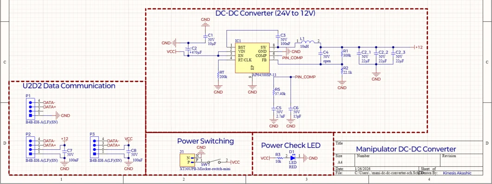
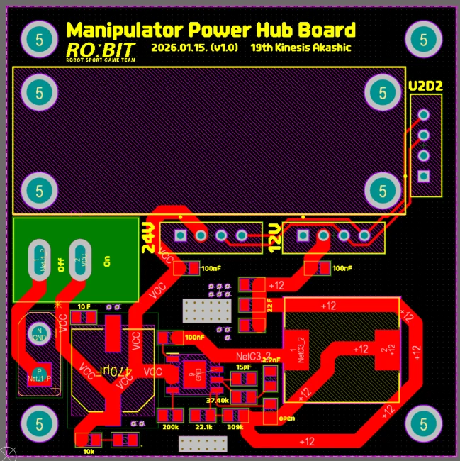
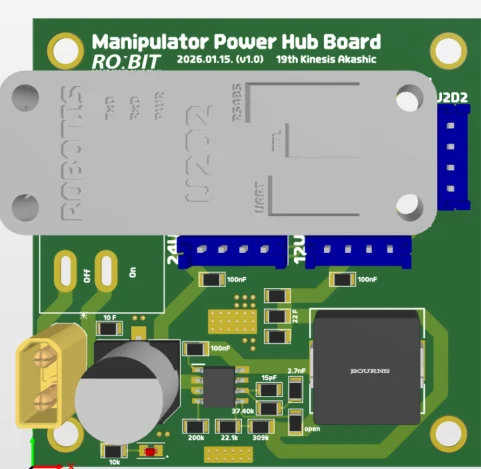
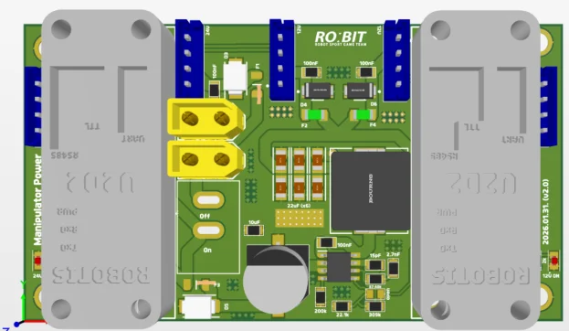
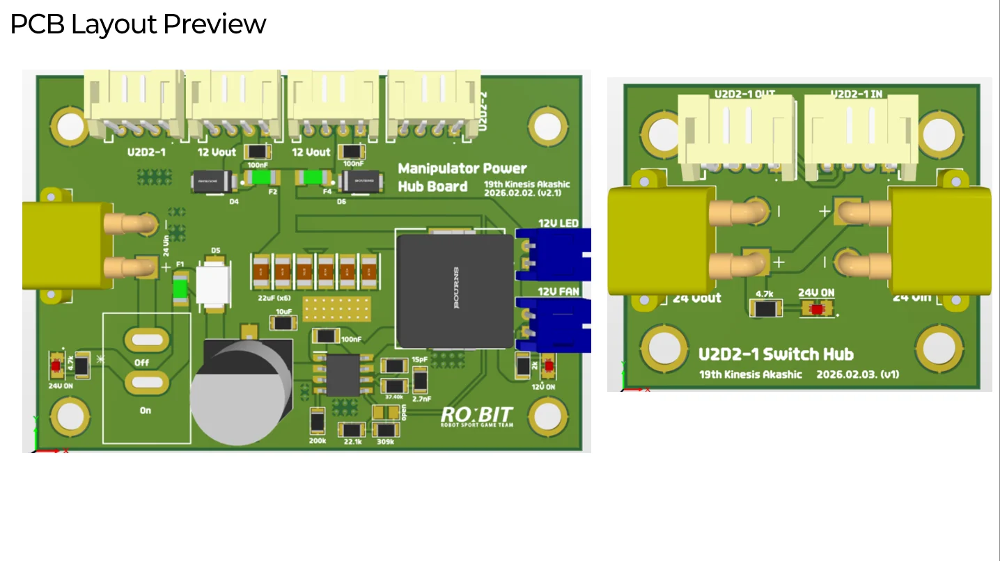
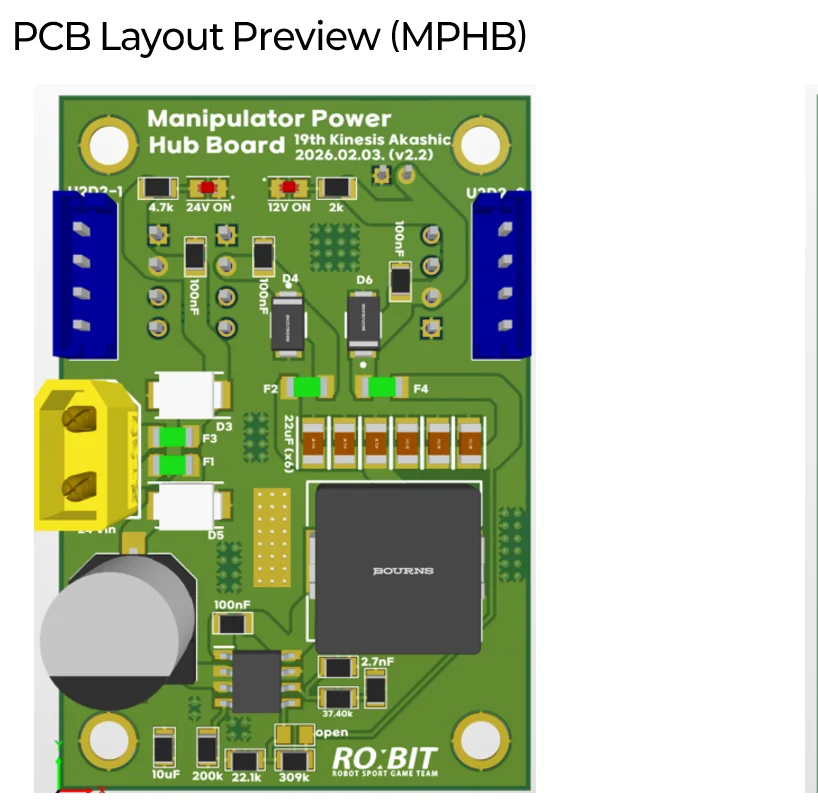

<!-- TODO(author to confirm): Please share the specs (input/output current, efficiency), physical test results (output voltage, ripple, load, temperature) with photos, and the reason it was made. The tests below are recorded only up to checking the 12V output. -->
## 1. Overview
MPHB (Manipulator Power Hub Board) is a **24V→12V DC-DC converter board that supplies 12V to the manipulator**. It is the first DC-DC converter I designed and built myself, in 2026, and I kept revising it as I tested. The board is part of the electrical system of the robot for [RoboCup Rescue 2026](/en/projects/robocup-rescue-2026/).

- **Period:** January – February 2026
- **My role:** Selecting parts, designing the schematic and PCB, soldering and testing
- **What is on the board:** A 24V→12V buck (step-down) converter, a power switch with 24V and 12V indicator LEDs, connectors for U2D2 communication, and 12V outputs (for the communication devices, LEDs, and a fan)

## 2. Version History
| Version | Date | What changed |
|---|---|---|
| v1.0 | 2026-01-15 | First design: the converter circuit, U2D2 data communication connectors, a power switch, and a power-check LED. The U2D2 module mounted directly on the board. |
| v2.0 | 2026-01-31 | Expanded so two U2D2 modules can mount, one on each side. |
| v2.1 | 2026-02-02 | Changed to connect the U2D2 through connectors, and added 12V output terminals and 12V terminals for an LED and a fan. I made a separate switch-hub board for the U2D2 connection. |
| v2.2 | 2026-02-03 | A further revision of the v2.1 layout. (Details of the changes will be added.) |

I soldered v2 and tested **up to getting a 12V output** (February 22).

### v1.0

### v2.0 – v2.2

### What I found after v2 and revised
- **An electrolytic capacitor was too tall.** The part's width, height ratio, and size were not reflected correctly in the PCB, so when soldered the part stuck out above the board.
- **Output configuration change.** Because only one U2D2 would be used, the output that had been reserved for one of the U2D2s had to be removed and the 12V output for the U2D2 changed to two. A v2.3 revision was needed to reflect this.

## 3. What I Learned
- If a part's size in the PCB library differs from the real part, **the problem only shows up at soldering.** I needed a habit of checking height and mountability before ordering.
- Before connecting to a motor, I test the connector and polarity first.
