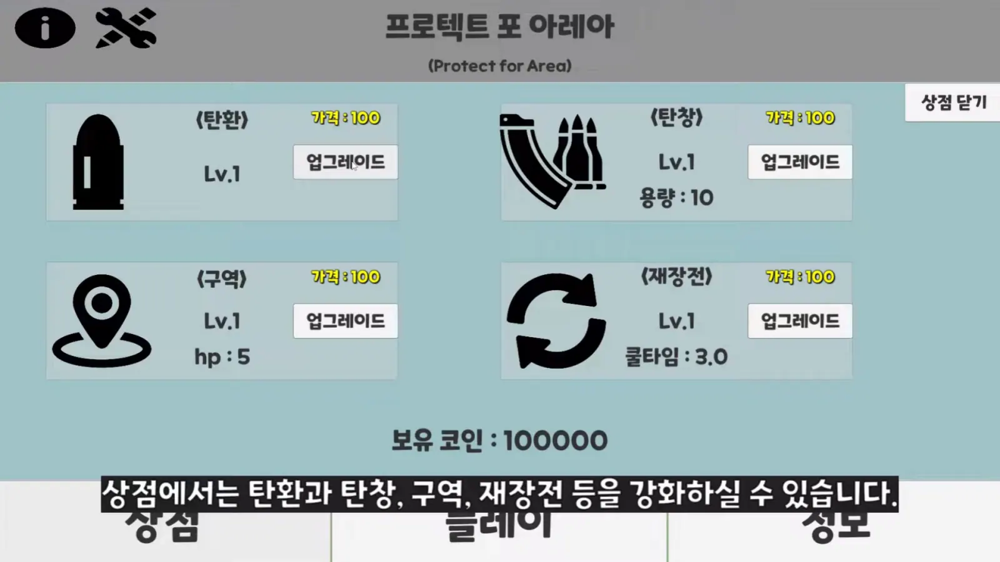
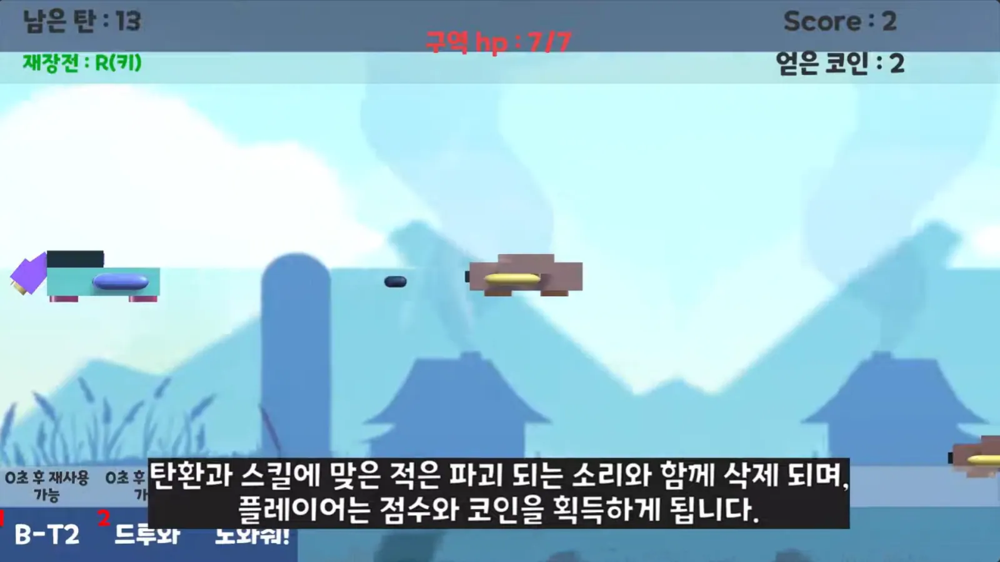

## 1. Overview
A 3D shooting defense game developed in five intensive days through Bucheon University's Zepet Studio "Unity Short Academy".
The goal is to protect a safe area from waves of alien ships, and players can upgrade their craft through a shop system.

- **Period:** 2022.01.10 ~ 2022.01.14 (5 days)
- **Role:** Solo development (planning, 3D modeling, development)
- **Result:** Selected as a **scholarship student** of the Unity Short Academy

## 2. Key Features
- **Defense system:** wave logic that manages the area's HP and the player's health while holding off enemies
- **Shop & upgrades:** spend collected coins to strengthen bullets (unlocking skills), magazine capacity, area health and reload speed
- **Infinite scroll:** the background scrolls endlessly to convey the speed and immersion of flight

## 3. Technical Implementation (Engineering Logic)
This project focused on **data management** and **understanding 3D space**.

### JSON data serialization (data persistence)
Instead of plain `PlayerPrefs`, I adopted **JSON**, which is more extensible and secure, to manage game data.
- **Implementation:** I built a system that serializes the player's currency, upgrade state and high score into a JSON file, saves it locally and loads it back.
- **Takeaway:** a deeper understanding of structured data exchange.

### Controlling 3D coordinates (Vector3 & Transform)
Unlike 2D, 3D adds a Z axis, and I learned to control objects in that environment.
- **Learning:** I used `Vector3` and `Quaternion` to calculate bullet firing angles and enemy paths, and controlled live positions through the `Transform` component.

## 4. What I Gained
- **3D modeling:** I designed the player craft and enemy ships myself, experiencing the 3D asset production process.
- **Problem solving:** moving beyond clone-coding, I used Google searches and official documentation to design and apply "features of my own" (the shop and skills).

---

## 5. Gameplay

*The shop system, where data is saved as JSON*

*Defense combat in 3D space*

## 6. Demo Video

  <iframe 
    class="w-full h-full rounded-xl"
    src="https://www.youtube.com/embed/wUh_Z_ylrH8?si=qt-jsDK6tD3IB49p"
    title="Minecraft RPG Project" 
    frameborder="0" 
    allow="accelerometer; autoplay; clipboard-write; encrypted-media; gyroscope; picture-in-picture" 
    allowfullscreen>
  </iframe>

