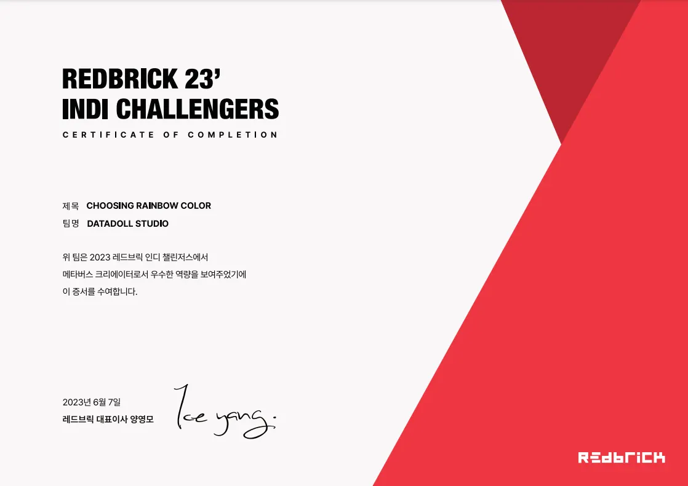

## 1. Overview
A 3D hyper-casual game selected for the **Indie Developer Win-Win Project** hosted by RedBrick and the Korea Indie Game Association.
Within a time limit you must find a key and survive on platforms that break at random. The game earned the **"REDBRICK 23' INDI CHALLENGERS"** certification.

- **Period:** 2023.02.27 ~ 2023.04.30
- **Role:** Solo development (World Director) - planning, 3D world building, scripting
- **Result:** Selected for the 2023 RedBrick x Korea Indie Game Association **Indie Developer Win-Win Project**

## 2. Core Logic and Algorithms
The main algorithms and engineering points implemented in `script.js`.

### Asynchronous game loop
I designed a core loop that checks the game state every second using `setInterval`.
- **Timer & state check:** the timer (`timerCount`) updates every second, and `clearInterval` controls the loop when time runs out.
- **Win/loss condition:** when the timer ends, the round result is decided by combining `isKeyHave` (whether the player holds the key) and `isPlayerTouchingFoothold` (whether the player survived on a platform) with the logical `&&` operator.

### Randomized spawning
To give players a new experience every round, I randomized position values.
- **Key spawning:** `getRandom(1, 7)` picks a zone, and a second `getRandom(1, 3)` decides the detailed (x, y, z) coordinates, so the key appears in an unpredictable place.
- **Map destruction:** I assign random values to the `aryFoothold` array and destroy platform objects (`objFoothold[i]`) that exceed a threshold (`> 7`) with `kill()`, producing a dynamic map.

### Object interaction and event handling
- **Collision detection:** `onCollide` events detect contact between the player and platforms/items, and the `selectHoldNum` variable tracks the current position state in real time.
- **Trap mechanics:** moving obstacles (`moveY`) and rotating traps (`rotateY`) are driven by coordinate calculations.

## 3. What I Gained
- **Project lifecycle:** I completed the entire solo-development process, from planning, algorithm design and implementation to QA and contest submission.
- **Using JavaScript:** I applied ES6 features such as variable scope, array handling and asynchronous timers to real game logic, deepening my understanding of the language.

---

## 4. Gameplay Video
Choosing Rainbow Color gameplay demo

  <iframe 
    class="w-full h-full rounded-xl border border-neutral-800"
    src="https://www.youtube.com/embed/9_hgpJxI2AE?si=xcCbtei_k81k_tJp" 
    title="Choosing Rainbow Color Gameplay" 
    frameborder="0" 
    allow="accelerometer; autoplay; clipboard-write; encrypted-media; gyroscope; picture-in-picture" 
    allowfullscreen>
  </iframe>

## 5. Awards and Certification

*2023 REDBRICK INDI CHALLENGERS certificate (Korea Indie Game Association)*
