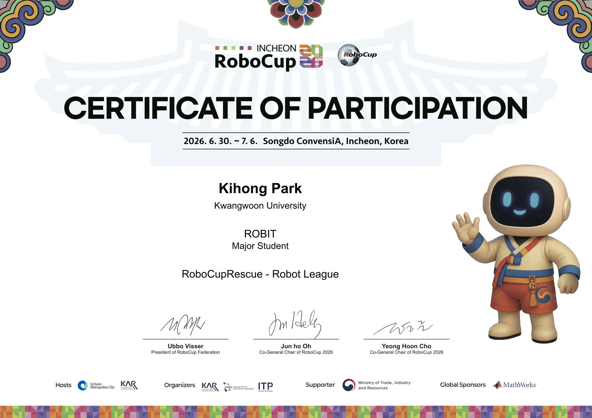

<!-- TODO(author to confirm): The certificate shown is a participation certificate. If there is a separate Best TDP award certificate, please let me know. -->
## 1. Overview
I took on **the wiring and circuits** of the robot, and **the audio package**, on the ROBIT team that entered the Rescue Robot League at **RoboCup 2026 Incheon** (June 30 – July 6, 2026, Songdo ConvensiA).

- **Result (team):** Advanced to the semifinals and finished **9th**, and won the **Best TDP** award
- **My role:** Designing the power distribution and wiring, designing, building, and ordering the boards and DC-DC converters we needed, and developing the audio package
- Best TDP is separate from the placement awards: it goes to a team that wrote its team description paper (TDP) well.

> This is a system that the junior members continue to use and improve, so **I do not disclose configuration values or detailed design**, and I describe design decisions and results. The detailed stories by topic are split into the articles below.

## 2. Rules Analysis and Requirements
As a first step I read the rules closely, organized the scoring items, and made a translation that I shared so the team could use it right away. (The rulebook text itself is not reproduced here.)

While deciding the hardware specs for the TDP, I summarized why the operator box needed its own circuit:
- Go beyond simple motor control: **faster data reception** and **room to add sensors**.
- Add **voltage monitoring** so the battery state can be seen on the operator screen.
- Make **maintenance easy** so a failed part can be unplugged and replaced right away.

## 3. What I Took On, by Topic
| Topic | Article |
|---|---|
| Power distribution, wiring, and boards | [Robot Electrical System Design](/en/projects/robot-electrical-architecture/) |
| DC-DC conversion board | [MPHB](/en/projects/mphb-dc-dc-converter/) |
| Two-way audio | [2-Way Audio](/en/projects/two-way-audio/) |

I later applied the same electrical design to the [Defense Robot Competition 2026](/en/projects/defense-robot-2026-electrical-comm/), where the team won the grand prize.

<video controls muted playsinline preload="metadata" src="/videos/operator-station-demo.mp4"></video>

A demonstration of the operator station.

## 4. Participation Certificate

## 5. Limits and What I Learned
- Splitting the electrical system into boards means a failed part can be replaced on its own, but **more boards meant more connector and wiring checks.**
- If a part's real size is not reflected correctly in the PCB, the problem only shows up at soldering. A step to check part height and mountability before ordering is needed.
