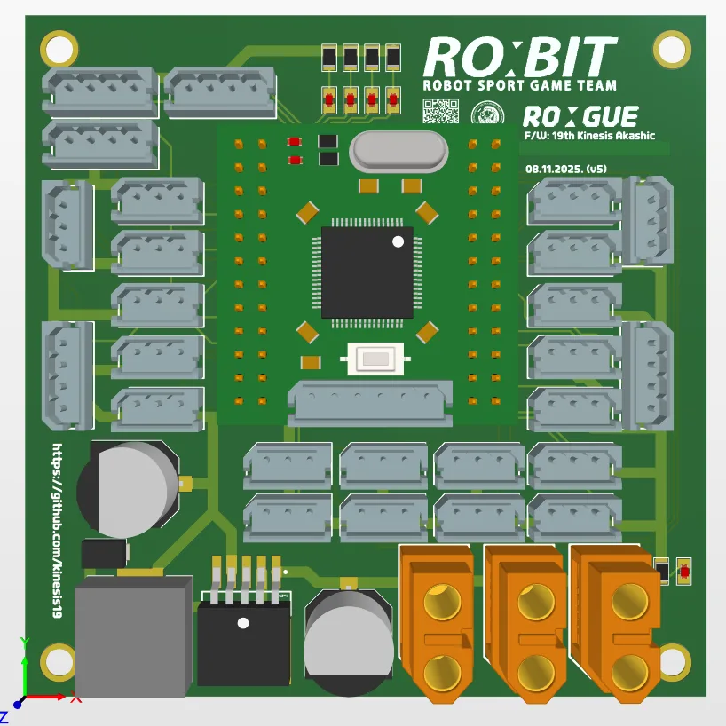

## 1. Overview
I designed and built one robot for the **Ssireum robot category of the IRC Intelligent Robot Competition**, hosted by Kwangwoon University. In Ssireum robot matches, robots push each other out of the ring to score. ROBIT sent two teams, and my team placed **4th**.

- **Period:** June – November 2025
- **My role:** Design and build of one robot (circuit design, board ordering, firmware)
- **Competition format:** On the day, we went straight to the main bracket without a qualifier.

> In Ssireum robot, strategy decides matches between teams, so **I do not disclose the algorithm, the sensors used, or details of the ring in this article.**

## 2. Design and Build
I designed an ESP32-based control board that connects the sensors and the motor drivers myself and ordered it in August 2025.

## 3. Match Results
- Round 1: lost 4:12.
- Round 2: tied 10:10, but with a lower total score we went to the 4th/5th place match.
- 4th/5th place match: won 9:7 to secure **4th place**.

## 4. Looking Back
- **The gap between practice and the real match.** The sensor reference values I set during practice differed from the values coming in during the real match, so detection was late and we sometimes lost points. I adjusted the reference in round 1, but the same kind of point loss repeated, so I changed the strategy in the break between rounds, and in round 2 we caught up to a tie.
- **What I learned.** Sensor references should be **recalibrated in the real environment right before the match**, and you should leave time to change the strategy even after the practice matches.

In 2026 I formed a new team and entered the same competition again. → [Ssireum Robot 2026](/en/projects/ssireum-robot-2026/)
