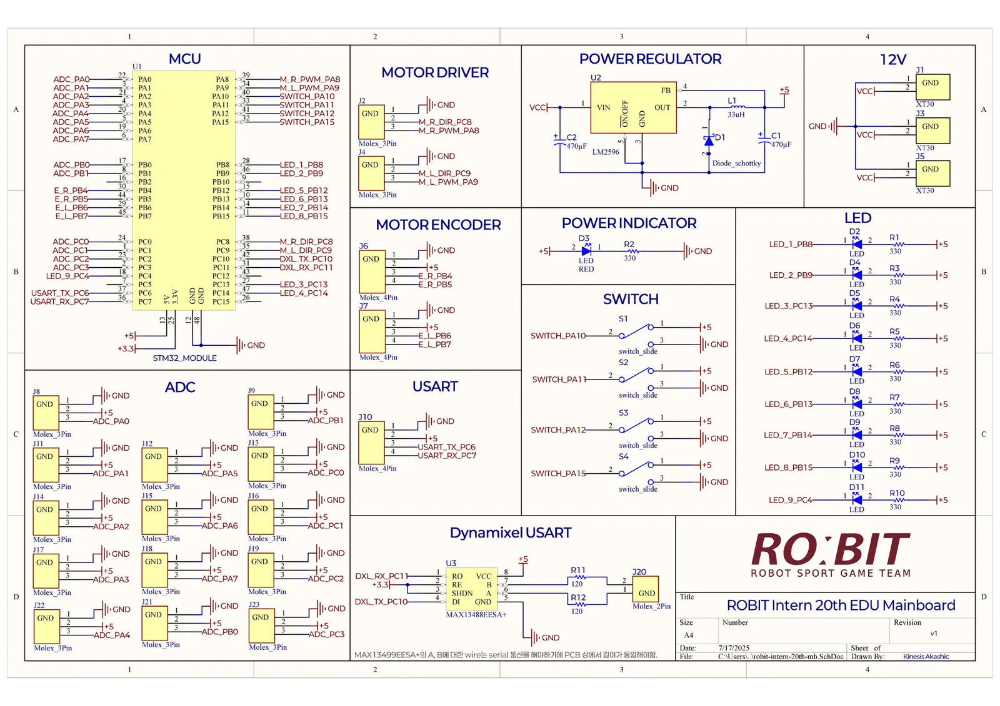
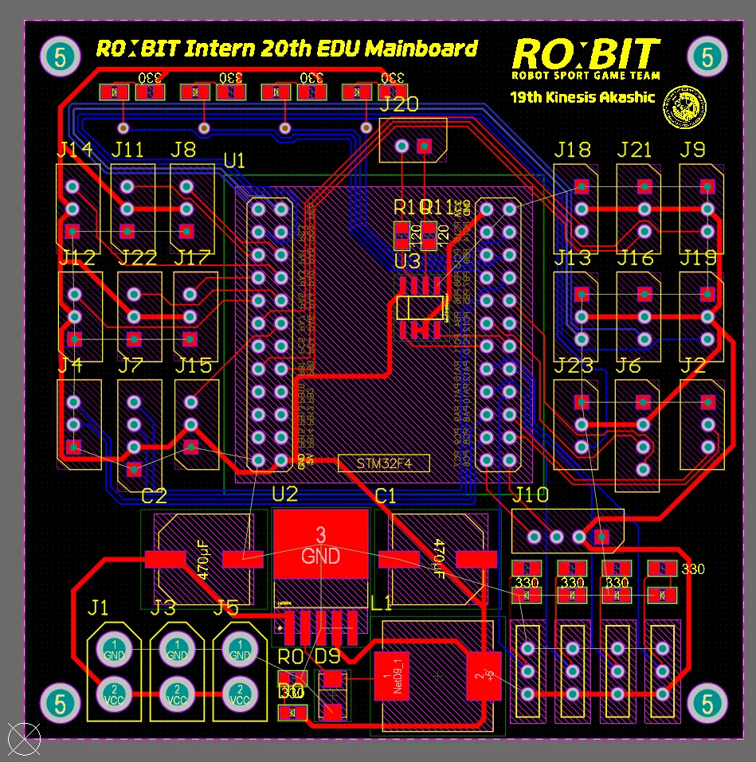

<!-- TODO(author to confirm): Please share how many boards were made and how they were used in the actual training (which exercises). -->
## 1. Overview
I designed the STM32-based mainboard used in the training of the student self-governing organization ROBIT's **20th-generation new members**. I did the circuit design through the PCB layout myself, and then did the soldering and function checks of the fabricated boards.

- **Period:** July – September 2025
- **MCU:** STM32F446RE
- **My role:** Deciding the pin assignment, designing the schematic and PCB, soldering and function checks

## 2. Contents
I decided the pin assignment in STM32CubeMX and then reflected it in the circuit. The functions on the board:

| Function | Details |
|---|---|
| Motor drivers | 1 channel each for left and right (timer PWM + direction GPIO) |
| Encoders | 1 channel each for left and right (timer encoder mode) |
| ADC | 14 channels |
| Communication | 1 serial (USART) channel and 1 Dynamixel-dedicated channel (with direction control) |
| Input/indicators | 2 switches, LEDs, power indicator |
| Power | Power regulator, 12V terminal |

## 3. Fabrication and Checks
I created a repository and designed with version control of the circuit files. Because many functions had to fit on one board, I first fixed the pin assignment in CubeMX and then reflected it in the circuit. In September 2025 I finished soldering the PCBs for the new members and checked one by one whether each function worked. (Detailed test results will be added when they are organized.)
