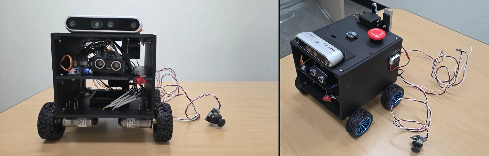
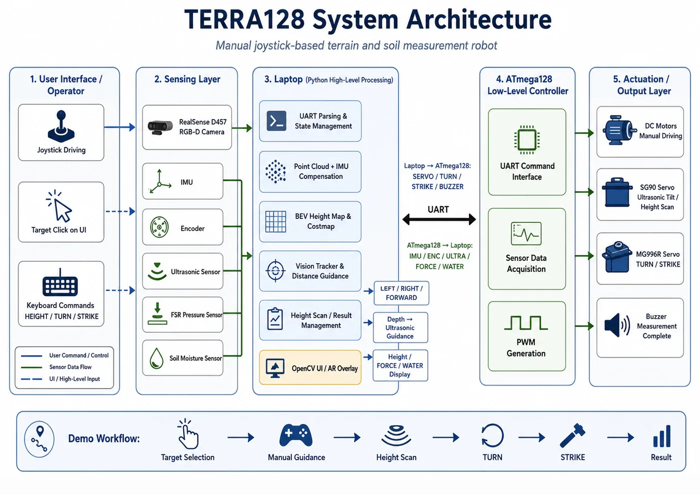
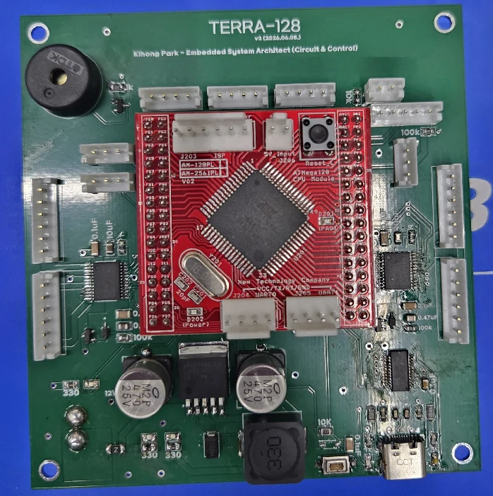
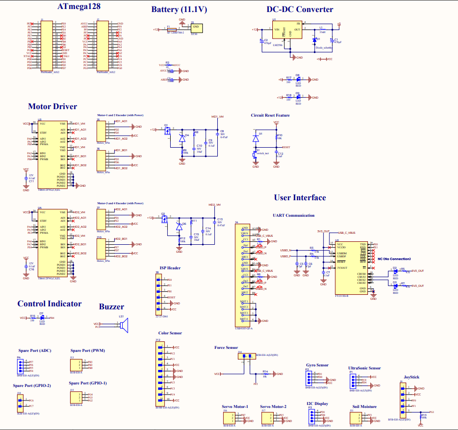
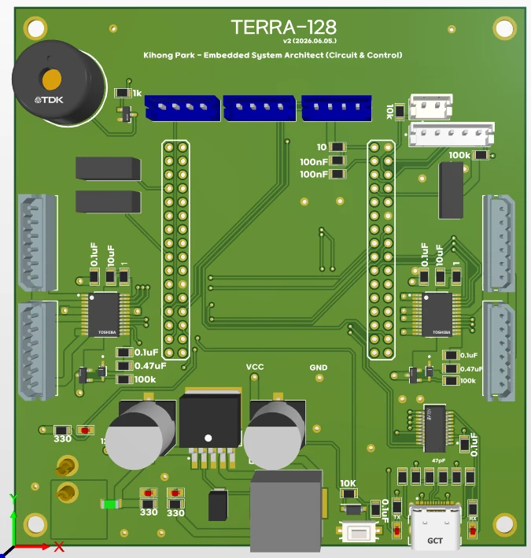
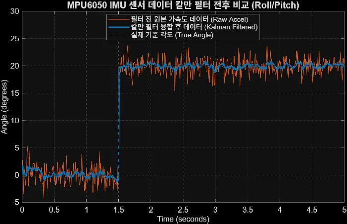
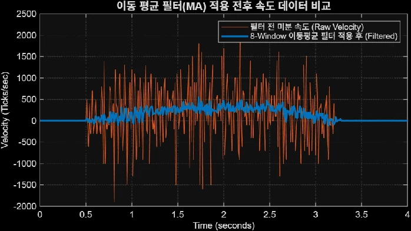
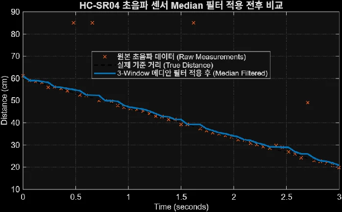
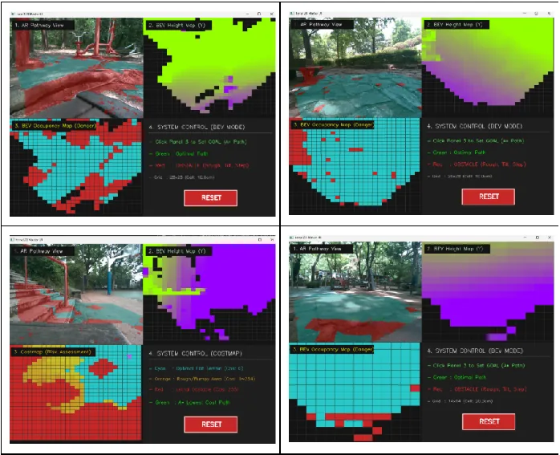

<!-- TODO(author): date is a temporary value taken from the v2 date printed on the PCB silkscreen (2026-06-05). Tell me the actual final presentation date. -->
## 1. Overview
**Terra-128** is a soil and terrain survey rover built as a two-person team project for "AI Robotics Experiment 3" in the first semester of 2026.
In farms, disaster sites and outdoor exploration, it is hard for people to check the flatness of the ground, obstacles and soil condition directly. On terrain mixed with soil, stones and roots, distance sensors alone are not enough to judge driving, so we aimed for a robot that fuses several sensors to judge terrain and soil condition together.

- **Course:** AI Robotics Experiment 3 (first semester 2026)
- **Team:** Team of 2, with roles split into circuits, PCB and low-level firmware / mechanical design, vision and the Python high-level software
- **My role:** designing and building the Altium-based custom control PCB, the ATmega128 low-level firmware, and the sensor filter pipelines
- **How it works:** it is not fully autonomous. The user drives with a joystick and follows the direction and distance guidance on a laptop UI, so it is a **manual-drive measurement assistant**.

## 2. System Overview
A **Python high-level processor** on a laptop and an **ATmega128 low-level controller** are connected over UART, each with its own role.

| Part | Component | Role |
|---|---|---|
| Controller | ATmega128 | Sensor reading, PWM control, UART communication |
| High-level processor | Laptop (Python, OpenCV) | RealSense processing, PointCloud, Costmap, A* path check, UI |
| Vision sensor | Intel RealSense D457 | RGB image and Depth-based 3D terrain data |
| Attitude sensor | MPU6050 (I2C) | Roll/Pitch measurement, PointCloud tilt correction |
| Distance sensor | HC-SR04 + SG90 servo | Close-range distance measurement and height scan |
| Drive feedback | 4 motor encoders | Wheel rotation and travel distance estimate |
| Soil sensors | FSR pressure sensor, soil-moisture sensor | Ground firmness and moisture |
| Actuators | DC motors, MG996R servo, buzzer | Driving, stamp module, completion alert |

Data flows `sensors → ATmega128 → UART → laptop (Python) → UI`. The laptop sends `SERVO`, `TURN`, `STRIKE` and `BUZZER` commands, and the ATmega128 returns `IMU`, `ENC`, `ULTRA`, `FORCE`, `WATER` and `RESULT` values.

## 3. What I Did
### Custom control PCB: design and build
Breadboards and thin jumper wires cannot cope with the current peaks of four motors and servos, or with motor noise corrupting encoder and analog sensor signals, so I **designed and built a dedicated control PCB in Altium Designer.**

- **MCU:** an ATmega128A with a 16 MHz crystal. Two hardware UARTs and plenty of timers handle four-axis encoder counting and several PWM outputs.
- **Power:** the battery (11.1–12.6 V) is stepped down to 5 V by an LM2596XS switching regulator for the sensors and servos.
- **USB-UART:** an FT231XS connects to the laptop. Considering the surge noise from the motors, I lowered the baud rate to **9600 bps** to favor stability.
- **VBUS power isolation:** the laptop's USB-C 5 V and the board's main 5 V rail are physically separated. This prevents the two supplies from fighting and damaging the laptop port or back-feeding current; plugging in USB-C wakes only the serial chip, and the MCU runs only when main power is applied.
- **AVCC filter:** a resistor and a 0.1 µF capacitor next to the ADC supply pin form an LC low-pass filter so digital switching noise does not leak into the analog inputs of the soil-moisture and pressure sensors.
- **RESET protection:** a fast switching diode (1N4148W) between RESET and VCC keeps the residual charge of the reset capacitor from flowing back into the MCU when power is cut.

### Fabrication and hardware debugging
- I ordered the PCB from the Gerber files and **hand-soldered** the small SMD parts with tweezers and a rework station.
- **Two-stage power bring-up:** before applying power, I checked every VCC-GND pair for shorts with a multimeter. I then set the bench supply to 12 V with a 0.1 A current limit and powered the board for the first time; once nothing was wrong and I released the limit, the no-load standby current settled at about 30 mA.
- **From v1 to v2:** the v1 board was ordered with a GND-VCC short. Tracing it, I found the **route width on the motor-driver side was too thick**. I re-routed it more cleanly and fixed the vias, and the second order (v2) worked normally.
- **Hardware loopback test:** before bringing up the MCU, I shorted the MCU_TXD and MCU_RXD pads with tweezers and sent text from Tera Term (9600 bps); getting the data echoed back confirmed the FT231XS communication path.

### ATmega128 low-level firmware
A timer-based structure with tasks at different rates.

- **10 ms task:** IMU, ADC sensors (pressure, soil moisture), encoder speed calculation and filter updates
- **60 ms task:** ultrasonic measurement, run as an independent sequence to avoid interference between sensors
- **200 ms task:** sends the filtered values to the laptop as UART packets such as `IMU,roll,pitch`
- **Encoders:** a 0.1 ms timer interrupt XORs pin state changes to count rising-edge ticks for four wheels
- **Ultrasonic:** measures the echo pulse width with a timer and has a timeout guard; takes three samples 20 ms apart, averages them, then applies a median filter
- **UART protocol:** text packets such as `ENC,lf,lb,rf,rb`, `ULTRA,distance`, `FORCE,value` and `WATER,value`

### Per-sensor filter pipelines
Each sensor has different noise, so I chose a different filter for each.

| Sensor | Problem | Filter |
|---|---|---|
| MPU6050 IMU | Accelerometer is vibration-sensitive and gyro drift accumulates | Kalman filter (Roll/Pitch) fusion |
| Wheel encoder | Quantization error and motor ripple when differentiated into speed | 8-sample moving average |
| HC-SR04 ultrasonic | Spikes and dropouts depending on the reflecting surface | 3-sample average, then 3-sample median |
| FSR pressure sensor | Residual offset at no load, impulses at contact | Initial zero calibration + 8-sample moving average |
| Soil-moisture sensor | Impedance swing at contact, motor ground ripple | 8-sample moving average + bit-shift low-pass filter |

The soil-moisture low-pass filter uses a **3-bit right shift (÷8)** instead of floating-point math to avoid division cost on an 8-bit AVR.

<!-- TODO(author): Tell me whether the before/after graphs above are measured data or simulations made (for example in MATLAB) to show the filter effect. If they are simulations, I will say so in the captions. Please also confirm whether numbers such as the Kalman gain (0.17) are measured. -->

## 4. Teammate's Part (High-level Software and Mechanics)
- **Mechanics:** designed the upper and lower plates, sensor brackets, servo mounts and the ultrasonic sensor mount in Inventor. The **stamp module** (MG996R, compression springs) turns servo rotation into vertical linear motion through a linkage so the FSR pressure sensor and soil-moisture sensor touch the ground only when needed.
- **Terrain analysis:** converts RealSense Depth into a PointCloud, corrects its tilt with the IMU Roll/Pitch, builds a BEV Height Map and Costmap, and previews an A* path.
- **Target tracking and UI:** when the user clicks a target on screen, a Vision Tracker follows it and gives `LEFT`, `RIGHT` and `FORWARD` guidance. An OpenCV UI shows the camera, terrain maps and measurement results.

## 5. Demo Flow
`Select target → Drive by joystick → Height Scan → TURN → STRIKE → Result`

1. Clicking a target in the UI starts tracking; beyond 50 cm the distance is updated from the RealSense and the encoders.
2. From 40–50 cm, the ultrasonic sensor and servo align to the target direction, covering the close range the depth camera cannot see.
3. After arriving, a **Height Scan** moves the SG90 servo to change the ultrasonic sensor's angle and measure height.
4. `TURN` rotates the stamp module into the measuring position, and `STRIKE` lowers it to read pressure and moisture.
5. When both values arrive normally, the UI shows `END` and the buzzer signals completion.

## 6. Schedule
From April 27 until the presentation day. Laptop software, ATmega128 and hardware work ran in parallel.

| Period | Laptop software | ATmega128 | Hardware |
|---|---|---|---|
| 4.27 – 5.8 | Camera calibration, basic OpenCV setup | Motor PWM control | Mechanical design and printing |
| 5.9 – 5.16 | - | ADC filtering, sensor signal transfer | Controller design |
| 5.17 – 5.24 | Sensing data parsing (UART) | - | Power circuit design |
| 5.25 – 6.1 | UI | Servo control | Stamp module assembly |
| Until the presentation | Debug | Debug | Debug |

## 7. Limits and Next Steps
- **Ultrasonic sensor:** values jumped or did not arrive depending on the surface material, angle and distance. We compensated with timeout handling, raw-value decisions and change-based edge detection; sometimes using the raw value was better than filtering it blindly.
- **Measurement variance:** the pressure sensor depends on contact position and force, and the soil-moisture sensor on soil density and insertion depth. Per-sensor calibration and repeated-measurement averaging are needed. The stamp module also varies with linkage play and spring stiffness, so contact-force calibration, a linear guide and limit switches could be added.
- **Manual driving:** we chose manual driving for implementation stability and demo reliability. Using the current Costmap and Vision Tracker results for automatic speed control, alignment and stopping could extend it into a semi-autonomous rover.

On a real sensor-based robot, noise, spikes, delays and unstable communication show up unlike the theoretical values, and we confirmed how important exception handling and state management are.

## 8. Reflection
When I ordered the PCB, v1 had a GND-VCC short, and the cause was a route width that was too thick on the motor-driver side. I re-routed it more cleanly and fixed the vias, and the second order worked normally. We had a hard deadline to finish ordering the board, the firmware and the features, so with shipping time included it was nerve-racking.

---

## 9. Demo Video
<!-- TODO: Send me the YouTube link and I will add it in this form.

  <iframe class="w-full h-full rounded-xl" src="https://www.youtube.com/embed/VIDEO_ID" title="Terra-128 Demo" frameborder="0" allowfullscreen></iframe>

-->
