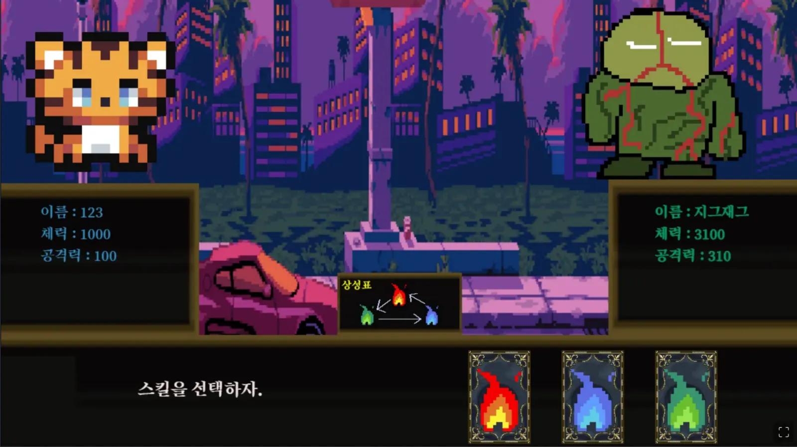
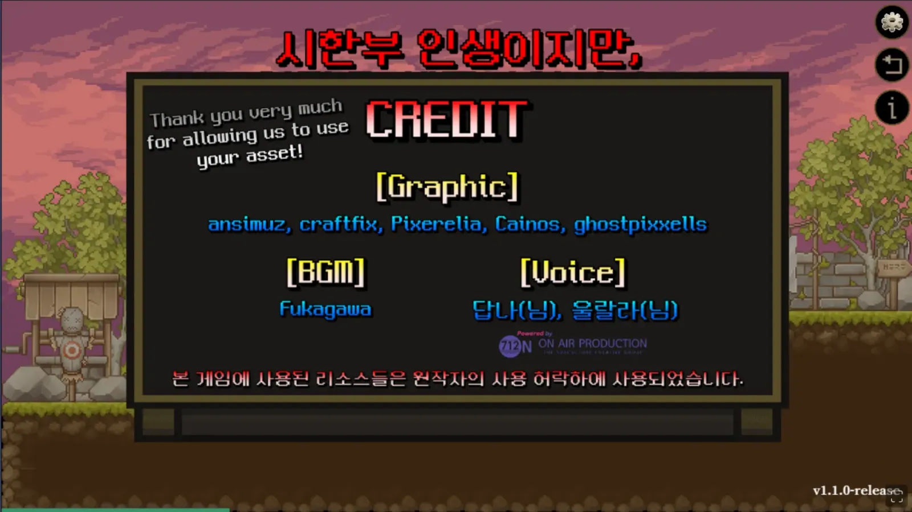

## 1. Overview
This is my entry for the "2022 RedBrick Creator Challenge Season 4" contest.
It is a 2D turn-based RPG set in a zombie apocalypse, built so that it runs right in the browser with no installation. I implemented all the core elements of an RPG on my own: exploration, combat, a shop and a ranking system.

- **Period:** 2022.06.28 ~ 2022.08.14
- **Role:** Solo development (planning, design, overall development)
- **Result:** **Award winner**, 2022 RedBrick Creator Challenge Season 4

## 2. Key Features
- **Combat system:** turn-based strategy combat built on the type matchups of three elements, fire, water and grass (a rock-paper-scissors logic)
- **Exploration and economy:** spend action points to explore regions, and buy or upgrade items and skins with the currency you earn (N-Coin)
- **Ranking system:** survival days (D-Day) are scored and reflected in a server ranking

## 3. Technical Challenges (Engineering & Optimization)
This project was an attempt to **understand and work around platform constraints**.

### Web resource optimization (resource management)
In a web game, using high-resolution resources carelessly slowed loading and caused lag.
- **Problem:** unlike an installed app, browser memory limits made asset size management essential.
- **Solution:** I optimized the size of in-game resources and cut unnecessary computation. I couldn't include every high-resolution asset, but I came to feel **how important resource management is in hardware-constrained environments (such as embedded systems)**.

### Combat algorithm (logic design)
Instead of plain attacks, I implemented interactions between elements.
- **Logic:** I designed the cyclic matchup `Fire > Grass > Water > Fire` with conditionals, and applied an algorithm in which the damage multiplier changes depending on the player's and the monster's choices.

## 4. What I Gained
- **Understanding cross-platform:** I experienced the advantage of a web game that runs on both PC and mobile without a separate build.
- **System integration:** I designed the structure so that modules like the inventory, shop, settings (coupons, sound) and ranking exchange data with each other seamlessly.

---

## 5. Gameplay

*Turn-based combat using the elemental matchups (water, fire, grass)*

*Credits screen*

## 6. Tutorial Video

  <iframe 
    class="w-full h-full rounded-xl"
    src="https://www.youtube.com/embed/-1u-7GLbhuU?si=as_tF9-PUnR1cviX"
    title="Minecraft RPG Project" 
    frameborder="0" 
    allow="accelerometer; autoplay; clipboard-write; encrypted-media; gyroscope; picture-in-picture" 
    allowfullscreen>
  </iframe>

