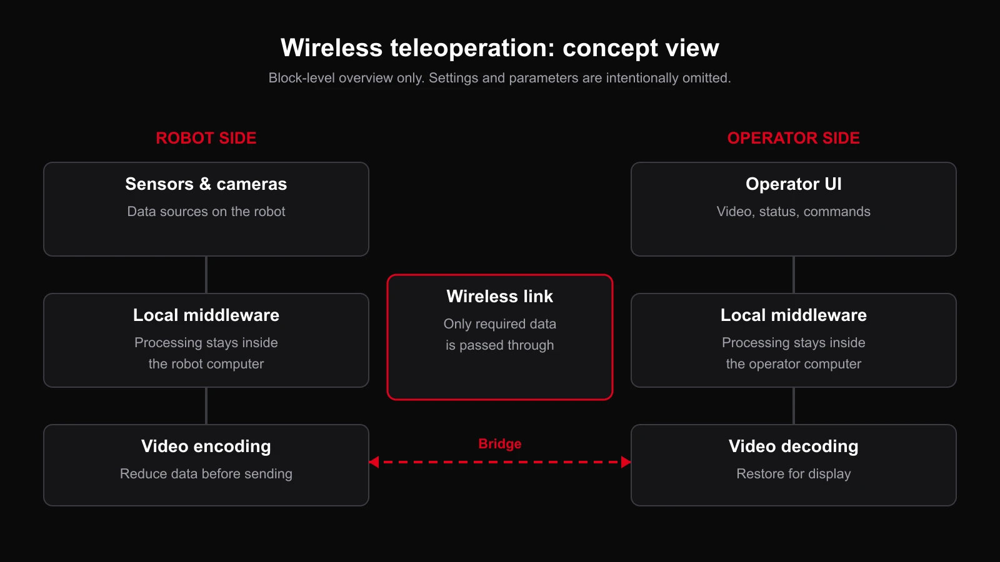

## 1. Overview
From 2026 I took on designing the robot's power and communication architecture as a whole. This article covers **the wireless link between the robot and the operator**. I applied this communication structure to the **Defense Robot Competition 2026** and validated it in the competition environment.

> This system is one that the junior members continue to use and improve, so **I do not disclose configuration values or detailed settings in this article.** I wrote it around design decisions and validation results.

## 2. Design Direction
- **Separate local from wireless.** Communication inside each computer stays as it is, and only **the data that is truly needed** passes through the wireless link. The goal is to keep unnecessary traffic off the wireless link.
- **A Zenoh-based bridge for the wireless link.**
- **Reduce video before sending.** Camera video is encoded for sending and restored on the operator side.
- **Check for setting mismatches.** I once found and fixed a problem where the communication quality settings on the sending and receiving sides differed, so data did not flow as expected. Checking both sides as a pair was important.

## 3. Comparing Camera Data Usage
I compared this year's approach against last year's under the same conditions (same cameras, same resolution), measuring per-topic bandwidth on the operator side.

- Under the same conditions, the total for several USB cameras dropped by **about 80%** compared to last year, and a single depth camera by **about 88%**.
- In the measurement at the real operating condition with higher resolution, the value was actually lower, because **I measured while filming a static scene**. Video compression sends only the differences between frames, so the value rises with motion. This result alone cannot be taken as real-world bandwidth.

## 4. Problems and Responses
1. **Camera streams drop intermittently.** By analyzing logs, I pinned down that the cause was not in the software settings but in **a lower layer of the system (the USB side)**. With the competition close, I postponed a root-cause fix and applied only a mitigation that lowers the data volume. **This was not a root-cause fix.**
2. **The whole system hangs.** During a load test I hit a complete freeze where even remote access failed. I analyzed it, but it is **unresolved**.
3. **A connection race at startup.** If devices are started almost simultaneously, the connection order gets tangled, so I avoid it by adjusting the startup order.
4. **Wireless environment at the venue.** Many teams' routers are on at once and channels are congested. I chose channels that do not overlap with other teams myself, and also measured channel occupancy at the venues (the Defense Robot Competition had about 10 teams).
5. **Communication quality values tuned by experience.** I had not yet established a principle for designing these values on a wireless link, so I had to readjust every time conditions changed.

## 5. What I Learned and Next Steps
- Even with the same symptom, the cause varied across **communication settings, video processing, lower system layers, and the wireless environment**, so measuring one layer at a time was the most important thing.
- I regret not having used the observation tools well enough. I am learning how to capture on both computers and tell where the bottleneck is.
- I compiled these problems into a list of questions for an outside expert about architecture review and design principles.
