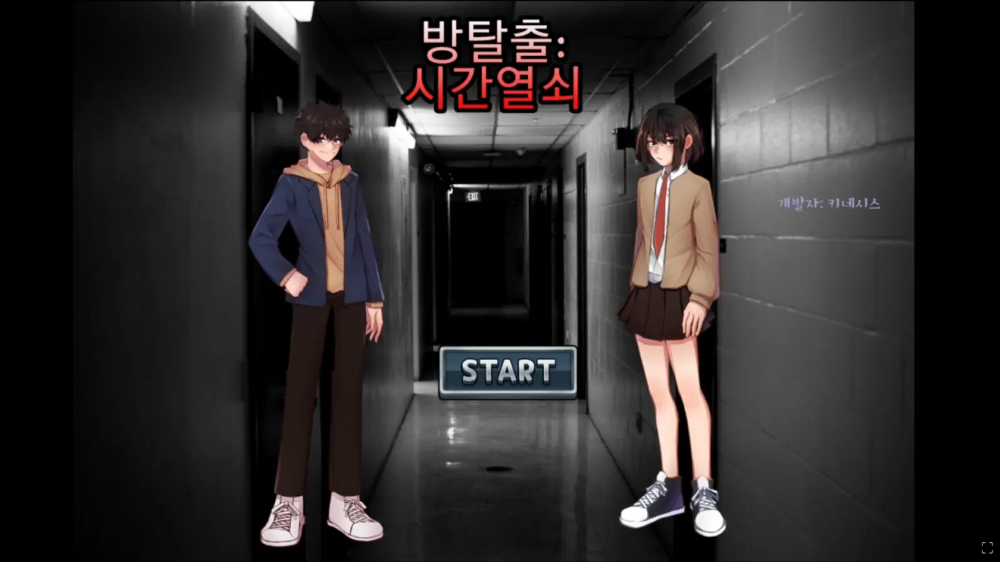
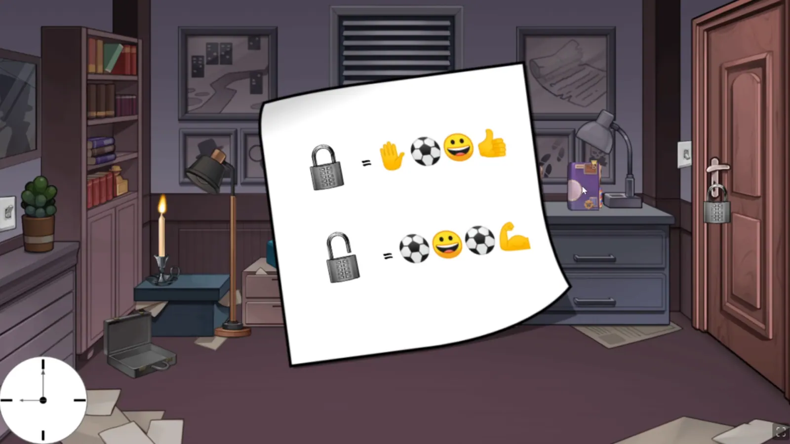

## 1. Overview
A web game I developed alone for the "Wizlab Escape Room Creator Challenge".
It tells the story of a kidnapped protagonist searching for clues through the flow of time to escape, and it was made to be played directly in the browser with no installation.

- **Period:** 2020.06.20 ~ 2020.08.20 (2 months)
- **Role:** Solo development (planning, design, overall development)
- **Result:** **Prize**, Wizlab Escape Room Creator Challenge

## 2. Key Features
- **Clue combination system:** puzzle logic where you click on-screen objects to collect clues and combine them to advance to the next stage
- **Hidden ending:** a true-ending system unlocked by collecting every clue hidden throughout the stages

## 3. Technical Growth (Engineering Growth)
The core of this project was **the shift from Unknown to Known**.

### Learning from zero
When I started, I knew no JavaScript syntax at all.
- **Approach:** I learned the syntax by reading Wizlab's API documentation and following other developers' open-source examples.
- **Result:** I picked up programming fundamentals such as variables, conditionals and event listeners through a real project in just two months, and finished the game logic.

### Cross-platform compatibility
I decided players should get the same experience whether they come in from a PC or a mobile device.
- **Solution:** I handled touch events and mouse clicks compatibly, and built a responsive structure so the UI doesn't break at different resolutions.

## 4. Development Summary
- **Planning:** analyzed escape-room content on Instagram and YouTube and reflected "tricks that users like" as game elements
- **Implementation:** state management with ES6 syntax, and optimization of sound and image resources

---

## 5. Gameplay Screens

*Title screen: a dark UI design*

*Puzzle screen: logic for decoding a cipher to open a box*
