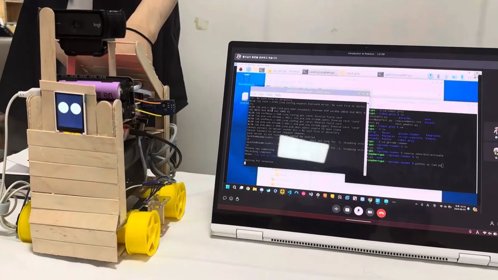
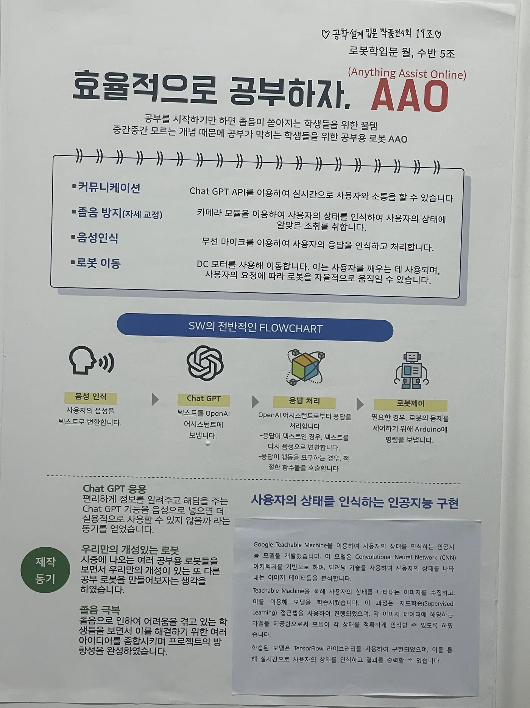
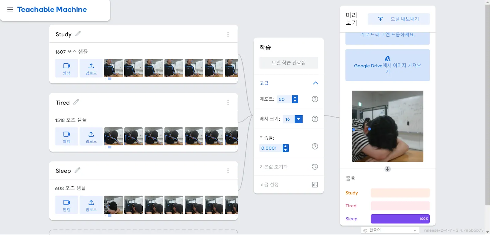
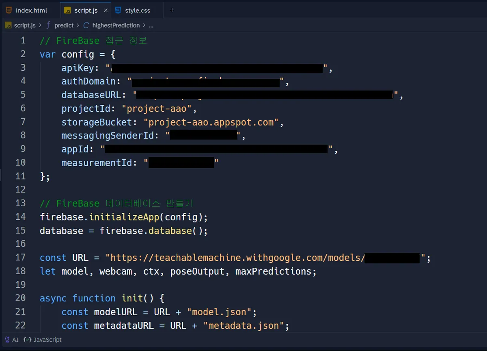

## 1. 프로젝트 개요
'로봇학입문' 수업의 팀 프로젝트(공학설계 입문 작품전시회 출품)로 개발한 **학습 보조 로봇 AAO(Anything Assist Online)** 입니다.
공부를 시작하면 졸음이 쏟아지는 학생, 모르는 개념 때문에 공부가 막히는 학생을 위해, AI로 효율적인 공부를 돕고 졸면 깨워 주며 궁금한 점을 바로 알려 주는 것을 목표로 했습니다.

- **과목:** 로봇학입문 (2024)
- **기간:** 2024.04.07 ~ 2024.06.03
- **최종 발표:** 2024.06.12
- **팀:** 5인 팀 (하드웨어 제작과 디스플레이 제어 / 하드웨어 설계와 데이터베이스 / QR 코드 인식과 바퀴 제어 / 객체 인식과 이미지 분류 / 어시스턴트 시스템과 UART 연결로 역할 분담)
- **내 역할:** 하드웨어 설계(Inventor), 데이터베이스 시스템(Firebase)

## 2. 프로젝트 목표
- **학습 효율 최적화:** AI 기술로 학생이 더 효과적으로 공부하도록 안내
- **시간 관리 지원:** 공부 중 잠들면 타이머로 깨워 줌
- **정보 접근성:** 다양한 주제의 관련 정보를 즉시 제공해 학습 요구를 지원

## 3. 주요 기능
- **커뮤니케이션:** ChatGPT API로 사용자와 실시간으로 대화
- **졸음 방지(자세 교정):** 카메라 모듈로 사용자의 상태를 인식하고 상태에 맞는 조치를 실행
- **음성 인식:** 무선 마이크로 사용자의 응답을 인식하고 처리
- **로봇 이동:** DC 모터로 이동하며, 사용자를 깨우거나 요청에 따라 자율적으로 움직임

## 4. 시스템 구성
### 하드웨어
라즈베리파이 1개, 아두이노 나노 2개, LCD 디스플레이 1개, 블루투스 스피커 1개, DC 모터 4개, 아두이노 전용 배터리 1개, 웹캠 1개, 아이스크림 막대 50개로 구성했습니다.

- 라즈베리파이는 보조 배터리(USB-C)로 구동하고, 블루투스 스피커는 3.5mm 단자에 연결했습니다.
- LCD 디스플레이와 DC 모터는 각각 아두이노 나노로 제어하고, 라즈베리파이의 USB-A 단자에 연결했습니다. 블루투스 마이크와 웹캠도 USB-A 단자에 연결했습니다.
- 브레드보드 위에 아두이노 나노와 DC 모터 드라이버를 구성해 모터를 제어했습니다.

### 소프트웨어 흐름
`음성 인식 → ChatGPT → 응답 처리 → 로봇 제어`

1. **음성 인식:** 사용자의 음성을 텍스트로 변환
2. **ChatGPT:** 텍스트를 OpenAI 어시스턴트에 전달
3. **응답 처리:** 응답이 텍스트면 다시 음성으로 변환하고, 행동을 요구하면 알맞은 함수를 호출
4. **로봇 제어:** 필요하면 아두이노에 명령을 보내 몸체를 제어

*공학설계 입문 작품전시회에 전시한 설명 포스터*

QR 코드 인식 결과는 `감지된 NumPy 배열 → 파이썬 리스트 → QR 코드 네 모서리 좌표` 순서로 변환해서 로봇 제어에 사용했습니다.

## 5. 사용자 상태 인식 AI
Google **Teachable Machine**의 자세(Pose) 모델로 사용자의 상태를 인식하는 모델을 만들었습니다. 클래스를 학습시킨 뒤 JavaScript로 내보내, 웹(HTML5, CSS3, JavaScript)에서 노트북 카메라로 사람의 자세(T-pose)를 인식하고 지금 졸고 있는지, 공부 중인지를 판단합니다. CNN(Convolutional Neural Network) 기반이고, 상태별 이미지에 라벨을 붙여 학습시키는 **지도학습** 방식이며 TensorFlow로 구현됩니다.

- **클래스 3개:** `Study`(공부 중, 1607 샘플), `Tired`(피곤함, 1518 샘플), `Sleep`(졸음, 608 샘플)
- **학습 설정:** 에포크 50, 배치 크기 16, 학습률 0.0001

## 6. 데이터베이스 시스템
웹 페이지(HTML5, CSS3, JavaScript)에서 학습한 Teachable Machine 모델(`model.json`, `metadata.json`)을 불러와 노트북 카메라 영상으로 사용자의 상태(공부 중, 피곤함, 졸음 등)를 판단하고, **Firebase Realtime Database**에 판단한 상태를 기록했습니다.

**Firebase가 웹 페이지와 라즈베리파이를 잇는 통로**입니다. 라즈베리파이에서 도는 파이썬 코드가 Firebase 데이터베이스 API로 값을 읽고, 그 값에 따라 `switch ~ case` 식으로 분기해 알맞은 동작을 합니다. 예를 들어 사용자가 졸고 있으면 로봇이 사용자 쪽으로 이동해 부딪혀서 깨웁니다.

## 7. 하드웨어 설계와 시행착오
로봇의 하드웨어는 **Inventor로 설계**했습니다. 출력할 곳을 찾는 일부터 쉽지 않았습니다. 3D 프린터 출력 지원처 여러 곳과 연락했지만 협의 결렬, 사업 종료, 출력 오류로 연이어 무산됐고, 마지막으로 연락한 곳에서 5월 9일부터 협의를 이어가 마침내 출력할 수 있었습니다.

그런데 출력된 모델이 **너무 무거웠습니다.** 내구성을 위해 두껍게 설계했지만 부품을 얹었을 때의 무게를 충분히 감안하지 못한 것입니다. 그래서 새로운 재질인 **나무(아이스크림 막대)로 구조를 다시 잡았습니다.**

## 8. 분석 (SWOT)
- **강점:** GPT를 활용한 효율적인 학습, 딥러닝 알고리즘, 사용자 상태에 맞는 적절한 피드백
- **약점:** 높은 비용, 주변 소음에 민감함, 무거운 무게
- **기회:** 학습 보조 로봇이 아직 대중화되지 않음, 부품 형태로 다른 용도에 활용 가능, e러닝 수요 증가
- **위협:** 시장 경쟁, 빠른 기술 변화, 유사 기술을 개발하는 경쟁자

## 9. 확장 가능성
학습 보조뿐 아니라 **가사(Housekeeping), 의료(Medical), 구조(Rescue)** 분야로 확장할 수 있다고 정리했습니다.

## 10. 회고
프로젝트를 진행하면서 로봇학입문 시간에 배운 개념과 기존의 경험을 응용해 결과물을 만들어 낸 것이 뿌듯했습니다. 디자인과 개발을 하면서 어렵고 수많은 에러로 스트레스도 많이 받았지만, 동료들과 협력하며 공통된 목표를 달성하기 위해 끊임없이 도전한 것이 가장 오랫동안 기억에 남을 것 같습니다.

---

## 11. 데모 영상
<!-- TODO: 유튜브 영상 주소를 알려 주시면 아래 형식으로 넣습니다.

  <iframe class="w-full h-full rounded-xl" src="https://www.youtube.com/embed/영상ID" title="AAO Demo" frameborder="0" allowfullscreen></iframe>

-->
