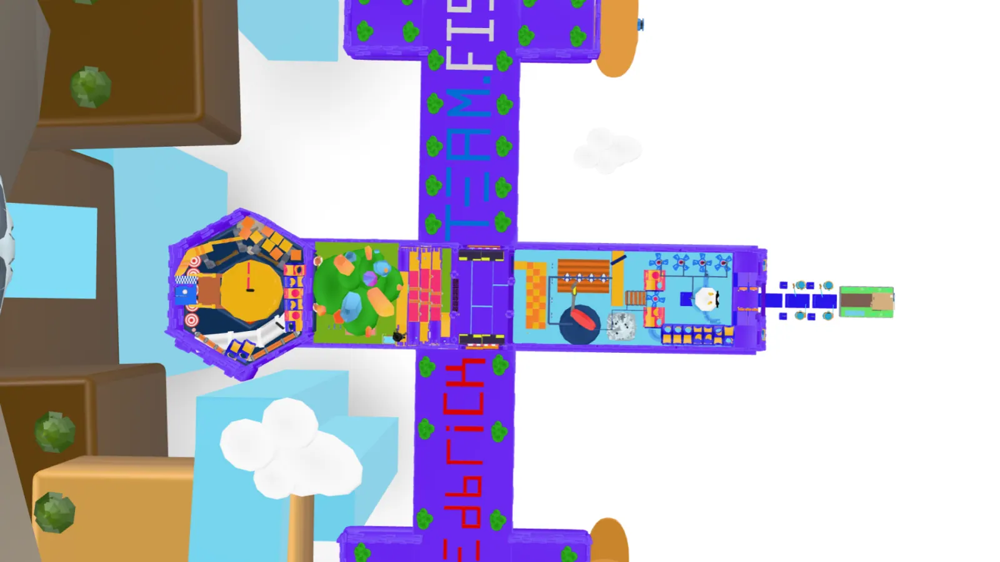
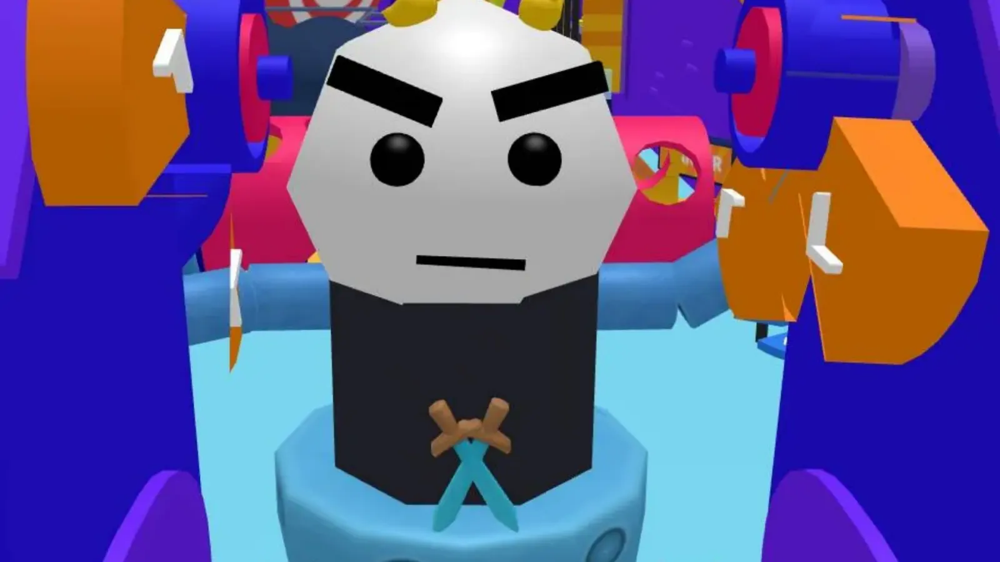

## 1. 프로젝트 개요
'2022 레드브릭 월드 챌린지 타임어택' 공모전 출품작입니다.
예능 '출발 드림팀'에서 영감을 받아, 동화 속 장애물들을 피해 목적지(학교)까지 가장 빠르게 도달해야 하는 **타임어택 레이싱 월드**를 구축했습니다.

- **진행 기간:** 2022.04.18 ~ 2022.05.29
- **역할:** World Director (총괄) - 기획, 맵 디자인, 개발 전 과정 참여
- **성과:** 2022 레드브릭 월드 챌린지 타임어택 **수상**

## 2. 주요 기능
- **타임어택 시스템:** 장애물을 통과하여 결승점에 도달하는 시간을 측정하는 레이싱 로직
- **다양한 테마:** 세계 각국의 대표 동화를 모티브로 한 장애물 코스 설계
- **스폰 시스템:** 게임 시작 및 리스폰 시 지정된 3D 좌표로 플레이어를 이동시키는 로직 구현

## 3. 기술적 경험 (Engineering & Collaboration)
이 프로젝트의 핵심은 **올라운더(All-rounder) 협업**입니다.

### 크로스 펑셔널 팀(Cross-functional Team) 운영
총 4명의 팀원이 기획, 디자인, 개발의 경계 없이 모든 과정에 참여했습니다.
- **도전:** 팀원 각자가 구현하고 싶은 세계관(동화)이 달라 초기 컨셉 통일이 어려웠습니다.
- **해결:** Discord를 활용한 지속적인 아이디어 회의를 통해, 서로 다른 동화 테마들을 하나로 묶어줄 **비행정**이라는 메인 컨셉을 도출하고 융합했습니다.

### 공간 좌표 및 로직 설계
- **좌표 시스템 이해:** 시작점과 체크포인트, 도착점의 정확한 (x, y, z) 좌표를 계산하여 스폰 시스템을 구축했습니다.
- **경로 설계:** 플레이어가 최단 시간 내에 주파할 수 있는 '최적 경로'를 고려하여 장애물 난이도를 배치했습니다.

## 4. 개발 후기
모든 팀원이 기술과 기획을 함께 고민하는 과정에서, **아이디어를 기술적으로 실현 가능한 형태로 구체화**하는 커뮤니케이션 능력을 길렀습니다.

---

## 5. 월드 기획 PT 영상
Team.FIS의 프로젝트 기획 PT 영상입니다.

  <iframe 
    class="w-full h-full rounded-xl border border-neutral-800"
    src="https://www.youtube.com/embed/bU4PyNK7MZo" 
    title="Strange World Airship Project" 
    frameborder="0" 
    allow="accelerometer; autoplay; clipboard-write; encrypted-media; gyroscope; picture-in-picture" 
    allowfullscreen>
  </iframe>

## 6. 스크린샷

*Team.FIS 로고가 새겨진 비행정 형태의 전체 맵*

*맵을 지키는 로봇 캐릭터 (스노우)*
