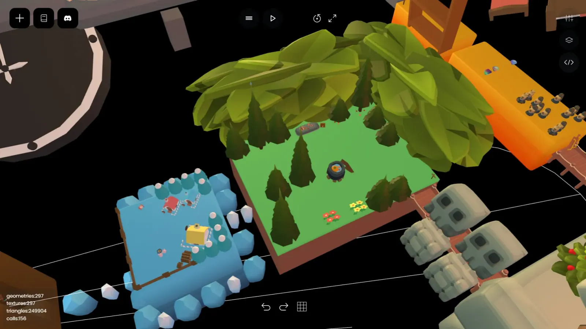

## 1. 프로젝트 개요
'2022 레드브릭 월드 챌린지 스핀오프' 공모전 출품작입니다.
동화 '이상한 나라의 앨리스'를 모티브로 하여, 몽환적이고 복합적인 3D 가상 공간을 구축했습니다. 플레이어가 앨리스가 되어 토끼 굴로 떨어지는 듯한 경험을 할 수 있도록 레벨을 디자인했습니다.

- **진행 기간:** 2022.01.28 ~ 2022.02.24
- **역할:** 1인 개발 (World Director) - 기획, 맵 디자인, 스크립팅
- **성과:** 2022 레드브릭 월드 챌린지 스핀오프 **장려상 수상**

## 2. 주요 구성 (Level Design)
원작의 '혼란스럽지만 매끄러운' 느낌을 살리기 위해 구역별로 테마를 나누고 유기적으로 연결했습니다.

- **낙하 구역 (Falling Zone):** 앨리스가 굴러떨어지는 도입부를 구현하기 위해, 수직으로 긴 공간에 시계, 가구, 책 등을 불규칙하게 배치하여 원작의 분위기를 연출했습니다.
- **테마 구역:** 얼음 구역, 마녀의 숲, 장난감 공장 등 서로 다른 컨셉의 공간을 배치하고 플레이어의 동선을 유도했습니다.
- **스폰 시스템:** 게임 시작 시 플레이어가 기획된 좌표에서 정확히 시작하도록 스크립트를 구현했습니다.

## 3. 기술적 도전 (Spatial Design)
이 프로젝트는 **3D 공간 구성 능력**을 기르는 계기가 되었습니다.

### 디자인 감각의 공학적 보완
전문적인 아트 리소스를 제작할 수 없는 환경이었기에, **엔지니어링적 접근**으로 문제를 해결했습니다.
- **레퍼런스 분석:** 유튜브와 3D 레퍼런스를 분석하여 공간감을 익혔습니다.
- **에셋 활용:** 제공된 에셋(Asset)들을 창의적으로 조합하고 배치하여, 새로운 오브젝트를 모델링하지 않고도 독창적인 월드를 구성했습니다.

## 4. 개발 경험
- **3D 툴 숙련도 향상:** 3D 오브젝트의 좌표(X, Y, Z), 회전, 스케일을 다루며 공간 지각 능력을 키웠습니다. 이는 추후 로봇 시뮬레이션 환경(Gazebo, Unity)을 구축하는 데 밑거름이 되었습니다.
- **기획의 시각화:** 머릿속의 아이디어를 스케치하고, 이를 실제 3D 월드로 구현해내는 전체 프로세스를 경험했습니다.

---

## 5. 월드 스크린샷

*다양한 테마가 어우러진 월드 전경 (얼음 구역, 숲, 공장)*

## 6. 데모 영상

  <iframe 
    class="w-full h-full rounded-xl"
    src="https://www.youtube.com/embed/YPRg0TyHKo0?si=mvM7UjSXUEU1gfrF"
    title="Minecraft RPG Project" 
    frameborder="0" 
    allow="accelerometer; autoplay; clipboard-write; encrypted-media; gyroscope; picture-in-picture" 
    allowfullscreen>
  </iframe>

