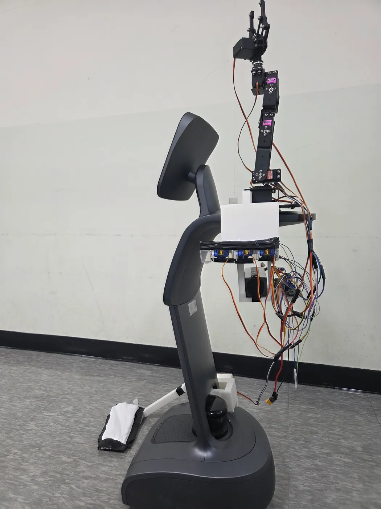
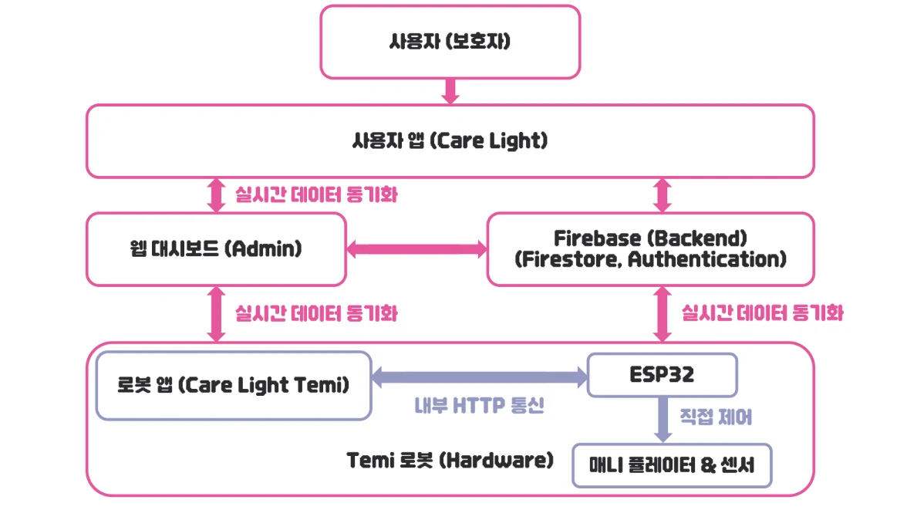
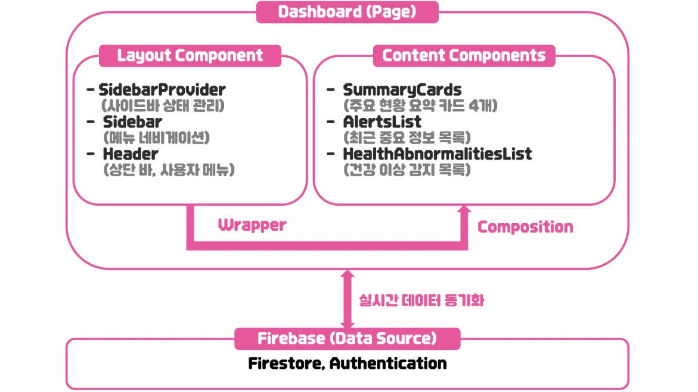
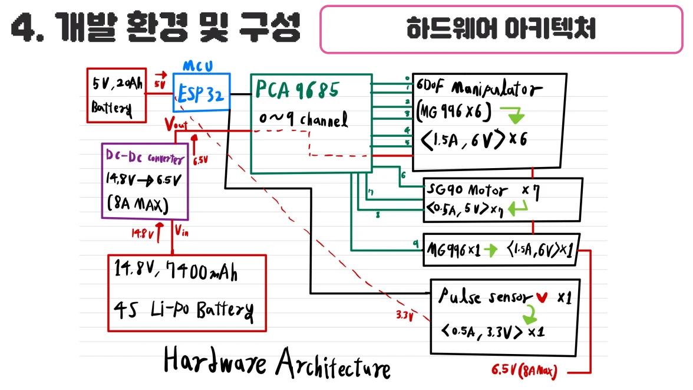

## 1. 프로젝트 개요
'모바일로봇의이해' 수업의 팀 프로젝트(팀명: 빛이되길바라)로 개발한 **어르신 돌봄 로봇 서비스 Care Light** 입니다.
초고령 사회에서 돌봄 공백이 커지는 문제에 주목했습니다. 기존의 사람 중심 돌봄, 사물인터넷(응급 호출기, 센서), 영상(CCTV) 방식이 채우지 못하는 **이동성, 양방향 소통, 정서적 교감**을 로봇으로 보완하는 것이 목표였습니다.

- **과목:** 모바일로봇의이해 (2025)
- **개발 기간:** 2025년 5월 ~ 6월 (8주)
- **최종 발표:** 2025.06.20
- **팀:** 3인 팀 (앱·웹과 데이터베이스 / 하드웨어 설계와 회로, 저수준 제어 / 3D 하드웨어 설계와 구동으로 역할 분담)
- **내 역할:** 안드로이드 앱 2종(사용자 앱, 로봇 앱)과 웹 대시보드 개발, Firebase 데이터베이스 설계, ESP32 서버 펌웨어
- **예산:** 약 30만 원, 독거노인이 사는 평평한 실내 환경을 전제로 했습니다.

## 2. 핵심 목표
- **SMART SAFETY:** 음성 기반 긴급 호출과 원격 모니터링으로 24시간 안전 확보
- **WARM CONNECT:** 맞춤형 콘텐츠 제공으로 정서적 고립 해소
- **EASY CONTROL:** 직관적인 앱으로 보호자의 돌봄 부담 경감

## 3. 주요 기능
- **건강 매니저:** 약 복용 시간을 음성과 화면으로 반복 알림
- **말벗:** 텍스트나 음성으로 대화(Perplexity Sonar 모델 기반 챗봇)
- **청소:** 버튼 하나로 로봇이 사용자 위치로 이동해 매니퓰레이터로 테이블 청소
- **로봇 호출:** 사용자 위치 또는 등록한 장소로 로봇 호출
- **심박수 측정:** 로봇에 부착한 센서로 측정해 화면에 표시하고 DB에 저장
- **관리자 웹 대시보드:** 사용자 등록·수정·삭제, 로봇 상태 확인, 약 복용 상태 등 건강 모니터링

## 4. 시스템 구성
시스템을 **Firebase를 중심 허브로 둔 허브 앤 스포크(Hub-and-Spoke) 구조**로 설계했습니다. 사용자 앱(보호자), 로봇 앱(Temi), 웹 대시보드(관리자), 커스텀 하드웨어가 Firebase를 통해 상태를 공유하고 명령을 주고받습니다. 각 구성 요소는 자기 역할에만 집중하고, 새 기능이나 장치를 추가하기 쉽습니다.

| 구성 | 사용 기술 |
|---|---|
| 사용자 앱 (Care Light) | Android (Java) |
| 로봇 앱 (Care Light Temi) | Android (Java), Temi SDK |
| 웹 대시보드 (Admin) | Next.js, TypeScript, shadcn/ui |
| 백엔드 | Firebase (Firestore, Authentication) |
| 로봇 플랫폼 | Temi (3D LiDAR 자율 주행, 4개의 디지털 마이크) |
| 커스텀 하드웨어 | ESP32-S3-WROOM-1, PCA9685 서보 드라이버, 6축 매니퓰레이터 (약통 SG90, 청소와 매니퓰레이터 MG996R) |
| 통신 | Wi-Fi(HTTP), okhttp |
| 도구 | SolidWorks, Arduino IDE, Android Studio, Git/GitHub |

사용자 앱, 로봇 앱, 웹 대시보드는 **Firestore 실시간 리스너로 데이터를 동기화**하고, 로봇 앱은 ESP32와 내부 HTTP 통신으로 매니퓰레이터와 약통을 제어합니다.

## 5. 내가 맡은 일
- **사용자 앱(Care Light)과 로봇 앱(Care Light Temi) 개발:** 로그인과 회원가입, 홈 화면, 로봇 호출, 챗봇, 심박수 측정 요청, 개발자용 수동 제어 화면
- **관리자 웹 대시보드 개발:** 요약 카드, 최근 알림, 건강 이상 감지 목록, 사용자 CRUD. UI 초안은 AI 도구(v0.dev)로 만들고, Firebase 연동 로직과 이벤트 핸들러는 직접 구현했습니다.
- **데이터베이스 설계:** Firestore의 `users` 컬렉션에 보호자, 어르신, 로봇 정보를 모으고, 앱의 조회 패턴에 맞춰 일부를 의도적으로 중복시켰습니다.
- **ESP32 서버 펌웨어:** 앱의 HTTP 요청을 받는 서버를 구축했고, 서보 모터 제어와 센서 읽기 같은 저수준 제어는 하드웨어 담당 팀원이 이 베이스 위에 구현했습니다.

## 6. 구현 하이라이트
### 실시간 양방향 동기화
모든 클라이언트는 Firestore 문서에 `addSnapshotListener`를 걸어 변경을 즉시 받습니다. 사용자 앱이 `temiCommand` 필드에 명령(예: `{"command": "goToLocation", "parameters": {"location": "거실"}}`)을 쓰면 로봇 앱의 리스너가 이를 파싱해 Temi SDK(`goTo`, TTS)나 ESP32 HTTP 요청으로 실행하고, 배터리, 위치, 동작 상태를 `robotState`에 다시 보고합니다. 사용자 앱과 대시보드는 이 값을 새로고침 없이 화면에 반영합니다.

### 조이스틱처럼 누르는 동안만 움직이는 수동 제어
복잡한 자율 주행에 앞서 통신과 구동을 검증하려고 개발자용 `DebugActivity`를 만들었습니다. `OnTouchListener`로 버튼을 누르고 있는 동안 150ms 간격으로 이동 명령을 보내고, 손을 떼면 즉시 정지 명령을 보냅니다. 이후 만든 '위치로 이동', '사용자 호출'의 기반이 됐습니다.

### 심박수 데이터 흐름
`앱 → ESP32 → 앱 → Firestore → 모든 클라이언트` 순서로 흐릅니다. 앱이 ESP32에 HTTP로 BPM 값을 요청해 받으면 화면을 직접 바꾸지 않고 Firestore의 `heartRate` 필드를 갱신하고, 이 변경이 리스너로 앱과 대시보드에 퍼집니다. 데이터를 단일 원천(Single Source of Truth)에 모으기 위한 설계입니다.

### AI 챗봇과 음성 루프
Perplexity의 `sonar-pro` 모델로 챗봇을 만들었습니다. 텍스트 또는 음성으로 입력하면 응답을 채팅 화면에 보여 주고, 동시에 `speak` 명령으로 Firestore에 보내 로봇이 Temi TTS로 읽어 줍니다. 페르소나는 `PromptFormatter` 클래스로 관리합니다(문제 해결 참고).

### 대시보드
`getCountFromServer`로 문서를 내려받지 않고 개수만 집계해 비용과 네트워크 사용량을 줄였고, `status` 가 `Caution` 또는 `Danger` 로 바뀐 사용자를 `onSnapshot` 으로 실시간 감지해 '심박수 이상 사용자' 목록에 보여 줍니다. 화면은 레이아웃과 콘텐츠 컴포넌트를 조합하는 컴포넌트 기반 구조입니다.

<!-- TODO(작성자 확인): 사용자 앱(홈, 로봇 호출, 챗봇)과 대시보드(메인, 사용자 관리) 화면 캡처를 보내 주시면 이 섹션에 넣겠습니다. -->

## 7. 하드웨어
- **설계와 제작:** SolidWorks로 설계해 Ultimaker S5 Pro 등으로 ABS를 출력했고, 인두로 표면을 다듬고 지지대를 제거했습니다. 매니퓰레이터는 Temi 상단 왼쪽에 고정하고 양쪽에 3D 프린트 부품을 두어 움직일 때 기울지 않게 했습니다.
- **회로:** ESP32가 I2C로 PCA9685 서보 드라이버(서보 10개: MG996R 7개, SG90 3개)와 심박수 센서를 제어합니다. 서보 전원은 7400mAh 리튬 배터리(14.8V)를 DC-DC 컨버터(6.5V, 최대 8A)로 낮춰 공급하고, ESP32는 별도의 5V 보조 배터리로 구동합니다.

- **매니퓰레이터 제어:** 처음에는 역기구학(IK)으로 제어하려 했지만 해석과 학습에 시간이 많이 들어, 책상 높이와 매니퓰레이터 위치를 고려해 **각도 값을 직접 넣고 디버깅하는 방식**으로 구현했습니다.

## 8. 문제 해결
### 하드웨어
- **3D 프린트 오차와 가공:** SolidWorks와 3D 프린팅 경험이 없어 한 번에 정확한 치수로 뽑지 못했습니다. 5월 2주차부터 6월 1주차까지 약 9차례 설계와 출력을 반복하며 모터와 매니퓰레이터 체결부, 배터리와 회로 공간을 완성했습니다. 그래도 조립 때 치수 오차와 나사 구멍이 뚫리지 않은 부품이 나와서, 직접 타공하고 인두로 녹이거나 톱으로 잘라 맞췄습니다.
- **로봇 전력 인가:** 보조 배터리 2개(20000mAh, 5V)로 모든 모터와 센서를 구동할 수 있을 줄 알았지만 아니었습니다. 검색, AI 챗봇, 교수님과 선배들의 조언을 모아 7400mAh 14.8V 배터리와 정격 8A DC-DC 컨버터로 방향을 잡았고, 컨버터 가변저항을 조정해 MG996R 약 6V, SG90 약 5.5V를 일정하게 공급했습니다. 이 과정에서 리튬 배터리의 보관, 충전, 사용법도 익혔습니다.

### 소프트웨어
- **스플래시 화면의 경쟁 상태(Race Condition):** 2초 타이머와 Firebase 로그인 확인이 비동기로 동시에 끝나 화면 전환이 중복되거나 어긋났습니다. 플래그 변수 두 개(`isSplashTimeOver`, `isNavigated`)와 `synchronized`로 "타이머가 끝났고 아직 전환하지 않았을 때"만 단 한 번 전환하도록 고쳤습니다.
- **챗봇의 페르소나 이탈:** "안녕"에도 사전적 의미를 설명하는 식의 딱딱한 답이 나왔습니다. 요청 맨 앞에 `system` 프롬프트로 "어르신을 위한 따뜻한 대화 친구 로봇" 역할과 존댓말, 공감하는 말투를 정의하고, 이상적인 질문과 답변 예시를 함께 보내는 퓨샷 프롬프팅을 적용해 어조를 안정시켰습니다.
- **ESP32와 로봇 앱 사이의 Wi-Fi 통신 불안정:** HTTP 요청이 자주 타임아웃됐습니다. 원인을 단계적으로 좁혀 ESP32가 **2.4GHz만 지원**한다는 점, 휴대폰 핫스팟의 절전 기능과 클라이언트 격리가 통신을 방해한다는 점을 확인했습니다. 추가 하드웨어 없이 핫스팟 절전을 끄고, ESP32의 IP를 시리얼 모니터로 확인해 앱의 `SharedPreferences`에 저장하고, `okhttp` 타임아웃을 늘려서 안정화했습니다.

## 9. 시연 시나리오
1. **로봇 호출:** 사용자가 '호출하기'를 누르면 Care Light가 사용자 위치로 이동
2. **특정 위치로 호출:** 앱에 등록한 장소 중 하나를 선택해 로봇을 이동
3. **약 복용 확인:** 약 복용 알림 후 '약 가져오기'를 누르면 로봇이 이동하고, 도착해 손을 감지하면 약통을 개방
4. **주변 환경 청소:** 사용자가 지정한 위치로 이동해 매니퓰레이터로 테이블 청소
5. **심박수 측정:** 센서에 손가락을 대면 심박수를 화면에 표시하고 DB에 저장, 대시보드에서 확인
6. **의사소통:** 텍스트나 음성으로 말하면 Sonar 모델 기반으로 응답
7. **관리자 대시보드:** 로그인, 사용자 정보 확인, 사용자 추가와 삭제

## 10. 결과와 한계
제안서에서 구상한 기능 대부분을 구현했고, 클라이언트 여러 개를 개발해 서로 통신하는 데까지 완성했습니다. 약 복용 알림과 확인, 로봇 호출, 청소, 심박수 모니터링, 관리자 대시보드가 이 프로젝트의 차별점입니다.

- **통합 생태계:** 앱 하나나 로봇 하나가 아니라 [사용자 앱] - [로봇 앱] - [웹 대시보드] - [커스텀 하드웨어]가 함께 동작합니다.
- **능동적 케어:** 고정 센서나 CCTV처럼 기다리지 않고, 로봇이 직접 다가가 말을 걸고 청소나 약 전달 같은 물리적 임무를 수행합니다.
- **한계:** Temi 기본 기능에 의존하는 부분이 크고, 매니퓰레이터의 정밀도와 안정성이 부족하며, 복잡한 장애물이나 동적 환경에는 대응이 약합니다. 심박수와 약 복용 패턴만으로 건강 상태를 정확히 판단하기도 어렵습니다.
- **향후 방향:** 지능형 낙상 및 응급 상황 감지, AI 기반 생활 패턴 분석, 감성 대화 AI, 가족 앨범과 소식 공유, 더 정밀한 매니퓰레이터 동작, 다양한 IoT 헬스케어 기기 연동, 병원과 요양 시설 같은 B2B 확장을 계획했습니다.

## 11. 회고
세 명이 모든 것을 구현하기는 쉽지 않다는 것을 느꼈고, 저수준 제어를 팀원에게 믿고 맡길 수 있어서 매니퓰레이터와 센서 제어까지 기한 안에 끝낼 수 있었습니다. 이번에는 실패가 두렵지 않았고, 해 보고 싶은 것을 마음껏 시도했습니다. 의견이 부딪혀도 한 걸음 물러서 공통의 목표를 향하는 팀이 가장 좋은 팀이라는 것도 다시 느꼈습니다.
AI로 UI 프로토타입을 빠르게 만들되, 생성된 코드를 이해하고 핵심 로직은 직접 고쳐 가며 쓰는 방식이 개발 속도를 올려 준다는 것도 경험했습니다.

---

## 12. 데모 영상
<!-- TODO: 유튜브 영상 주소를 알려 주시면 아래 형식으로 넣습니다.

  <iframe class="w-full h-full rounded-xl" src="https://www.youtube.com/embed/영상ID" title="Care Light Demo" frameborder="0" allowfullscreen></iframe>

-->
