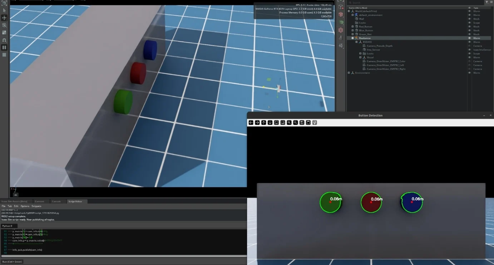
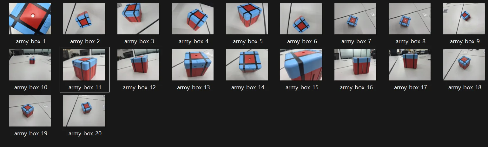

<!-- TODO(작성자 확인): (1) 상자 라벨링·YOLO 학습이 극한 미션 4(구호 물품)용이었는지, 팀원과 어떻게 나눠 했는지 확인해 주세요. (2) 같은 폴더의 `isaacsim-realsense-detection.mp4`도 글에 넣을지 알려 주세요. 영상 속 RViz 제목줄에 로컬 경로(사용자 이름, 저장소 이름)가 작게 보입니다. (3) 미션 번호(3, 4)와 미션 환경 설명이 공개해도 되는 수준인지 확인해 주세요. (4) 시뮬레이션 이후 단계(좌표 표시 등)를 어디까지 했는지 알려 주세요. -->
## 1. 프로젝트 개요
학생자치기구 ROBIT 지능팀에서 **극한로봇경진대회**(2025년 9월 30일~10월 2일, 코엑스)를 준비하면서 **Isaac Sim 시뮬레이션**과 **비전**을 맡았습니다. 배선이나 임베디드 쪽 작업은 이 해에는 제 담당이 아니었습니다.

- **기간:** 2025년 7월
- **내 역할:** Isaac Sim 미션 환경과 RealSense 카메라 구성, 색 버튼 감지와 거리 측정 시험, 구호 물품 인식용 YOLO 학습(팀원과 함께)
- **팀 성과:** ROBIT 팀은 이 대회 극한로봇 부문에서 **대상(서울시장상)** 을 받았습니다. 같은 해 국방로봇경진대회(2025년 9월 13~14일)에서도 대상을 받았고 2026년에도 이어서 받아 **2연속 대상**이 되었습니다. 이것은 팀 전체의 성과입니다.

## 2. 시뮬레이션: Isaac Sim에서 미션 환경 만들기
대회 미션의 환경을 Isaac Sim에 비슷하게 구성해서, 카메라 인식 알고리즘을 시뮬레이션에서 먼저 시험했습니다.

- **환경 구성:** 색이 다른 버튼이 달린 패널과 RealSense D455 카메라 모델을 씬에 배치했습니다.
- **카메라 데이터를 ROS 2로 내보내기:** 일반 카메라는 Action Graph로 노드를 구성해 데이터를 내보냈습니다. 그런데 RealSense 모델은 이 방식에 대한 자료가 부족해서, **Script Editor에 코드를 직접 넣어** 이미지 데이터를 받아 왔습니다.
- **모션 플래닝으로 팔을 움직이며 비전 확인:** 앞서 만든 Isaac Sim ROS 2 모션 플래닝(MoveIt 2) 패키지의 매니퓰레이터를 같은 환경에 더했습니다. RViz에서 계획한 대로 팔이 움직이면 카메라 시점도 바뀌는데, 그런 상태에서도 **버튼 감지와 거리 표시가 계속 동작하는지** 시뮬레이션에서 확인했습니다. → [Isaac Sim ROS 2 매니퓰레이터 제어](/projects/isaac-ros2-control-manipulator/)

<video controls muted playsinline preload="metadata" src="/videos/isaacsim-motion-planning-vision.mp4"></video>

Isaac Sim 화면(위), RViz의 모션 플래닝(왼쪽 아래), 버튼 감지 화면(오른쪽 아래)입니다. 팔이 버튼에 가까워질수록 표시되는 거리가 줄어듭니다.

## 3. 비전
### 버튼 감지와 거리 측정
- 실제 대회에서는 RealSense D435로 미션을 수행하는 것이 목표였고, 시뮬레이션에서는 D455 모델에 내장된 RGB 카메라와 깊이 카메라를 사용했습니다.
- **색으로 버튼을 구분하고, 깊이 값으로 각 버튼까지의 거리를 화면에 표시**하는 것까지 완료했습니다.
- 개발 환경(RealSense SDK, Qt)을 세팅하고, 팀원이 먼저 구성해 둔 RealSense 패키지를 가져와 그 위에 미션 수행 알고리즘을 구현하는 방식으로 진행했습니다.

### 구호 물품 인식 (YOLO)
- 팀원과 함께 상자를 촬영해 라벨링하고, Darknet으로 YOLOv4-tiny와 YOLOv7-tiny 모델을 학습했습니다.
- 인식된 바운딩 박스의 **중앙점 좌표**를 구하는 것까지 구현했습니다.
- 학습 중 `.conv`(사전 학습된 시작 가중치)와 `.weights`(학습이 끝난 가중치)의 쓰임을 혼동하기 쉬워서, 새로 학습을 시작할 때와 이어서 학습할 때 쓰는 파일을 문서로 정리했습니다.

## 4. 한계와 배운 점
- 시뮬레이션의 거리 측정은 정밀도가 아직 부족해서, **영역을 더 세밀하게 나눠 데이터를 확보하는 일**과 **좌표 표시**가 다음 단계로 남아 있었습니다.
- Isaac Sim에서 센서 데이터를 ROS 2로 내보내는 방법은 센서마다 달랐고, 자료가 부족한 센서는 **스크립트로 직접 구현해야** 했습니다.
- 미션 환경을 비슷하게 만들어 두면, 실제 장비 없이도 인식 알고리즘의 흐름(색 구분 → 거리 계산 → 화면 표시)을 먼저 검증할 수 있었습니다.
- 데이터가 적은 상태에서도 파이프라인(촬영 → 라벨링 → 학습 → 좌표 추출)을 한 번 끝까지 돌려 보는 것이 이후 개선에 도움이 되었습니다.
