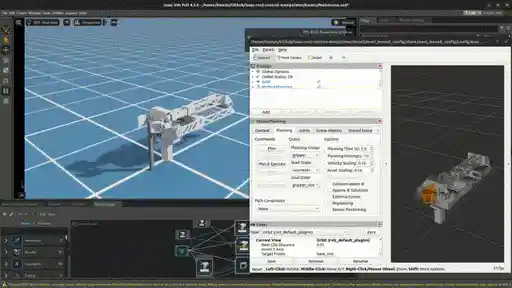
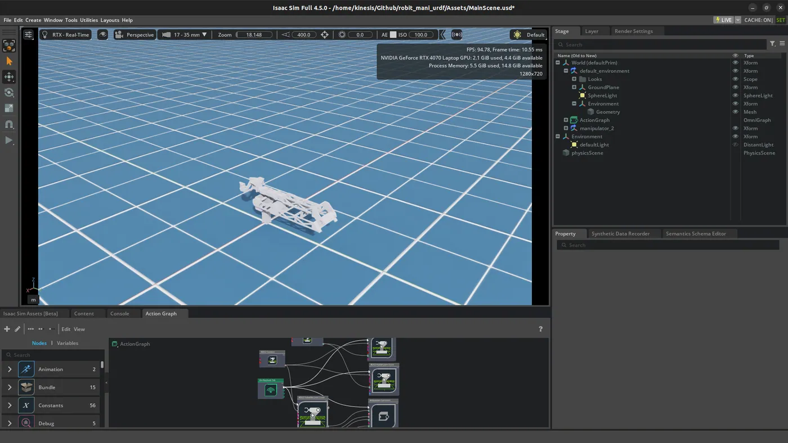
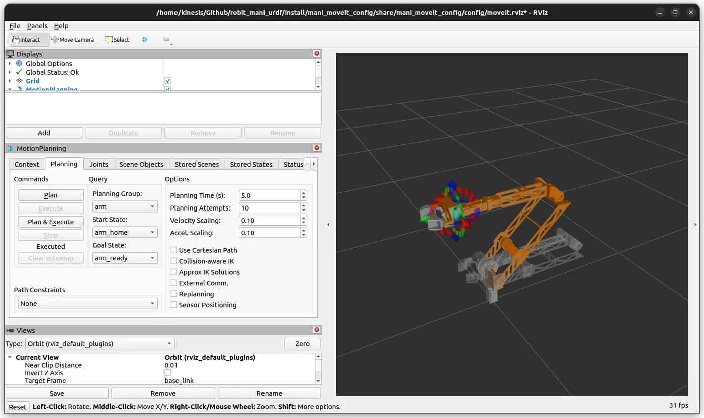

<!-- TODO(작성자 확인): 이 프로젝트의 배경(수업, 동아리, 연구실, 개인)과 목적을 알려 주시면 개요에 한 줄 추가합니다. 날짜는 저장소 커밋 기간(2025-02-20 ~ 02-24) 기준으로 넣었습니다. -->
## 1. 프로젝트 개요
이 패키지는 **매니퓰레이터를 Isaac Sim에 불러오고**, **RViz에서 설정한 모션 플래닝을 Isaac Sim과 동기화**해서 시뮬레이션 환경에서 매니퓰레이터를 제어합니다.
RViz에서 목표 자세를 지정하고 실행하면, Isaac Sim에 올려 둔 URDF 모델이 같은 동작을 따라 움직입니다.


*화면 왼쪽이 Isaac Sim, 오른쪽이 RViz(MoveIt 2) 입니다.*

- **내 역할:** 패키지 개발. 매니퓰레이터와 그리퍼의 설계는 각각 다른 팀원이 맡았습니다.
- **라이선스:** MIT
- **저장소:** [kinesis19/isaac-ros2-control-manipulator](https://github.com/kinesis19/isaac-ros2-control-manipulator)

## 2. 사용 기술
- **매니퓰레이터 모델:** 시뮬레이션에서 제어할 수 있도록 URDF로 변환한 6축 매니퓰레이터와 그리퍼(그리퍼 관절 5개)
- **시뮬레이션:** Isaac Sim 4.5.0
- **프레임워크:** ROS 2 Humble. MoveIt 2와 ros2_control로 RViz의 매니퓰레이터와 Isaac Sim의 매니퓰레이터를 동기화
- **환경:** Ubuntu 22.04

## 3. 구성과 동작 방식
### 구성
- **모션 플래닝(`mani_moveit_config`):** MoveIt Setup Assistant로 만든 설정 패키지입니다. 플래닝 그룹은 `arm`(Joint_1~6)과 `gripper`로 나누고, 역기구학은 KDL 솔버를 씁니다. `arm_home`, `arm_ready` 같은 이름 붙인 자세도 정의했습니다.
- **컨트롤러(ros2_control):** `arm_controller`와 `gripper_controller`를 `JointTrajectoryController`로 두고(100Hz), MoveIt이 `FollowJointTrajectory`로 궤적을 보냅니다. 관절 상태는 `joint_state_broadcaster`가 내보냅니다.
- **Isaac Sim 씬(`MainScene.usd`):** Action Graph에서 ROS 2 컨텍스트, 관절 상태 구독과 발행, Articulation Controller를 이어서 ROS 2 쪽 관절 값이 시뮬레이션의 매니퓰레이터를 움직이게 했습니다.



### 실행 순서
1. **ROS 도메인 ID 맞추기:** Isaac Sim의 Action Graph와 ROS 2 환경에 같은 `ROS_DOMAIN_ID`를 설정
2. **Isaac Sim 실행:** `MainScene.usd` 파일을 불러오기
3. **ROS 2 시작:** 워크스페이스를 source하고 모션 플래닝 노드를 실행
   ```bash
   ros2 launch mani_moveit_config demo.launch.py
   ```
4. **RViz에서 자세 지정:** 원하는 모션 플래닝 자세를 정하고 Plan & Execute를 실행하면 RViz와 Isaac Sim의 매니퓰레이터가 함께 움직입니다.



## 4. 팀
- 패키지 개발: 나
- 매니퓰레이터 설계: 팀원 1명
- 그리퍼 설계: 팀원 1명

현재는 시뮬레이션 단계이고, 실제 하드웨어(디지털 트윈) 연결은 아직 하지 않았습니다.
