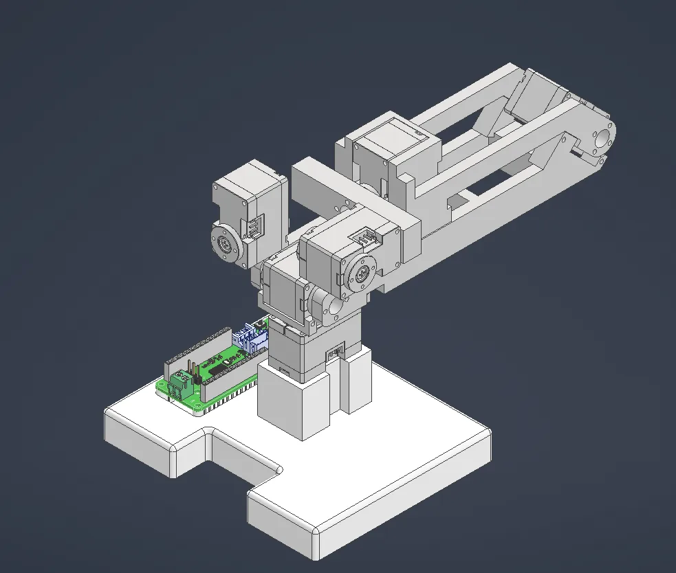
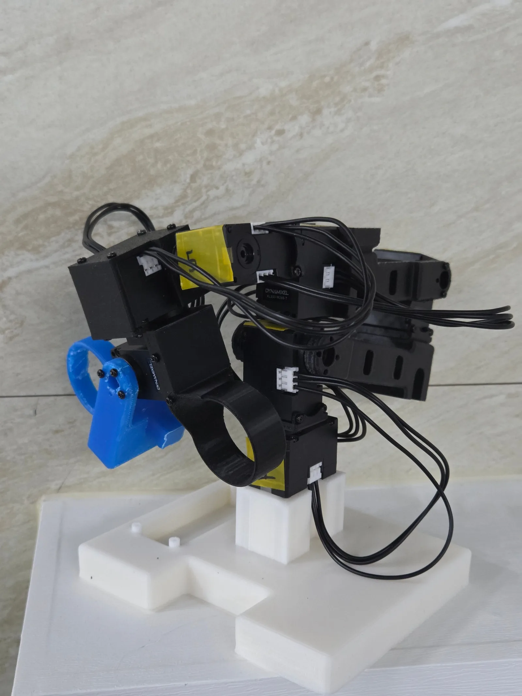
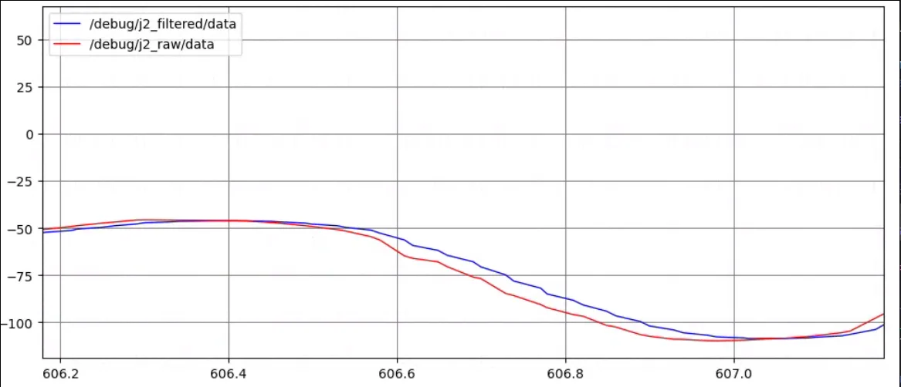
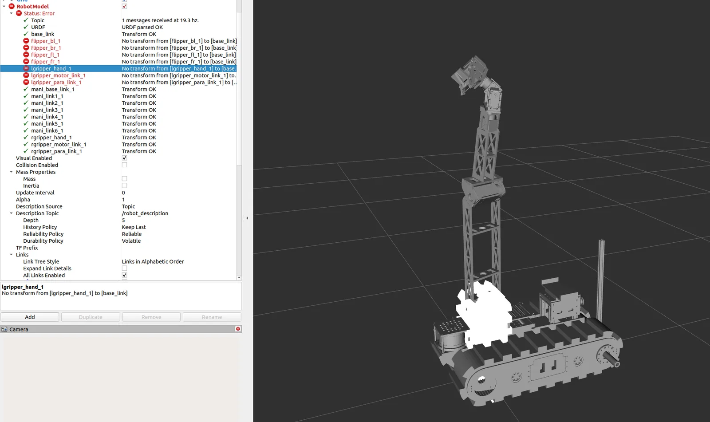

## 1. 프로젝트 개요
조이스틱이나 키보드로 매니퓰레이터를 조종하는 방식이 직관적이지 않다고 느껴서, 사람이 팔을 움직이는 대로 따라 움직이는 **텔레오퍼레이션용 리더 암**을 만들어 보았습니다. '로봇게임 세미나' 수업의 2025년 하반기 최종 과제로 진행했고, 설계부터 제작, 제어까지 혼자 했습니다.

- **기간:** 2025년 11월 ~ 12월
- **목표:** ROBIT이 가진 6축 매니퓰레이터(팔로워)와 같은 구조의 소형 6축 리더 암을 만들고, 제어기를 구현하기
- **구성:** OpenRB-150, Dynamixel XL330-M288-T 7개(그리퍼 포함), 3D 프린트 부품. 소프트웨어는 ROS 2, Python, Pinocchio 라이브러리
- **통신:** 시리얼 1Mbps

## 2. 하드웨어 설계
### 축소 비율
실제 팔의 2축 링크(436.856mm)를 150mm로 줄이는 비율(약 34.3%)을 전체에 적용하려고 했습니다. 그런데 액추에이터(XL330) 자체의 크기와 링크 최소 두께 때문에 말단의 5·6축에서는 이 비율을 지킬 수 없었습니다. 그래서 주요 링크(2·3축)에는 비율을 유지하고, 말단부는 구동 가능한 최소 크기로 다시 설계했습니다.

### 물리 파라미터
모터와 볼트는 데이터시트 값을 쓰고, 링크는 3D 슬라이서의 내부 채움 80% 설정을 기준으로 질량을 구했습니다. 모터를 포함한 질량은 2축 링크 49.34g, 3축 링크 45.85g입니다.

## 3. 소프트웨어
관절 값을 읽어서 중력을 보상하는 전류를 계산해 되돌려 주는 구조를 시도했습니다.

`XL330 엔코더 → 저역 통과 필터 → Pinocchio(RNEA) → XL330 전류 제어`

1. 시리얼로 7개 모터의 원시 위치값(0~4095)을 받습니다.
2. SI 단위(라디안)로 바꾸고 저역 통과 필터로 노이즈를 줄입니다.
3. Pinocchio의 RNEA(재귀 뉴턴-오일러) 알고리즘으로 중력 토크를 구합니다.
4. 토크(Nm)를 전류(mA)로 바꿔 모터에 보냅니다. 전류 한도는 300mA로 두었습니다.

URDF를 불러와 RViz에서 관절 값이 모델에 반영되는 것도 확인했습니다.

## 4. 한계와 배운 점
- **중력 보상은 완성하지 못했습니다.** 팔을 앞으로 길게 뻗으면 특정 각도에서 버티지 못하고 처지는 현상이 남았습니다. 축별 보정값을 조절했지만 해결되지 않았습니다.
- 원인으로는 모델링 오차와, 부하가 큰 자세에서 XL330의 토크가 부족할 가능성을 생각했습니다. 어느 쪽이 원인인지 분리해서 확인하지는 못했습니다.
- 결과적으로 이 프로젝트는 **하드웨어 제작과 관절 값 읽기·시각화**까지 마무리한 상태입니다. 실제 팔로워 매니퓰레이터를 이 리더 암으로 제어하는 데까지는 이어 가지 못했습니다.
- 큰 팔을 같은 비율로 줄이려 하면 액추에이터의 최소 크기 때문에 말단부 설계가 먼저 한계에 부딪힌다는 것을 배웠습니다.
