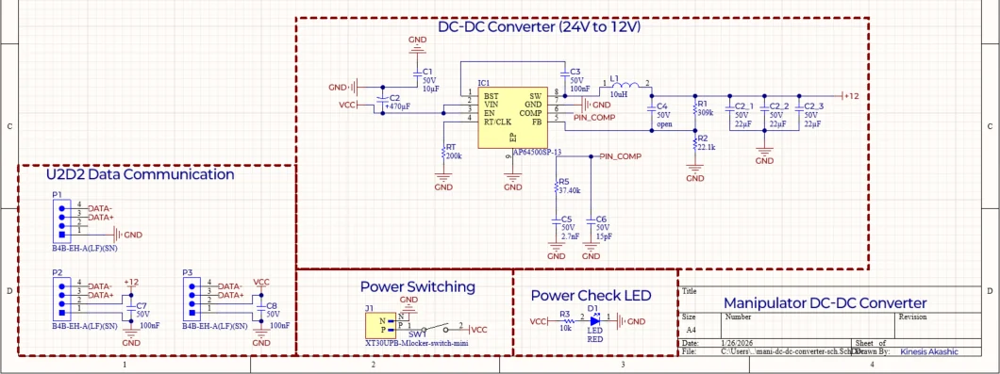
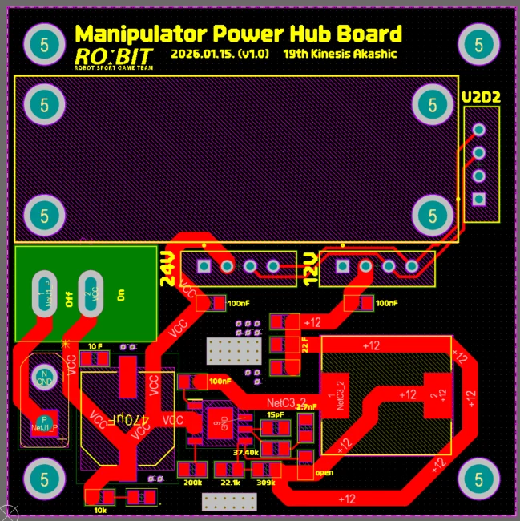
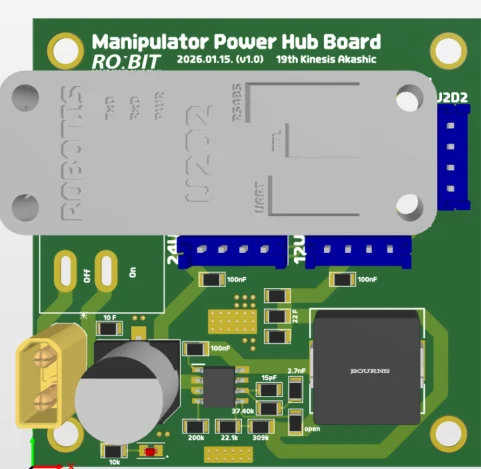
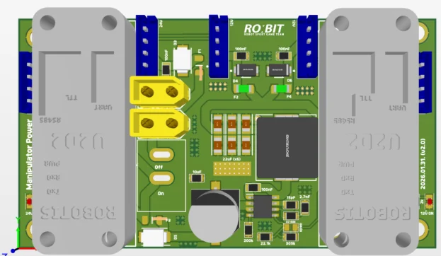
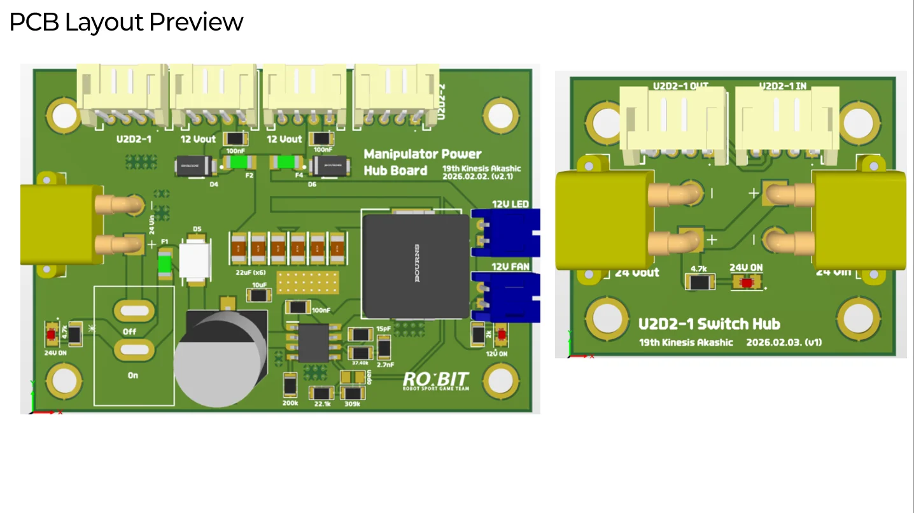
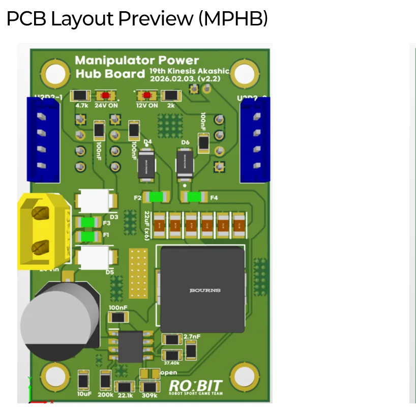

<!-- TODO(작성자 확인): 사양(입력·출력 전류, 효율), 실물 시험 결과(출력 전압, 리플, 부하, 온도)와 시험 사진, 만든 이유를 알려 주세요. 아래 시험 항목은 12V 출력 확인까지만 기록돼 있습니다. -->
## 1. 프로젝트 개요
MPHB(Manipulator Power Hub Board)는 **매니퓰레이터에 12V를 공급하기 위한 24V→12V DC-DC 컨버터 보드**입니다. 2026년에 처음으로 DC-DC 컨버터를 직접 설계해 만든 결과물이고, 시험하며 개정을 이어 갔습니다. 이 보드는 [RoboCup Rescue 2026](/projects/robocup-rescue-2026/)용 로봇의 전기 시스템에 포함되었습니다.

- **기간:** 2026년 1월 ~ 2월
- **내 역할:** 부품 선정, 회로도와 PCB 설계, 납땜과 시험
- **보드의 구성:** 24V→12V 벅(강압) 컨버터, 전원 스위치와 24V·12V 표시 LED, U2D2 통신용 커넥터, 12V 출력(통신 장치, LED, 팬)

## 2. 버전별 기록
| 버전 | 날짜 | 내용 |
|---|---|---|
| v1.0 | 2026-01-15 | 첫 설계. 컨버터 회로와 U2D2 데이터 통신 커넥터, 전원 스위치, 전원 확인 LED로 구성했습니다. U2D2 모듈을 보드에 직접 장착하는 형태였습니다. |
| v2.0 | 2026-01-31 | U2D2를 양쪽에 2개 장착할 수 있는 구성으로 확장했습니다. |
| v2.1 | 2026-02-02 | U2D2를 커넥터로 연결하는 방식으로 바꾸고, 12V 출력 단자와 LED·팬용 12V 단자를 추가했습니다. U2D2 연결용 스위치 허브 보드를 따로 만들었습니다. |
| v2.2 | 2026-02-03 | v2.1을 다시 개정한 레이아웃입니다. (세부 변경점은 정리해 추가할 예정) |

v2를 납땜해 **12V 출력이 나오는 것까지** 시험했습니다(2월 22일).

### v1.0

### v2.0 ~ v2.2

### v2 이후 발견해 개정한 점
- **전해 커패시터의 높이가 너무 큼.** PCB에 부품의 가로·세로 비율과 크기가 제대로 반영되지 않아서, 실제로 납땜하면 부품이 기판 위로 넘쳤습니다.
- **출력 구성 변경.** 사용하는 U2D2가 1개로 바뀌어서, 기존에 U2D2 하나를 위해 두었던 출력을 없애고 U2D2용 12V 출력을 2개로 바꾸어야 했습니다. 이를 반영한 v2.3 개정이 필요했습니다.

## 3. 배운 점
- PCB 라이브러리의 부품 크기가 실제 부품과 다르면 **납땜 단계에서야 문제가 드러납니다.** 발주 전에 높이와 실장 가능 여부를 확인하는 습관이 필요했습니다.
- 모터에 연결하기 전에는 커넥터와 극성을 먼저 시험합니다.
