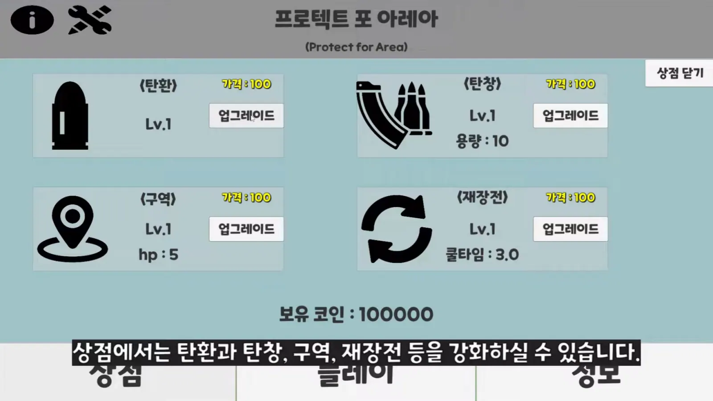
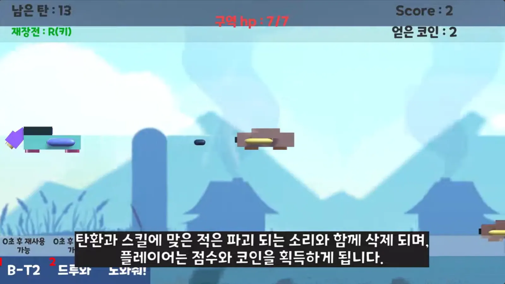

## 1. 프로젝트 개요
부천대 제펫스튜디오 '유니티 단기 아카데미'를 통해 5일간 집중적으로 개발한 3D 슈팅 디펜스 게임입니다.
몰려오는 외계 비행선으로부터 안전 구역(Area)을 지키는 것이 목표이며, 상점 시스템을 통해 기체를 업그레이드할 수 있습니다.

- **진행 기간:** 2022.01.10 ~ 2022.01.14 (5일)
- **역할:** 1인 개발 (기획, 3D 모델링, 개발)
- **성과:** 유니티 단기 아카데미 **장학생 선발**

## 2. 주요 기능
- **디펜스 시스템:** 구역 HP와 플레이어 생명력을 관리하며 적을 막아내는 웨이브 로직
- **상점 & 업그레이드:** 획득한 코인으로 탄환(스킬 해금), 탄창 용량, 구역 체력, 재장전 속도를 강화
- **무한 스크롤:** 배경을 무한히 스크롤시켜 비행하는 속도감과 몰입감 구현

## 3. 기술적 구현 (Engineering Logic)
이 프로젝트는 **데이터의 관리**와 **3D 공간의 이해**에 중점을 두었습니다.

### JSON 데이터 직렬화 (Data Persistence)
단순한 `PlayerPrefs`가 아닌, 확장성과 보안성이 높은 **JSON 방식**을 채택하여 게임 데이터를 관리했습니다.
- **구현:** 플레이어의 재화, 업그레이드 상태, 최고 점수 등을 JSON 파일로 직렬화(Serialize)하여 로컬에 저장하고 불러오는 시스템을 구축했습니다.
- **의의:** 구조화된 데이터 통신 방식에 대한 이해를 높였습니다.

### 3D 공간 좌표 제어 (Vector3 & Transform)
2D와 달리 Z축이 추가된 3D 환경에서의 오브젝트 제어를 익혔습니다.
- **학습:** `Vector3`와 `Quaternion`을 활용해 탄환의 발사 각도와 적의 이동 경로를 계산하고, `Transform` 컴포넌트로 실시간 위치를 제어했습니다.

## 4. 개발 경험
- **3D 모델링:** 플레이어 기체와 적 비행선을 직접 디자인하며 3D 리소스 제작 프로세스 경험
- **문제 해결:** 기존 클론 코딩 방식에서 벗어나, 구글링과 공식 문서를 통해 '나만의 기능(상점, 스킬)'을 직접 설계하고 응용하여 구현함

---

## 5. 플레이 화면

*JSON으로 데이터가 저장되는 상점 시스템*

*3D 공간에서 펼쳐지는 디펜스 전투*

## 6. 데모 영상

  <iframe 
    class="w-full h-full rounded-xl"
    src="https://www.youtube.com/embed/wUh_Z_ylrH8?si=qt-jsDK6tD3IB49p"
    title="Minecraft RPG Project" 
    frameborder="0" 
    allow="accelerometer; autoplay; clipboard-write; encrypted-media; gyroscope; picture-in-picture" 
    allowfullscreen>
  </iframe>

