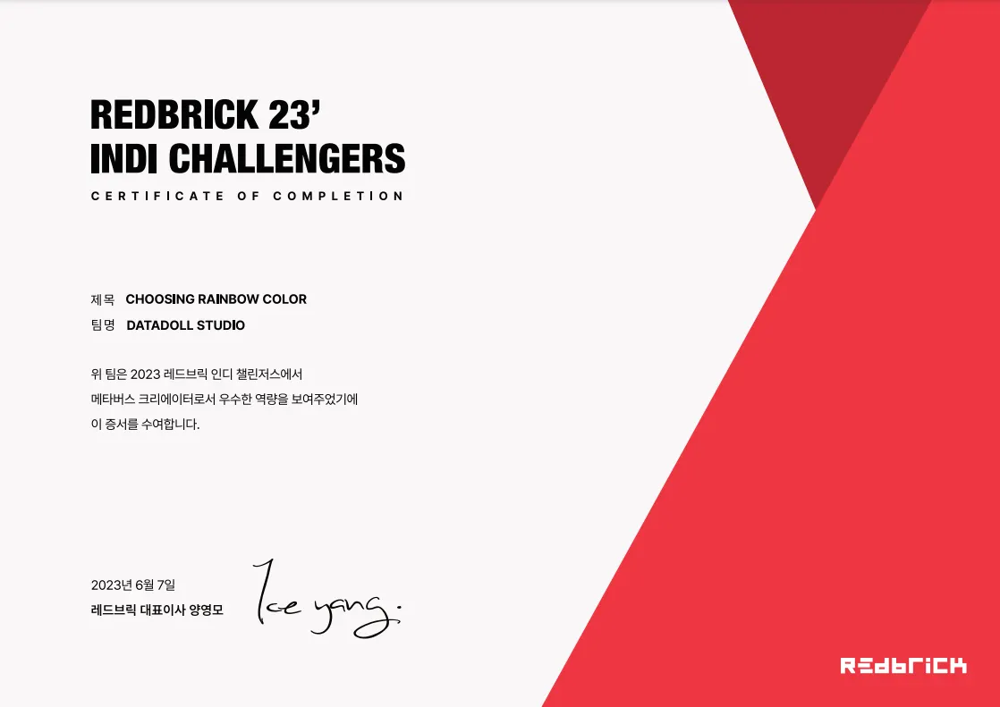

## 1. 프로젝트 개요
레드브릭(RedBrick)과 한국인디게임협회가 주관한 **인디 개발자 상생 프로젝트**에 선정된 3D 하이퍼 캐주얼 게임입니다.
제한 시간 내에 열쇠를 찾아내고, 무작위로 파괴되는 발판 위에서 살아남아야 하는 서바이벌 게임입니다. **'REDBRICK 23\' INDI CHALLENGERS'** 인증을 획득했습니다.

- **진행 기간:** 2023.02.27 ~ 2023.04.30
- **역할:** 1인 개발 (World Director) - 기획, 3D 월드 제작, 스크립팅
- **성과:** 2023 레드브릭 x 한국인디게임협회 **인디 개발자 상생 프로젝트 선정**

## 2. 핵심 로직 및 알고리즘 (Core Logic)
`script.js`에 구현된 주요 알고리즘과 엔지니어링 포인트입니다.

### 비동기 게임 루프 (Asynchronous Game Loop)
`setInterval` 함수를 활용하여 1초 단위로 게임 상태를 체크하는 코어 루프를 설계했습니다.
- **Timer & State Check:** 매초 타이머(`timerCount`)를 갱신하며, 제한 시간 종료 시 `clearInterval`로 루프를 제어합니다.
- **Win/Loss Condition:** 타이머 종료 시점에 `isKeyHave`(열쇠 보유 여부)와 `isPlayerTouchingFoothold`(발판 생존 여부)를 논리 연산자(`&&`)로 판단하여 라운드 승패를 결정합니다.

### 랜덤 스폰 알고리즘 (Randomized Spawning)
매 라운드마다 플레이어에게 새로운 경험을 제공하기 위해 위치 값을 난수화했습니다.
- **Key Spawning:** `getRandom(1, 7)`로 구역을 정하고, 2차 `getRandom(1, 3)`으로 세부 좌표(x, y, z)를 결정하여 예측 불가능한 위치에 열쇠를 생성합니다.
- **Map Destruction:** `aryFoothold` 배열에 난수 값을 할당하고, 특정 임계값(`> 7`)을 넘는 발판 객체(`objFoothold[i]`)를 `kill()` 메서드로 파괴하여 동적인 맵 변화를 구현했습니다.

### 객체 상호작용 및 이벤트 처리
- **Collision Detection:** `onCollide` 이벤트를 통해 플레이어와 발판/아이템 간의 접촉을 감지하고, `selectHoldNum` 변수로 현재 위치 상태를 실시간으로 관리했습니다.
- **Trap Mechanics:** 움직이는 장애물(`moveY`)과 회전하는 트랩(`rotateY`)의 좌표 연산을 통해 방해 요소를 구현했습니다.

## 3. 개발 경험
- **Project Lifecycle:** 기획부터 알고리즘 설계, 구현, QA, 공모전 출품까지 1인 개발의 전 과정을 완주했습니다.
- **JavaScript 활용:** 변수 스코프 관리, 배열 처리, 비동기 타이머 등 ES6 문법을 실제 게임 로직에 적용하며 언어 이해도를 높였습니다.

---

## 4. 플레이 영상
Choosing Rainbow Color 플레이 데모

  <iframe 
    class="w-full h-full rounded-xl border border-neutral-800"
    src="https://www.youtube.com/embed/9_hgpJxI2AE?si=xcCbtei_k81k_tJp" 
    title="Choosing Rainbow Color Gameplay" 
    frameborder="0" 
    allow="accelerometer; autoplay; clipboard-write; encrypted-media; gyroscope; picture-in-picture" 
    allowfullscreen>
  </iframe>

## 5. 수상 및 인증

*2023 REDBRICK INDI CHALLENGERS 인증서 (한국인디게임협회)*
