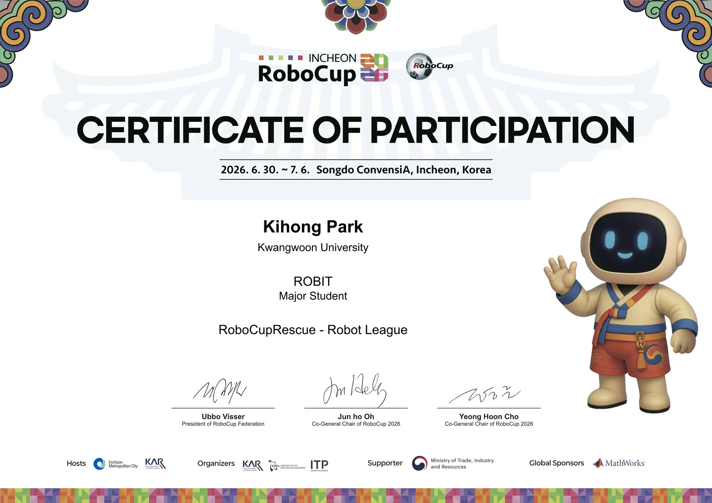

<!-- TODO(작성자 확인): 올린 인증서는 참가 인증서입니다. Best TDP 수상 인증서가 따로 있으면 알려 주세요. -->
## 1. 프로젝트 개요
**RoboCup 2026 인천**(2026년 6월 30일~7월 6일, 송도컨벤시아)의 Rescue Robot League에 출전한 ROBIT 팀에서, 로봇의 **배선과 회로**, 그리고 **오디오 패키지**를 맡았습니다.

- **결과(팀):** 세미파이널에 진출해 최종 **9위**, **Best TDP** 부문 수상
- **내 역할:** 전원 분배와 배선 설계, 필요한 보드와 DC-DC 컨버터의 설계·제작·발주, 오디오 패키지 개발
- Best TDP는 순위 상과 별개로, 팀 소개 논문(TDP, Team Description Paper)을 잘 쓴 팀에 주는 부문입니다.

> 이 시스템은 후배들이 이어서 쓰고 개선하는 시스템이어서, **구성값과 세부 설계는 공개하지 않고** 설계 판단과 결과 위주로 적습니다. 주제별 자세한 이야기는 아래 글들로 나누어 정리했습니다.

## 2. 규정 분석과 요구사항 정리
대회 준비의 첫 단계로 규정을 정독해 득점 항목을 정리하고, 번역본을 만들어 팀이 바로 쓸 수 있게 공유했습니다. (규정집 원문은 이 글에 싣지 않습니다.)

TDP에 쓸 하드웨어 사양을 정하면서 오퍼레이터 박스의 회로가 필요한 이유를 이렇게 정리했습니다.
- 단순한 모터 제어를 넘어 **데이터 수신 속도를 높이고**, 센서를 더 달 수 있는 **확장성**을 확보한다.
- 배터리 상태를 오퍼레이터 화면에서 볼 수 있도록 **전압 모니터링** 기능을 넣는다.
- 문제가 생기면 바로 뽑았다 꽂을 수 있도록 **유지보수성**을 높인다.

## 3. 맡은 일, 주제별 글
| 주제 | 글 |
|---|---|
| 전원 분배·배선·보드 설계 | [로봇 전장 설계](/projects/robot-electrical-architecture/) |
| DC-DC 변환 보드 | [MPHB](/projects/mphb-dc-dc-converter/) |
| 양방향 오디오 | [2-Way Audio](/projects/two-way-audio/) |

같은 전장 설계를 이후 [국방로봇경진대회 2026](/projects/defense-robot-2026-electrical-comm/)에도 적용했고, 팀은 그 대회에서 대상을 받았습니다.

<video controls muted playsinline preload="metadata" src="/videos/operator-station-demo.mp4"></video>

오퍼레이터 스테이션을 시연하는 장면입니다.

## 4. 참가 인증서

## 5. 한계와 배운 점
- 전기 시스템을 보드 단위로 나누면 고장 난 부분만 교체할 수 있지만, **보드 수가 늘어 커넥터와 배선 검증 부담이 커졌습니다.**
- 부품의 실제 크기가 PCB에 제대로 반영되지 않으면 납땜 단계에서야 문제가 드러납니다. 발주 전에 부품 높이와 실장 가능 여부를 확인하는 단계를 두어야 합니다.
