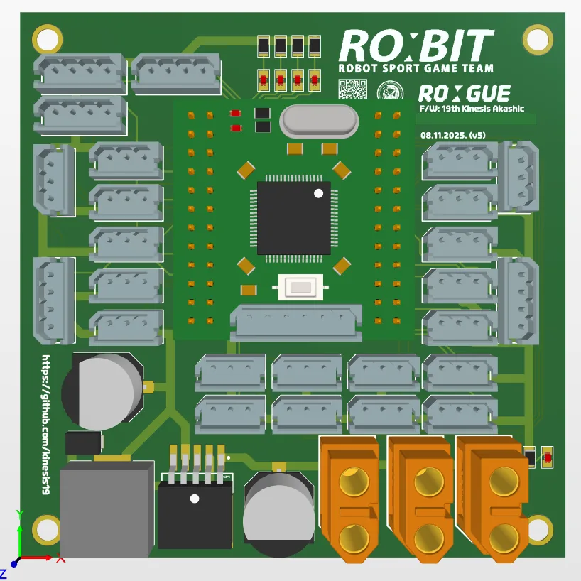

## 1. 프로젝트 개요
광운대학교가 주관한 **IRC 지능로봇대회의 씨름로봇 부문**에 출전하는 로봇 한 대를 설계하고 제작했습니다. 씨름로봇은 상대 로봇을 경기장 밖으로 밀어내 점수를 얻는 경기입니다. ROBIT에서는 두 팀이 출전했고, 제가 속한 팀이 **4위**를 했습니다.

- **기간:** 2025년 6월 ~ 11월
- **내 역할:** 로봇 1대의 설계와 제작(회로 설계, 보드 발주, 펌웨어)
- **대회 진행:** 경기 당일 예선 없이 바로 본선으로 진행되었습니다.

> 씨름로봇은 팀마다 전략이 승패를 가르는 종목이라, **알고리즘과 사용 센서, 경기장 세부 내용은 이 글에서 공개하지 않습니다.**

## 2. 설계와 제작
ESP32 기반으로, 센서와 모터 드라이버를 연결하는 제어 보드를 직접 설계해 2025년 8월에 발주했습니다.

## 3. 대회 결과
- 1라운드: 4:12로 뒤졌습니다.
- 2라운드: 10:10 동점이었지만 총점이 낮아 4·5위 결정전으로 갔습니다.
- 4·5위 결정전: 9:7로 승리해 **4위**를 확정했습니다.

## 4. 돌아보며
- **연습 환경과 실전 환경의 차이.** 연습 때 맞춰 둔 센서 기준값이 실제 경기 환경에서 들어오는 값과 달라서, 감지가 늦어 실점하는 경우가 있었습니다. 1라운드에서 기준을 조정했지만 같은 유형의 실점이 반복되어, 라운드 사이 정비 시간에 전략을 바꿨고 2라운드에서 동점까지 따라잡았습니다.
- **배운 점.** 센서 기준은 **경기 직전에 실전 환경에서 다시 맞추고**, 연습 경기가 끝난 뒤에도 전략을 바꿔 볼 시간을 남겨 두어야 합니다.

2026년에는 새 팀을 꾸려 같은 대회에 다시 출전했습니다. → [씨름 로봇 2026](/projects/ssireum-robot-2026/)
