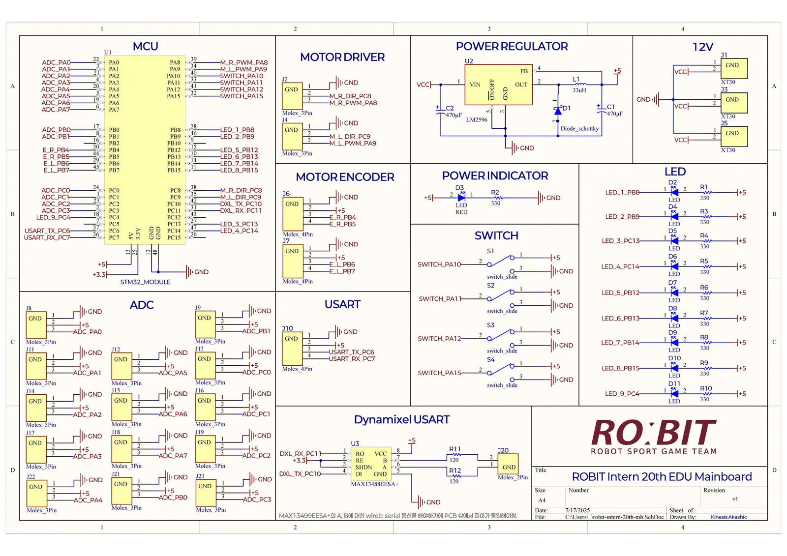
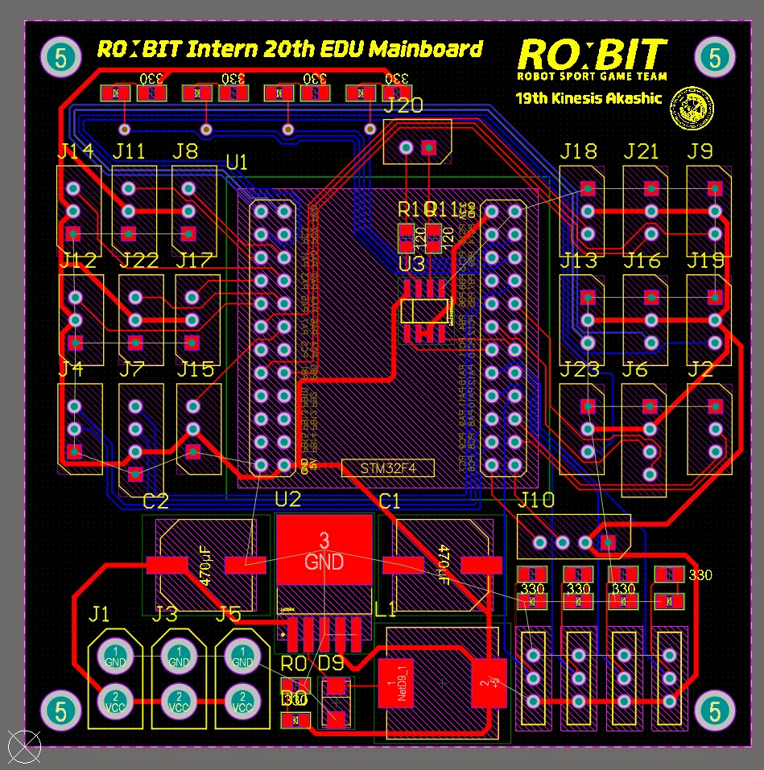

<!-- TODO(작성자 확인): 보드 제작 수량과 실제 교육에서 사용된 방식(어떤 실습에 썼는지)을 알려 주세요. -->
## 1. 프로젝트 개요
학생자치기구 ROBIT의 **20기 신입생 교육**에서 쓰는 STM32 기반 메인보드를 설계했습니다. 회로 설계부터 PCB 레이아웃까지 직접 했고, 제작한 보드의 납땜과 기능 확인도 이어서 했습니다.

- **기간:** 2025년 7월 ~ 9월
- **MCU:** STM32F446RE
- **내 역할:** 핀 배치 결정, 회로도와 PCB 설계, 납땜과 기능 확인

## 2. 구성
핀 배치는 STM32CubeMX에서 정한 뒤 회로에 반영했습니다. 보드에 담은 기능은 다음과 같습니다.

| 기능 | 내용 |
|---|---|
| 모터 드라이버 | 좌우 각 1채널 (타이머 PWM + 방향 GPIO) |
| 엔코더 | 좌우 각 1채널 (타이머 엔코더 모드) |
| ADC | 14채널 |
| 통신 | 시리얼(USART) 1채널, 다이나믹셀 전용 통신 1채널(방향 제어 포함) |
| 입력/표시 | 스위치 2개, LED, 전원 표시 |
| 전원 | 전원 레귤레이터, 12V 단자 |

## 3. 제작과 확인
저장소를 만들어 회로 파일을 버전 관리하며 설계했습니다. 한 장에 여러 기능을 담아야 해서, 핀 배치를 CubeMX에서 먼저 확정한 뒤 회로에 반영하는 순서로 진행했습니다. 2025년 9월에는 신입생용 PCB의 납땜을 마치고, 기능이 정상적으로 동작하는지 하나씩 확인했습니다. (세부 시험 결과는 정리가 끝나는 대로 추가합니다.)
