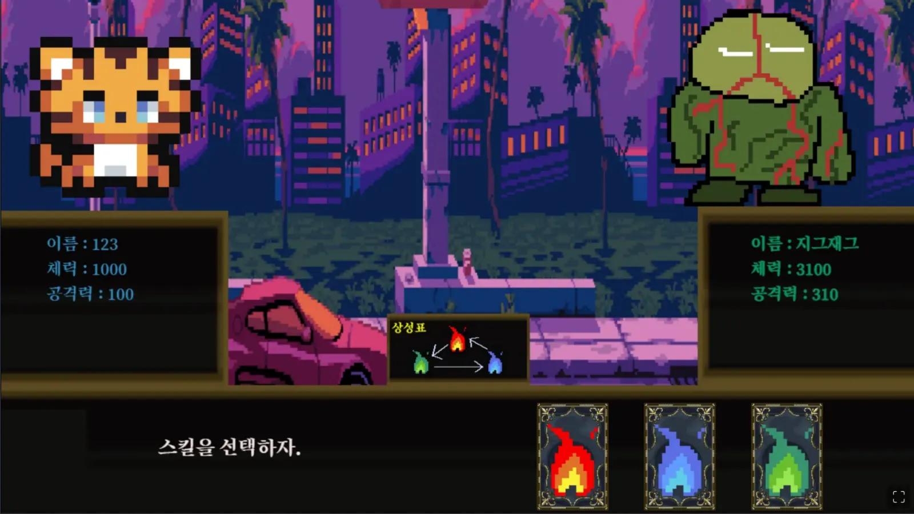
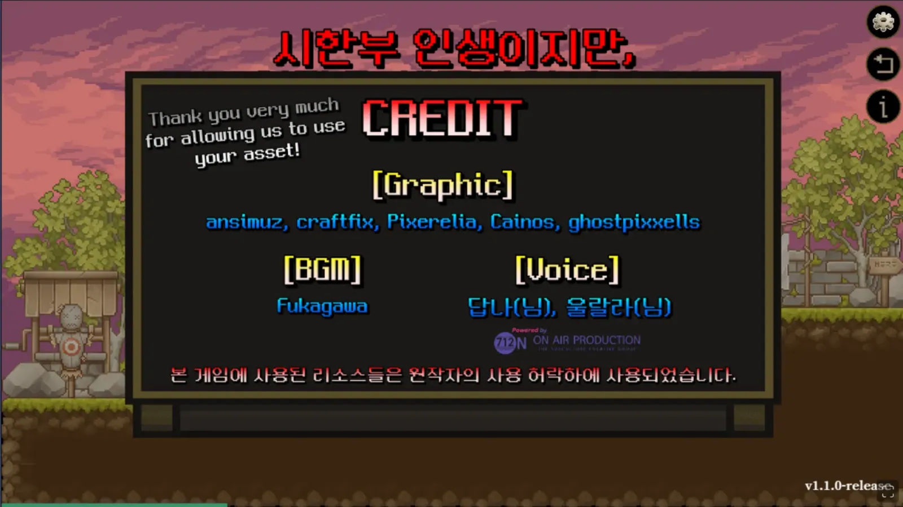

## 1. 프로젝트 개요
'2022 레드브릭 크리에이터 챌린지 시즌 4' 공모전 출품작입니다.
좀비 아포칼립스 세계관에서 생존해 나가는 2D 턴제 RPG로, 설치 없이 웹에서 바로 구동되는 접근성을 목표로 개발되었습니다. 탐험, 전투, 상점, 랭킹 시스템 등 RPG의 핵심 요소를 1인 개발로 모두 구현했습니다.

- **진행 기간:** 2022.06.28 ~ 2022.08.14
- **역할:** 1인 개발 (기획, 디자인, 개발 총괄)
- **성과:** 2022 레드브릭 크리에이터 챌린지 시즌 4 **수상**

## 2. 주요 기능
- **전투 시스템:** 불, 물, 풀 3가지 원소의 상성 관계(가위바위보 로직)를 활용한 턴제 전략 전투
- **탐험 및 경제:** 행동력을 소모하여 지역을 탐험하고, 획득한 재화(N-Coin)로 아이템과 스킨을 구매/강화
- **랭킹 시스템:** 생존 일수(D-Day)를 점수화하여 서버 랭킹에 반영

## 3. 기술적 도전 (Engineering & Optimization)
이 프로젝트는 **플랫폼의 제약 사항**을 이해하고 해결하려는 시도였습니다.

### 웹 리소스 최적화 (Resource Management)
웹 기반 게임 특성상, 고화질 리소스를 무분별하게 사용하면 로딩 속도 저하와 렉이 발생했습니다.
- **문제:** 설치형 앱과 달리 브라우저 메모리 한계로 인해 에셋 용량 관리가 필수적이었습니다.
- **해결:** 게임 내 리소스의 용량을 최적화하고, 불필요한 연산을 줄이는 작업을 수행했습니다. 비록 모든 고화질 에셋을 다 넣지는 못했지만, **하드웨어 제약이 있는 환경(임베디드 등)에서의 자원 관리 중요성**을 체감했습니다.

### 전투 알고리즘 구현 (Logic Design)
단순한 공격이 아닌, 속성 간 상호작용 로직을 구현했습니다.
- **로직:** `Fire > Grass > Water > Fire`의 순환 상성 관계를 조건문으로 설계하고, 플레이어와 몬스터의 선택에 따라 데미지 계수가 달라지는 알고리즘을 적용했습니다.

## 4. 개발 경험
- **크로스 플랫폼 이해:** 별도의 빌드 없이 PC와 모바일 웹 환경 모두에서 동작하는 웹 게임의 장점을 경험했습니다.
- **시스템 통합:** 인벤토리, 상점, 설정(쿠폰, 사운드), 랭킹 등 서로 다른 모듈들이 유기적으로 데이터를 주고받도록 구조를 설계했습니다.

---

## 5. 플레이 화면

*속성 상성(물, 불, 풀)을 활용한 턴제 전투 화면*

*크레딧 화면*

## 6. 튜토리얼 영상

  <iframe 
    class="w-full h-full rounded-xl"
    src="https://www.youtube.com/embed/-1u-7GLbhuU?si=as_tF9-PUnR1cviX"
    title="Minecraft RPG Project" 
    frameborder="0" 
    allow="accelerometer; autoplay; clipboard-write; encrypted-media; gyroscope; picture-in-picture" 
    allowfullscreen>
  </iframe>

