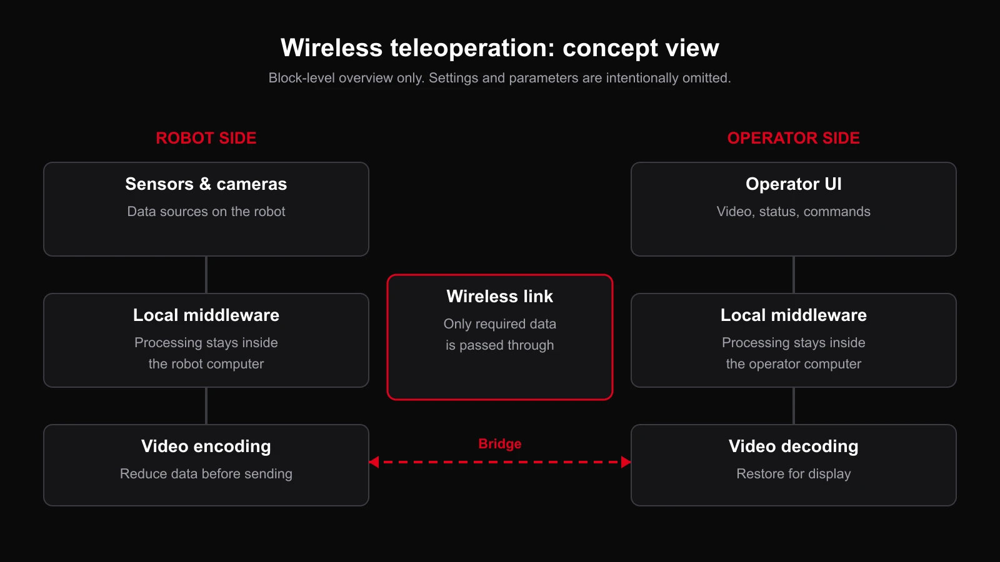

## 1. 프로젝트 개요
2026년부터 로봇의 전원·통신 구조를 전체적으로 설계하는 역할을 맡았습니다. 이 글은 그중 **로봇과 오퍼레이터를 잇는 무선 구간**을 다룹니다. 이 통신 구조를 **국방로봇경진대회 2026**에 적용해 대회 환경에서 검증했습니다.

> 이 시스템은 후배들이 이어서 쓰고 개선하는 시스템이어서, **구성값과 세부 설정은 이 글에서 공개하지 않습니다.** 설계 판단과 검증 결과 위주로 썼습니다.

## 2. 설계 방향
- **로컬과 무선을 분리합니다.** 각 컴퓨터 안의 통신은 그대로 두고, 무선으로 넘어가는 구간에는 **꼭 필요한 데이터만** 통과시키는 방식입니다. 무선에 불필요한 트래픽이 실리지 않도록 하는 것이 목적입니다.
- **무선 구간에는 Zenoh 기반 브리지를 사용합니다.**
- **영상은 보내기 전에 줄입니다.** 카메라 영상은 인코딩해서 보내고 오퍼레이터에서 복원합니다.
- **설정 불일치를 점검합니다.** 송신 쪽과 수신 쪽의 통신 품질 설정이 서로 달라서 데이터가 기대와 다르게 흐르는 문제를 찾아 고친 적이 있습니다. 양쪽 설정을 쌍으로 확인하는 것이 중요했습니다.

## 3. 카메라 데이터 사용량 비교
전년도 방식과 같은 조건(같은 카메라, 같은 해상도)에서 올해 방식을 비교했습니다. 오퍼레이터에서 토픽별 대역폭을 측정했습니다.

- 같은 조건에서 USB 카메라 여러 대의 합계는 전년도 대비 **약 80%**, 깊이 카메라 1대는 **약 88%** 줄었습니다.
- 실제 운용 조건으로 해상도를 높인 측정에서는 오히려 값이 더 낮게 나왔는데, **정적인 장면을 찍으며 측정했기 때문**입니다. 영상 압축은 프레임 사이의 차이만 보내서, 움직임이 많으면 값이 올라갑니다. 따라서 이 결과만으로 실전 대역폭을 단정할 수는 없습니다.

## 4. 겪은 문제와 대응
1. **카메라 스트림이 간헐적으로 끊김.** 로그를 분석해 원인이 소프트웨어 설정이 아니라 **시스템 하위 계층(USB 쪽)** 에 있음을 확정했습니다. 대회가 임박해 근본 수정은 미루고, 데이터량을 낮추는 완화책만 적용했습니다. **근본 해결은 아니었습니다.**
2. **시스템 전체가 멈춤.** 부하 시험 중 원격 접속도 안 되는 완전한 정지를 겪었고, 분석했지만 **미해결**입니다.
3. **시작 시점의 연결 경쟁.** 장치를 거의 동시에 켜면 연결 순서가 꼬이는 문제가 있어, 기동 순서를 조절해 피하고 있습니다.
4. **대회장 무선 환경.** 여러 팀의 공유기가 동시에 켜져 채널이 혼잡합니다. 다른 팀과 겹치지 않는 채널을 직접 골라 대응했고, 대회장의 점유 정도도 측정했습니다(국방로봇경진대회는 약 10팀 규모).
5. **통신 품질 값을 경험적으로 맞추고 있음.** 무선 구간에서 이 값을 설계하는 원칙을 아직 세우지 못해, 조건이 바뀔 때마다 다시 조정해야 했습니다.

## 5. 배운 점과 다음 단계
- 증상이 같아도 원인은 **통신 설정, 영상 처리, 시스템 하위 계층, 무선 환경**으로 다양해서, 계층별로 하나씩 분리해 측정하는 것이 가장 중요했습니다.
- 관측 도구를 충분히 활용하지 못한 점이 아쉽습니다. 두 컴퓨터에서 각각 캡처해 병목이 어디인지 가르는 방법을 익히는 중입니다.
- 이 문제들을 정리해 외부 전문가에게 구조 검토와 설계 원칙을 묻는 질문 목록을 만들었습니다.
