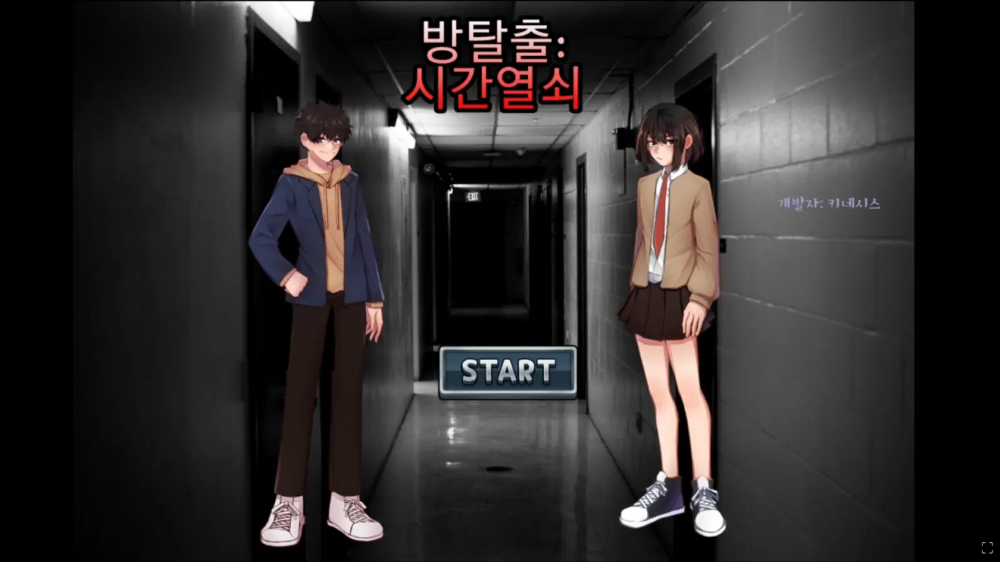
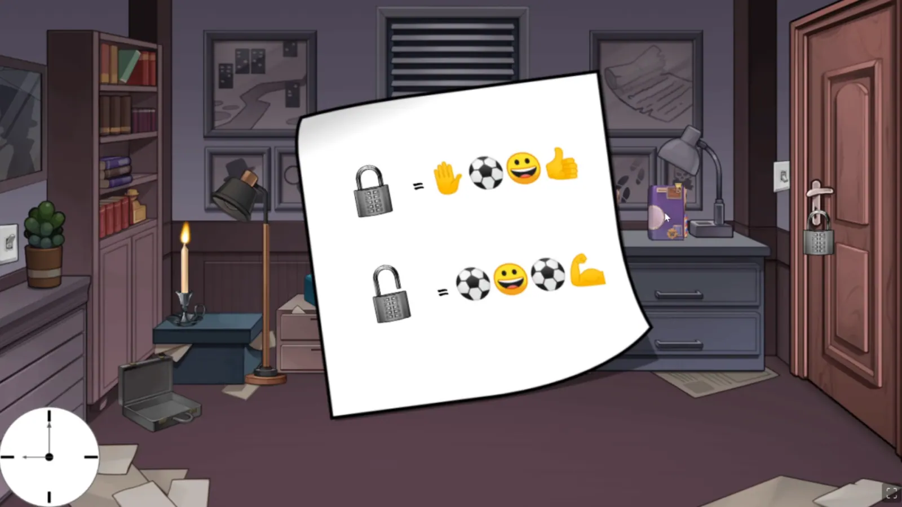

## 1. 프로젝트 개요
'위즈랩 방탈출 크리에이터 챌린지' 출품을 위해 1인 개발한 웹 게임입니다.
납치된 주인공이 시간의 흐름 속에서 단서를 찾아 탈출하는 스토리를 담고 있으며, 별도의 설치 없이 웹에서 바로 즐길 수 있도록 제작되었습니다.

- **진행 기간:** 2020.06.20 ~ 2020.08.20 (2개월)
- **역할:** 1인 개발 (기획, 디자인, 개발 총괄)
- **성과:** 위즈랩 방탈출 크리에이터 챌린지 **입상**

## 2. 주요 기능
- **단서 조합 시스템:** 화면 내 오브젝트를 클릭해 단서를 수집하고, 이를 조합해 다음 스테이지로 넘어가는 퍼즐 로직 구현
- **히든 엔딩:** 스테이지 곳곳에 숨겨진 단서를 모두 모으면 볼 수 있는 진엔딩 시스템 설계

## 3. 기술적 성장 (Engineering Growth)
이 프로젝트의 핵심은 **Unknown에서 Known으로의 전환**입니다.

### Zero-Base에서의 기술 습득
프로젝트 시작 당시 JavaScript 문법을 전혀 모르는 상태였습니다.
- **접근법:** 위즈랩에서 제공하는 API 문서와 타 개발자들의 오픈 소스 예제를 보고 따라하며 문법을 익혔습니다.
- **결과:** 변수, 조건문, 이벤트 리스너 등 프로그래밍 기초를 실전 프로젝트를 통해 2개월 만에 체득하고 게임 로직을 완성했습니다.

### 크로스 플랫폼 호환성 (Cross-Platform)
사용자가 PC와 모바일 어떤 환경에서 접속하더라도 동일한 경험을 해야 한다고 판단했습니다.
- **해결:** 터치 이벤트와 마우스 클릭 이벤트를 호환되게 처리하고, 해상도에 따라 UI가 깨지지 않도록 반응형 구조를 고려하여 개발했습니다.

## 4. 개발 경험 요약
- **기획:** 인스타그램과 유튜브의 방탈출 콘텐츠를 분석하여 '유저들이 좋아하는 트릭'을 게임 요소로 반영
- **구현:** ES6 문법을 활용한 상태 관리 및 사운드/이미지 리소스 최적화

---

## 5. 게임 플레이 화면

*타이틀 화면: 어두운 분위기의 UI 디자인*

*퍼즐 화면: 암호를 해독하여 상자를 여는 로직*
